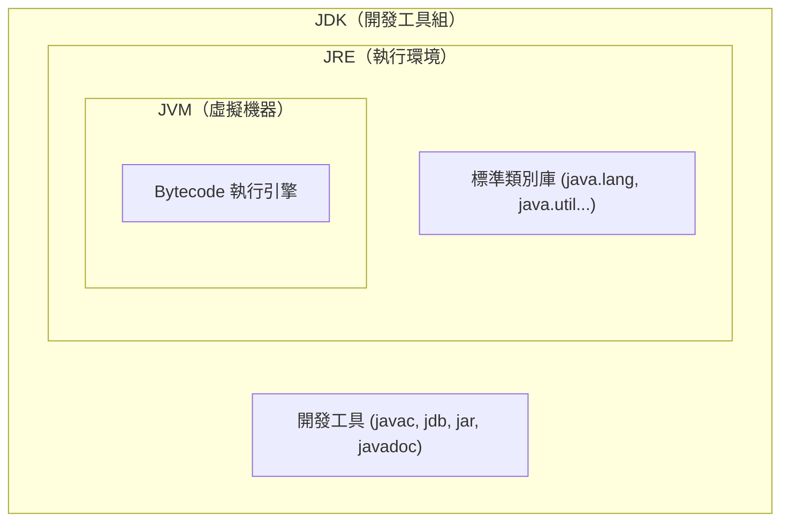
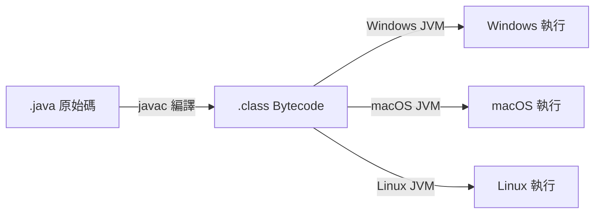

<div class="flex flex-col justify-center items-center h-full" style="background: #ffffff;">
  <p style="color: #5eada0; font-size: 1rem; font-weight: 600; letter-spacing: 0.2em; text-transform: uppercase; margin-bottom: 1.2rem;">Java Programming Masterclass</p>
  <h1 style="color: #1a5c5c; font-size: 3.8rem; font-weight: 900; line-height: 1.15; margin-bottom: 1.5rem;">基本觀念</h1>
  <div style="height: 4px; width: 320px; background: linear-gradient(90deg, #5eada0, #a7d9d0); border-radius: 2px; margin-bottom: 1.5rem;"></div>
  <p style="color: #4a7c7c; font-size: 1.15rem; font-style: italic;">
    「認識 Java：從起源到特色的完整旅程」
  </p>
  <Link to="home" style="color: #9dc4c4; font-size: 0.85rem; margin-top: 2rem; text-decoration: none; letter-spacing: 0.05em;">← 返回目錄</Link>
</div>

<!--
【開場白】
大家好！歡迎來到 Java 程式設計課程。
我知道你們看到「基本觀念」這幾個字，心裡可能在想：「喔不，又是只有文字、沒有程式碼的理論課，能不能直接跳過？」

【為什麼要學這個？】
說真的，我完全理解這種感受。但今天不只是背 Java 的歷史，而是幫你建立一個「框架」——Java 長什麼樣子、為什麼這樣設計，有一個清楚的全貌。
以後你遇到奇怪的錯誤訊息，或搞不清楚該裝什麼軟體，回想起今天說的東西，就會秒懂。

【今天學完你會能做什麼】
你會分得清 JDK、JRE、JVM，知道 Java 為什麼能跨平台，也能說出 Java 的幾個核心特色。好，我們開始！
-->

---
layout: default
---

# Outline

- **認識 Java**
- **Java 的起源**
- **Java 之父**
- **Java 發展史**
- **Java 的三大平台**
- **認識 Java SE 平台的 JDK / JRE / JVM**
- **Java 跨平台原理**
- **Java 語言的特色**

<!--
【核心說明】
先幫大家預告一下今天會走哪些地方。
我們從「Java 是什麼」開始，往回追它的出生背景，認識設計這個語言的人，再看看它這三十年來長成什麼樣子。
接著講三個很多人混淆的縮寫：JDK、JRE、JVM。我保證今天結束之後，你再也不會搞混。
然後是 Java 最厲害的招數：跨平台原理。最後收在 Java 的語言特色，讓你知道為什麼它到今天還有這麼多人在用。

【生活化比喻】
這就像玩遊戲前先看「世界觀設定」。規則先搞懂，後面打怪才不會一頭霧水。
聽起來很多，但放心，我會把每個部分都說得很白話。準備好了嗎？我們走！
-->

---
layout: section
class: flex flex-col justify-center items-center text-center
---

# 認識 Java

<!--
【開場白】
第一個部分：認識 Java。
你可能聽過一句話：「先選一個程式語言學好，其他的就都會了。」這句話對也不對，但有一點是真的——Java 是一個非常好的起點。

【為什麼要學這個？】
因為它夠嚴格、夠囉唆，你在這裡養成的好習慣，帶到任何語言都用得上。
就像練書法，一開始被老師盯著筆順寫很煩，但練好之後，拿毛筆、鋼筆、原子筆都比別人漂亮。Java 就是那個「讓你養成好習慣」的語言。
-->

---

# 什麼是 Java？

| 面向 | 說明 |
| --- | --- |
| **類型** | 高階、物件導向程式語言 |
| **誕生** | 1995 年，Sun Microsystems |
| **設計理念** | Write Once, Run Anywhere（一次撰寫，到處執行）|
| **現任維護** | Oracle Corporation（2009 年收購 Sun）|

<div class="mt-4 p-3 bg-blue-50 border-l-4 border-blue-400 text-gray-700 text-sm text-left">
💡 Java 目前被廣泛應用於 <b>網路應用程式、企業系統、Android 行動開發、嵌入式裝置</b>，全球超過 1000 萬名開發者使用。
</div>

<!--
【核心說明】
那 Java 到底是什麼？一句話說完：Java 是一個「高階、物件導向」的程式語言，1995 年由 Sun Microsystems 推出，現在由 Oracle 負責維護。
「高階」的意思是，你不用管 CPU 怎麼運算、記憶體在哪個位置，只要專注在解決問題，細節讓 Java 幫你處理。
「物件導向」現在聽起來可能很抽象，後面的課程會一直深入，你會越來越有感覺。

【生活化比喻】
Java 最重要的口號是 Write Once, Run Anywhere，一次撰寫，到處執行。
就像你寫好一份合約，不管拿到哪個國家都有效。你在 Windows 上寫的程式，放到 Mac、放到 Linux，一樣可以跑，完全不用改。它是怎麼辦到的？等一下講跨平台原理時會詳細說明。

💼 業界實務：
現在你只需要知道：Java 無所不在。Google 的服務、Amazon 的後台、你手機上的 Android App，背後幾乎都有 Java 的影子。全球超過一千萬名開發者在用它。
-->

---
layout: section
class: flex flex-col justify-center items-center text-center
---

# Java 的起源

<!--
【開場白】
接下來，我們往回追一下 Java 是怎麼誕生的。
這段歷史其實挺有意思的，而且有一個你意想不到的轉折：他們本來想做 A，最後卻做成了 B。
-->

---

# Green Project（1991）

| 時間 | 事件 |
| --- | --- |
| **1991** | Sun Microsystems 啟動 **Green Project**，目標是為家電設備開發軟體 |
| **原始語言** | James Gosling 設計新語言，最初命名為 **Oak（橡樹）** |
| **1993** | World Wide Web 興起，團隊方向轉向網際網路應用 |
| **1995** | Oak 改名為 **Java**，於 **5 月 23 日**正式公開發表 |

<div class="mt-4 p-3 bg-blue-50 border-l-4 border-blue-400 text-gray-700 text-sm text-left">
💡 <b>Java 名字的由來：</b>Java 是印尼一座以咖啡豆聞名的島嶼，因為 Oak 商標已被他人使用，開發團隊在喝咖啡時討論後改名為 Java！
</div>

<!--
【核心說明】
時間回到 1991 年。那時候手機還是磚頭，網路也還沒普及，但 Sun Microsystems 的工程師已經在想：「如果家裡的電視、洗衣機、冰箱都能用軟體控制，要怎麼做？」
他們成立了一個叫 Green Project 的秘密計畫。問題是，當時的 C++ 對小型裝置來說太笨重，記憶體用一大堆，設備根本跑不動。
所以他們決定自己打造一個新語言，最初叫做 Oak，也就是「橡樹」。據說是因為設計師辦公室外面有一棵橡樹，還挺文青的。
1993 年，全球資訊網爆炸性成長，計畫方向就順勢轉向了網際網路應用。

【生活化比喻】
到了 1995 年要正式發表時，一查才發現 Oak 這個名字已經被別人註冊了！
傳說開發團隊在咖啡廳討論，喝著爪哇島的咖啡，靈感就來了——Java！所以說，Java 這個名字是靠咖啡救出來的。

⚠️ 學生常見誤解：
很多人以為 Java 跟 JavaScript 是親戚。其實除了名字很像，兩個是完全不同的語言，就像「熱狗」跟「狗」沒有關係一樣。
-->

---
layout: section
class: flex flex-col justify-center items-center text-center
---

# Java 之父

<!--
【開場白】
說完 Java 的誕生，我們來認識一下這個語言的靈魂人物。
-->

---

# James Gosling — Java 之父

| 項目 | 說明 |
| --- | --- |
| **全名** | James Arthur Gosling |
| **國籍** | 加拿大 |
| **學歷** | 卡內基梅隆大學 電腦科學博士 |
| **任職** | Sun Microsystems 首席工程師（後轉至 Oracle）|
| **主要貢獻** | 設計並實作 Java 語言規格、JVM 原型、Java 核心類別庫 |
| **外號** | **「Java 之父」（Father of Java）** |

<div class="mt-4 p-3 bg-blue-50 border-l-4 border-blue-400 text-gray-700 text-sm text-left">
💡 Gosling 不只制定語言規格，也親自撰寫了第一版的 <code>javac</code> 編譯器與 JVM 原型，是名副其實的全端創造者。
</div>

<!--
【核心說明】
他叫 James Gosling，加拿大人，卡內基梅隆大學的電腦科學博士。
他在 Sun Microsystems 擔任首席工程師，設計了 Java 的語言規格，還親手寫出第一版的編譯器和 JVM 原型。

【生活化比喻】
這是什麼概念？他不只「想出」一個語言，還自己把整套工具全部刻出來。
就好比你不只設計了一款遊戲，還順手把遊戲引擎也寫好了。所以他被尊稱為「Java 之父」，完全實至名歸。

💼 業界實務：
Oracle 收購 Sun 之後，Gosling 在 Oracle 待了一段時間，後來輾轉去了其他公司。雖然 Java 現在由 Oracle 維護，但他的設計哲學到今天還深深影響著整個 Java 生態系。
-->

---
layout: section
class: flex flex-col justify-center items-center text-center
---

# Java 發展史

<!--
【開場白】
好，我們來快速看一下 Java 這三十年的成長史。
你不用把每個版本都背起來，但幾個關鍵版本要有印象。
-->

---

# Java 版本里程碑（一）

| 年份 | 版本 | 重要事件 |
| --- | --- | --- |
| **1995** | Java 1.0 | 正式公開發表（5 月 23 日）|
| **1998** | Java 1.2（J2SE）| 引入 Collections 框架、Swing GUI |
| **2004** | Java 5 | 泛型（Generics）、Annotations、增強 for 迴圈 |
| **2006** | Java 6 | OpenJDK 開源計畫啟動 |
| **2009** | —— | **Oracle 收購 Sun Microsystems** |
| **2011** | Java 7 | try-with-resources、Diamond 運算子 |

<!--
【核心說明】
1995 年，Java 1.0 正式發表，主打一次撰寫、到處執行，業界一片震驚。
1998 年的 Java 1.2，帶來了 Collections 框架，也就是後來 ArrayList、HashMap 那些東西的前身，還加了可以寫桌面視窗的 Swing。

【生活化比喻】
2004 年的 Java 5 很重要，它引入了「泛型」。
在這之前，你把一個字串放進清單，拿出來時它只知道是「某個東西」，你得自己手動轉型，轉錯了程式就在執行時爆炸，就像在開盲盒。
Java 5 之後，你可以直接說這是「裝字串的清單」，編譯器會幫你把關，型別錯誤在寫程式時就被抓出來。

💼 業界實務：
2009 年，Oracle 收購了 Sun。當時社群很擔心商業公司掌控這個語言，但到今天，Java 依然是開發者可以免費使用的語言。
-->

---

# Java 版本里程碑（二）

| 年份 | 版本 | 重要事件 |
| --- | --- | --- |
| **2014** | **Java 8** ⭐ LTS | Lambda 表達式、Stream API、新日期時間 API |
| **2017** | Java 9 | 模組系統（JPMS），改為六個月一版 |
| **2018** | **Java 11** ⭐ LTS | 移除獨立 JRE 封裝 |
| **2021** | **Java 17** ⭐ LTS | Sealed Classes、Pattern Matching（本課程版本）|
| **2023** | **Java 21** ⭐ LTS | Virtual Threads、Record Patterns |

<div class="mt-4 p-3 bg-blue-50 border-l-4 border-blue-400 text-gray-700 text-sm text-left">
💡 <b>LTS（Long-Term Support）</b> 版本提供長期安全性更新，企業首選。本課程以 <b>Java 17</b> 為主。
</div>

<!--
【核心說明】
接下來這幾個版本一定要記住，特別是有標星號的 LTS 版本。
2014 年的 Java 8 是革命性的一版，引入了 Lambda 表達式和 Stream API，讓 Java 可以用更現代、更簡潔的風格寫程式。很多公司到今天還在用 Java 8。我們課程後面也會學到。
2017 年的 Java 9 帶來模組系統，Oracle 也宣布從此每六個月出一個新版本。

【生活化比喻】
版本更新太快，企業根本跟不上，所以 Oracle 同時推出 LTS，也就是長期支援版本。
你可以把 LTS 想成「有長期保固的版本」，會提供好幾年的安全更新。Java 8、11、17、21 都是 LTS。

💼 業界實務：
企業選版本，基本上都選 LTS。我們課程用的是 Java 17，新特性夠多，社群也夠穩定，是學 Java 的好選擇。
-->

---
layout: section
class: flex flex-col justify-center items-center text-center
---

# Java 的三大平台

<!--
【開場白】
現在來看 Java 的生態系是怎麼組織的。
Java 根據用途，被分成三個主要平台。我們來看看哪一套適合你。
-->

---

# Java 三大平台

| 平台 | 全名 | 應用場景 |
| --- | --- | --- |
| **Java SE** | Standard Edition | 桌面應用、一般用途開發，是 EE / ME 的**基礎核心** |
| **Java EE / Jakarta EE** | Enterprise Edition | 企業級 Web 應用、伺服器端服務（Servlet、Spring）|
| **Java ME** | Micro Edition | 嵌入式系統、物聯網（IoT）、早期功能型手機 |

<div class="mt-4 p-3 bg-blue-50 border-l-4 border-blue-400 text-gray-700 text-sm text-left">
💡 <b>現況：</b>Java EE 已於 2019 年移交 Eclipse 基金會，更名為 <b>Jakarta EE</b>。Java ME 隨著 Android 崛起逐漸式微。<b>本課程聚焦 Java SE。</b>
</div>

<!--
【核心說明】
第一個是 Java SE，標準版。這是基礎，其他平台都建在它上面。日常應用程式和學習都用 SE，我們課程學的就是它。
第二個是 Java EE，企業版，給大公司的複雜系統用，像 Servlet、Spring 框架都屬於這個生態系。2019 年它移交給 Eclipse 基金會，改名叫 Jakarta EE。
第三個是 Java ME，微型版，為資源很少的裝置設計，像早期的功能型手機。Android 崛起後，ME 已經幾乎沒什麼存在感了。

【生活化比喻】
Java SE 是一台普通家用車，日常代步完全夠用。
Java EE 是商用大貨車，跑長途、運大貨，幫企業做大事。
Java ME 是超小的電動代步車，省電省資源，適合很窄小的地方。

💼 業界實務：
先把 Java SE 打好基礎。以後要學 Spring Boot、往企業開發走，是非常自然的延伸。
-->

---
layout: section
class: flex flex-col justify-center items-center text-center
---

# JDK / JRE / JVM

<!--
【開場白】
我們來到今天可能最多人搞混的部分：JDK、JRE、JVM。
很多新手剛開始安裝 Java，看到這三個縮寫就頭痛。今天我們把它徹底搞懂，一勞永逸。
-->

---

# JVM / JRE / JDK 定義

| 縮寫 | 全名 | 主要功能 |
| --- | --- | --- |
| **JVM** | Java Virtual Machine | 虛擬機器，負責**執行** Bytecode |
| **JRE** | Java Runtime Environment | 執行環境 = JVM + 標準類別庫，用來**執行**程式 |
| **JDK** | Java Development Kit | 開發工具組 = JRE + 編譯器等工具，用來**開發**程式 |

<div class="mt-4 p-3 bg-blue-50 border-l-4 border-blue-400 text-gray-700 text-sm text-left">
💡 <b>包含關係：</b>JDK ⊃ JRE ⊃ JVM。安裝 JDK 就自動擁有 JRE 和 JVM。
</div>

<!--
【核心說明】
先一個一個看定義。
JVM，Java 虛擬機器。它負責執行 Bytecode，也就是把「中間語言」翻譯成真正的電腦指令，然後跑起來。
JRE，Java 執行環境。它等於 JVM 加上標準類別庫，你只要「執行」Java 程式，有 JRE 就夠了。
JDK，Java 開發工具組。它等於 JRE 再加上編譯器、除錯器這些開發工具。你要「開發」Java 程式，就要裝 JDK。
包含關係很清楚：JDK 包含 JRE，JRE 包含 JVM。

【生活化比喻】
JVM 是電影放映機，負責把電影播出來。
JRE 是電影院，裡面有放映機，還有座位、音響、爆米花，也就是類別庫。
JDK 是整個電影製作公司，除了電影院，還有攝影棚、剪接室、導演。
你只是要看電影，JRE 就夠；你要拍電影，就得裝 JDK。

⚠️ 學生常見誤解：
有些舊教學叫你只裝 JRE，結果寫完程式卻沒辦法編譯。記住，我們是開發者，一定要裝 JDK。
-->

---

# JDK / JRE / JVM 包含關係

<div class="flex justify-center mt-4">



</div>

<!--
【看圖前的引導】
這張圖把三者的包含關係畫得非常清楚，就像一組俄羅斯娃娃。

【逐步帶著看】
最裡面是 JVM，也就是執行引擎。
包住它的是 JRE，裡面除了 JVM，還有標準類別庫。你呼叫 System.out.println 的時候，這個方法是從哪來的？就是標準類別庫，常用的功能它都幫你寫好了。
最外層是 JDK，在 JRE 外面再加上開發工具，讓你可以寫程式、編譯、除錯。

💼 業界實務：
記住這個包含關係。以後面試被問到，或是安裝環境出問題，腦袋裡要能馬上浮現這張圖。
-->

---

# JDK 主要工具

| 工具 | 指令 | 功能 |
| --- | --- | --- |
| 編譯器 | `javac` | 將 `.java` 原始碼編譯成 `.class` Bytecode |
| 執行工具 | `java` | 啟動 JVM 並執行 `.class` 檔 |
| 除錯工具 | `jdb` | 互動式除錯 |
| 封裝工具 | `jar` | 將多個 `.class` 封裝成 `.jar` 檔 |
| 文件工具 | `javadoc` | 從原始碼的註解自動產生 API 文件 |

<!--
【核心說明】
JDK 裡面有幾個重要的工具，我帶你快速看一遍。
javac 是編譯器，把你寫的點 java 原始碼，編譯成點 class 檔，也就是 Bytecode。
java 是執行工具，負責啟動 JVM，執行那個點 class 檔。
jdb 是除錯工具，程式怪怪的時候，可以一行一行追。
jar 是封裝工具，把一堆點 class 檔打包成一個點 jar 檔，方便發布。
javadoc 是文件工具，可以把程式裡特殊格式的註解，自動轉成網頁版的 API 文件。

【生活化比喻】
javac 像翻譯官，把你寫的人話翻成電腦的中間語言；java 像點火器，負責把程式發動起來。

💼 業界實務：
現在大家都用 IntelliJ IDEA 這類開發工具，按一個按鈕，背後就幫你跑完整個流程。
但了解這些原理，當你看到奇怪的錯誤訊息時，才知道是哪個環節出了問題。
-->

---
layout: section
class: flex flex-col justify-center items-center text-center
---

# Java 跨平台原理

<!--
【開場白】
到了今天的重頭戲之一：Java 是怎麼做到「一次撰寫，到處執行」的？
這個問題的答案，是 Java 設計上最精妙的地方。
-->

---

# WORA — 一次撰寫，到處執行

Java 實現跨平台的關鍵：**Bytecode + JVM**

<div class="flex justify-center mt-4">



</div>

<div class="mt-4 p-3 bg-blue-50 border-l-4 border-blue-400 text-gray-700 text-sm text-left">
💡 <b>關鍵：</b>Bytecode 是<b>平台中立</b>的；JVM 是<b>平台相依</b>的。各作業系統安裝對應版本的 JVM，即可執行同一份 Bytecode。
</div>

<!--
【核心說明】
關鍵就是兩個東西：Bytecode 和 JVM。
你用 javac 編譯點 java 檔之後，產生的不是 Windows 看得懂的機器碼，也不是 Mac 看得懂的機器碼，而是一種「平台中立」的中間語言，叫 Bytecode，存在點 class 檔裡。
沒有任何作業系統天生看得懂 Bytecode。但每個作業系統都有自己版本的 JVM，各自把 Bytecode 翻成自己平台能執行的指令。

【生活化比喻】
想像你用中文寫了一本食譜，再把它翻成一種「世界語」。沒有哪個國家的人天生懂世界語，但日本有日文翻譯機，美國有英文翻譯機。只要有翻譯機，大家都能照著同一本食譜，煮出一樣的料理。
Bytecode 就是那個世界語，JVM 就是各地的翻譯機。

⚠️ 學生常見誤解：
跨平台的是 Bytecode，不是 JVM。核心概念記好：Bytecode 是平台無關的，JVM 是平台相依的，每個作業系統要裝自己的版本。

💼 業界實務：
以前工程師為了讓程式在不同系統上跑，常常要寫好幾份不同的程式。Java 讓同一份程式到處都能跑，省下大量功夫。
-->

---

# 編譯與執行的完整流程

```java
// Hello.java
public class Hello {
    public static void main(String[] args) {
        System.out.println("Hello, Java!");
    }
}
```

| 步驟 | 指令 | 動作 |
| --- | --- | --- |
| **1. 編譯** | `javac Hello.java` | 產生 `Hello.class`（Bytecode）|
| **2. 執行** | `java Hello` | JVM 載入並執行 Bytecode |

<!--
【帶讀程式碼前的鋪陳】
來看一個具體的例子。這是最經典的 Java 入門程式，Hello 點 java，功能就是在畫面上印出 Hello, Java。
我們不用管每一行在做什麼，下一章會細講，今天先看它怎麼「跑起來」。

【逐步解說】
執行分兩步。
第一步是編譯：在命令列輸入 javac Hello 點 java，編譯器就會產生一個 Hello 點 class 檔，裡面裝的就是 Bytecode。
第二步是執行：輸入 java Hello，JVM 把 Hello 點 class 載入，翻譯執行，你就會看到 Hello, Java 出現在畫面上。
就這樣，兩個指令。

【類比說明】
就像寫好一份食譜（原始碼），先翻成世界語（編譯），再交給當地的翻譯機照著做（執行）。

⚠️ 學生常見誤解：
注意檔名！類別叫 Hello，檔名就要叫 Hello 點 java，H 要大寫。Java 是分大小寫的，錯一個字它就不認。
還有，執行時打的是 java Hello，後面不用加點 class。

💼 業界實務：
這是 Java 開發最基本的循環。不管你以後用什麼開發工具，底層都是這樣運作，工具只是把這兩步包成一個按鈕而已。
-->

---
layout: section
class: flex flex-col justify-center items-center text-center
---

# Java 語言的特色

<!--
【開場白】
最後一個部分，我們來看 Java 有哪些語言特色，讓它在三十年後還是全球最熱門的語言之一。
總共八個，分兩頁來看。
-->

---

# Java 核心特色（一）

| 特色 | 說明 |
| --- | --- |
| **簡單（Simple）** | 語法清晰，移除 C++ 的指標、多重繼承等複雜機制 |
| **物件導向（Object-Oriented）** | 支援封裝、繼承、多型，程式碼模組化、可重複使用 |
| **跨平台（Platform Independent）** | Bytecode + JVM，同一份程式碼跨平台執行 |
| **安全（Secure）** | 沙盒機制（Sandbox）、Bytecode 驗證，無法直接存取底層記憶體 |

<!--
【核心說明】
第一個是「簡單」。這不是說 Java 很容易學，而是相對於 C++，它把很多複雜的機制拿掉了。
最典型的是「指標」，也就是直接操作記憶體位址的功能。學過 C 語言的人，大概都被它搞到崩潰過。Java 把指標藏起來，少掉一大類的 Bug。
C++ 的「多重繼承」也常造成混亂，Java 直接不讓你做，改用介面來達到類似效果。
第二個是「物件導向」，這是 Java 的核心精神。封裝、繼承、多型，後面的章節會一直碰到。
第三個就是剛才說的「跨平台」，這裡不重複了。
第四個是「安全」。

【生活化比喻】
JVM 就像一個透明的玻璃房，也就是「沙盒」。程式可以在裡面跑，但沒辦法打破玻璃，去亂動系統記憶體，或讀不該讀的東西。

💼 業界實務：
物件導向聽起來很玄，其實就是把程式變成像樂高積木。不用每次從塑膠原料開始做，直接拿現成的積木拼起來就好。
-->

---

# Java 核心特色（二）

| 特色 | 說明 |
| --- | --- |
| **強健（Robust）** | 強型別、例外處理（Exception Handling）、自動垃圾回收（GC）|
| **多執行緒（Multithreaded）** | 內建支援多執行緒，提升程式並發效能 |
| **高效能（High Performance）** | JIT（Just-In-Time）即時編譯，熱點程式碼直接轉為機器碼 |
| **分散式（Distributed）** | 內建網路支援（Socket、RMI），適合分散式系統開發 |

<div class="mt-4 p-3 bg-blue-50 border-l-4 border-blue-400 text-gray-700 text-sm text-left">
💡 <b>Garbage Collection（GC）：</b>JVM 自動回收不再使用的物件記憶體，開發者無需手動 <code>free()</code>，大幅降低記憶體洩漏風險。
</div>

<!--
【核心說明】
第五個是「強健」。Java 非常嚴格，型別不對就不讓你過，很多 Bug 在寫程式時就被抓出來，不用等到使用者在用的時候才爆炸。
還有一個很重要的設計：垃圾回收，簡稱 GC。
第六個是「多執行緒」。現代電腦都是多核心，Java 從一開始就內建支援，讓程式可以同時做很多事。
第七個是「高效能」。早期 Java 被批評比 C++ 慢，因為要先翻譯 Bytecode。後來有了 JIT 即時編譯器，會把常被呼叫的熱點程式碼直接編成機器碼，現在速度在很多場景已經很接近 C++。
第八個是「分散式」。Java 內建網路功能，很適合開發多台電腦協作的系統。

【生活化比喻】
在 C 或 C++ 裡，你借來的記憶體要自己記得還，忘了就會記憶體洩漏，程式越跑越慢甚至當掉。
Java 的 GC 就像餐廳的清潔人員，會自動把不再使用的物件收走，你不用自己拿掃帚。

💼 業界實務：
別再聽別人說 Java 很慢。後來很紅的 Spring 這類框架，也都建立在這些特色上。八個特色加起來，就是 Java 三十年屹立不搖的原因。
-->

---
layout: section
class: flex flex-col justify-center items-center text-center
---

# Q & A

<!--
【結語】
好，今天的內容就到這裡。
我們從 1991 年的 Green Project，講到差點叫 Oak 的語言、靠咖啡換來的名字；從親手造工具的 James Gosling，講到三十年的版本演進。
然後是三大平台、JDK、JRE、JVM 的包含關係、跨平台原理，最後是八個核心特色。
這些東西現在聽起來可能有點抽象，但等你開始寫程式、遇到問題、解決問題，有一天會突然恍然大悟：「喔，原來當時是這樣設計的！」那個瞬間是學程式最爽的時候之一。

【問題引導】
有沒有問題？不管是今天的內容，還是安裝環境遇到的狀況，現在都可以問！
-->
