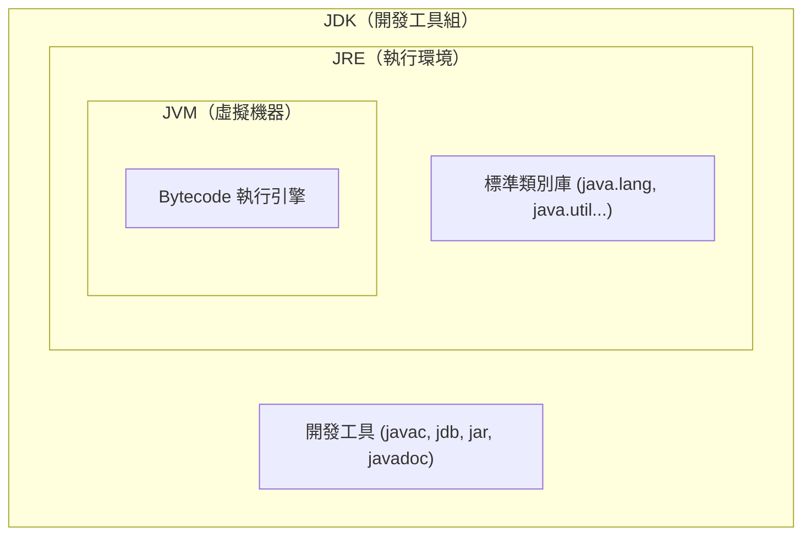
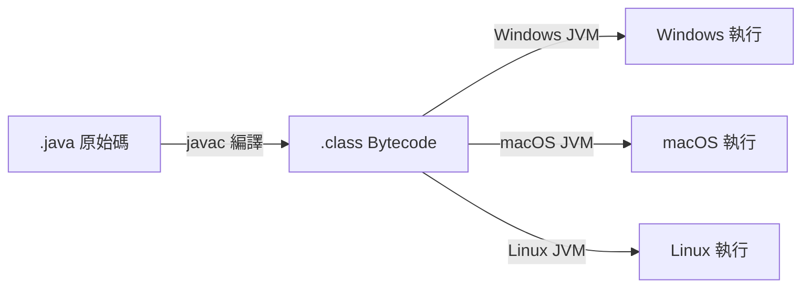

<div class="flex flex-col justify-center items-center h-full" style="background: #ffffff;">
  <p style="color: #5eada0; font-size: 1rem; font-weight: 600; letter-spacing: 0.2em; text-transform: uppercase; margin-bottom: 1.2rem;">Java Programming Masterclass</p>
  <h1 style="color: #1a5c5c; font-size: 3.8rem; font-weight: 900; line-height: 1.15; margin-bottom: 1.5rem;">基本觀念</h1>
  <div style="height: 4px; width: 320px; background: linear-gradient(90deg, #5eada0, #a7d9d0); border-radius: 2px; margin-bottom: 1.5rem;"></div>
  <p style="color: #4a7c7c; font-size: 1.15rem; font-style: italic;">
    「認識 Java：從起源到特色的完整旅程」
  </p>
  <Link to="home" style="color: #9dc4c4; font-size: 0.85rem; margin-top: 2rem; text-decoration: none; letter-spacing: 0.05em;">← 返回目錄</Link>
</div>

<!--
大家好，歡迎來到 Java 程式設計課程。第一章我們要聊的是 Java 的基本觀念。

看到這幾個字，大家可能會想：又是只有文字、沒有程式碼的理論課。但這一章其實是在幫我們建立一張地圖，知道 Java 從哪裡來、為什麼這樣設計、要裝哪些東西才能開始寫程式。

以後遇到奇怪的錯誤訊息，或搞不清楚該安裝什麼軟體時，今天建立的觀念就會派上用場。
-->

---
layout: default
---

# Outline

- **認識 Java**
- **Java 的起源**
- **Java 之父**
- **Java 發展史**
- **Java 的三大平台**
- **認識 Java SE 平台的 JDK / JRE / JVM**
- **Java 跨平台原理**
- **Java 語言的特色**

<!--
這一章我們會從「Java 是什麼」開始，接著回頭看它的誕生故事、認識設計它的人，再快速走過它三十年來的版本演進。

然後我們會搞懂三個很多人分不清楚的縮寫：JDK、JRE 和 JVM。最後看 Java 最厲害的招數「跨平台」，以及它到今天還這麼多人在用的語言特色。
-->

---
layout: section
class: flex flex-col justify-center items-center text-center
---

# 認識 Java

<!--
我們先從最基本的問題開始：Java 到底是什麼？為什麼很多人會建議用它當第一個程式語言？
-->

---

# 什麼是 Java？

| 面向 | 說明 |
| --- | --- |
| **類型** | 高階、物件導向程式語言 |
| **誕生** | 1995 年，Sun Microsystems |
| **設計理念** | Write Once, Run Anywhere（一次撰寫，到處執行）|
| **現任維護** | Oracle Corporation（2009 年收購 Sun）|

<div class="mt-4 p-3 bg-blue-50 border-l-4 border-blue-400 text-gray-700 text-sm text-left">
💡 Java 目前被廣泛應用於 <b>網路應用程式、企業系統、Android 行動開發、嵌入式裝置</b>，全球超過 1000 萬名開發者使用。
</div>

<!--
用一句話來說，Java 是一個「高階、物件導向」的程式語言，1995 年由 Sun Microsystems 推出，現在由 Oracle 負責維護。

「高階」的意思是，我們不需要管 CPU 怎麼運算、資料放在記憶體的哪個位置，只要專注在解決問題就好。「物件導向」現在聽起來可能有點抽象，後面的章節會一步一步帶大家熟悉。

Java 最有名的設計理念是「Write Once, Run Anywhere」，一次撰寫，到處執行。在 Windows 上寫好的程式，拿到 Mac 或 Linux 上，不用修改就能執行。它是怎麼做到的，我們等一下講跨平台原理時會說明。

下面的補充也提到，Java 用在網路應用、企業系統、Android 開發等各種地方，全球超過一千萬名開發者在使用。
-->

---
layout: section
class: flex flex-col justify-center items-center text-center
---

# Java 的起源

<!--
知道 Java 是什麼之後，我們回頭看看它是怎麼誕生的。這段歷史有一個意想不到的轉折。
-->

---

# Green Project（1991）

| 時間 | 事件 |
| --- | --- |
| **1991** | Sun Microsystems 啟動 **Green Project**，目標是為家電設備開發軟體 |
| **原始語言** | James Gosling 設計新語言，最初命名為 **Oak（橡樹）** |
| **1993** | World Wide Web 興起，團隊方向轉向網際網路應用 |
| **1995** | Oak 改名為 **Java**，於 **5 月 23 日**正式公開發表 |

<div class="mt-4 p-3 bg-blue-50 border-l-4 border-blue-400 text-gray-700 text-sm text-left">
💡 <b>Java 名字的由來：</b>Java 是印尼一座以咖啡豆聞名的島嶼，因為 Oak 商標已被他人使用，開發團隊在喝咖啡時討論後改名為 Java！
</div>

<!--
時間回到 1991 年。Sun Microsystems 的工程師在想一個很前衛的問題：如果家裡的電視、冰箱都能用軟體控制，該怎麼做？

他們成立了一個叫 Green Project 的計畫。但當時的 C++ 對小型家電來說太笨重了，所以 James Gosling 設計了一個新語言，最初取名叫 Oak，也就是橡樹。

到了 1993 年，全球資訊網快速興起，團隊的方向就轉向了網際網路應用。

1995 年準備正式發表時，才發現 Oak 這個名字已經被別人註冊了。據說團隊是在喝咖啡時想到新名字。Java 是印尼一座以咖啡聞名的島嶼，所以 Java 這個名字，其實是咖啡救回來的。

順帶一提，Java 和 JavaScript 除了名字很像，是兩個完全不同的語言，不要搞混了。
-->

---
layout: section
class: flex flex-col justify-center items-center text-center
---

# Java 之父

<!--
說完 Java 的誕生，我們來認識一下設計這個語言的關鍵人物。
-->

---

# James Gosling — Java 之父

| 項目 | 說明 |
| --- | --- |
| **全名** | James Arthur Gosling |
| **國籍** | 加拿大 |
| **學歷** | 卡內基梅隆大學 電腦科學博士 |
| **任職** | Sun Microsystems 首席工程師（後轉至 Oracle）|
| **主要貢獻** | 設計並實作 Java 語言規格、JVM 原型、Java 核心類別庫 |
| **外號** | **「Java 之父」（Father of Java）** |

<div class="mt-4 p-3 bg-blue-50 border-l-4 border-blue-400 text-gray-700 text-sm text-left">
💡 Gosling 不只制定語言規格，也親自撰寫了第一版的 <code>javac</code> 編譯器與 JVM 原型，是名副其實的全端創造者。
</div>

<!--
他是 James Gosling，加拿大人，卡內基梅隆大學的電腦科學博士，當時是 Sun Microsystems 的首席工程師。

他不只設計了 Java 的語言規格，還親手寫出第一版的編譯器和 JVM 原型。這就像不只設計了一款遊戲，還順手把遊戲引擎也寫好了。所以他被稱為「Java 之父」。

後來 Oracle 收購了 Sun，Java 的維護也交給了 Oracle，但 Gosling 的設計理念到今天仍然影響著整個 Java 生態系。
-->

---
layout: section
class: flex flex-col justify-center items-center text-center
---

# Java 發展史

<!--
接下來，我們快速看一下 Java 這三十年的成長過程。不用每個版本都背起來，但幾個關鍵版本要有印象。
-->

---

# Java 版本里程碑（一）

| 年份 | 版本 | 重要事件 |
| --- | --- | --- |
| **1995** | Java 1.0 | 正式公開發表（5 月 23 日）|
| **1998** | Java 1.2（J2SE）| 引入 Collections 框架、Swing GUI |
| **2004** | Java 5 | 泛型（Generics）、Annotations、增強 for 迴圈 |
| **2006** | Java 6 | OpenJDK 開源計畫啟動 |
| **2009** | —— | **Oracle 收購 Sun Microsystems** |
| **2011** | Java 7 | try-with-resources、Diamond 運算子 |

<!--
1995 年，Java 1.0 正式發表。1998 年的 Java 1.2，加入了 Collections 框架，也就是之後會學到的 ArrayList、HashMap 這些工具的基礎。

2004 年的 Java 5 是很重要的一版，它加入了「泛型」。在這之前，把資料放進清單，拿出來時 Java 只知道它是「某個東西」，要自己轉型，轉錯了程式就會在執行時出錯。有了泛型之後，我們可以直接指定「這是一個裝字串的清單」，型別錯誤在寫程式時就會被抓出來。

2009 年，Oracle 收購了 Sun Microsystems，Java 從此由 Oracle 維護。
-->

---

# Java 版本里程碑（二）

| 年份 | 版本 | 重要事件 |
| --- | --- | --- |
| **2014** | **Java 8** ⭐ LTS | Lambda 表達式、Stream API、新日期時間 API |
| **2017** | Java 9 | 模組系統（JPMS），改為六個月一版 |
| **2018** | **Java 11** ⭐ LTS | 移除獨立 JRE 封裝 |
| **2021** | **Java 17** ⭐ LTS | Sealed Classes、Pattern Matching（本課程版本）|
| **2023** | **Java 21** ⭐ LTS | Virtual Threads、Record Patterns |

<div class="mt-4 p-3 bg-blue-50 border-l-4 border-blue-400 text-gray-700 text-sm text-left">
💡 <b>LTS（Long-Term Support）</b> 版本提供長期安全性更新，企業首選。本課程以 <b>Java 17</b> 為主。
</div>

<!--
接下來這幾個版本特別重要，尤其是標了星號的 LTS 版本。

2014 年的 Java 8 引進了 Lambda 和 Stream，讓 Java 可以用更簡潔的方式寫程式，很多公司到今天還在用。2017 年的 Java 9 加入模組系統，Oracle 也宣布之後每六個月就發一個新版本。

版本更新這麼快，企業根本跟不上，所以有了 LTS，也就是「長期支援版本」。我們可以把它想成有長期保固的版本，會提供好幾年的安全更新。Java 8、11、17、21 都是 LTS。

實際工作中，企業選擇 Java 版本時，幾乎都會選 LTS。本課程以 Java 17 為主。
-->

---
layout: section
class: flex flex-col justify-center items-center text-center
---

# Java 的三大平台

<!--
Java 依照用途，分成三個主要平台。我們來看看它們各自負責什麼，以及我們要學的是哪一個。
-->

---

# Java 三大平台

| 平台 | 全名 | 應用場景 |
| --- | --- | --- |
| **Java SE** | Standard Edition | 桌面應用、一般用途開發，是 EE / ME 的**基礎核心** |
| **Java EE / Jakarta EE** | Enterprise Edition | 企業級 Web 應用、伺服器端服務（Servlet、Spring）|
| **Java ME** | Micro Edition | 嵌入式系統、物聯網（IoT）、早期功能型手機 |

<div class="mt-4 p-3 bg-blue-50 border-l-4 border-blue-400 text-gray-700 text-sm text-left">
💡 <b>現況：</b>Java EE 已於 2019 年移交 Eclipse 基金會，更名為 <b>Jakarta EE</b>。Java ME 隨著 Android 崛起逐漸式微。<b>本課程聚焦 Java SE。</b>
</div>

<!--
第一個是 Java SE，標準版。它是最基礎的核心，其他平台都建立在它上面，我們這門課學的就是 Java SE。

第二個是 Java EE，企業版，用來開發大型的網站後端和伺服器服務。2019 年它移交給 Eclipse 基金會，改名叫 Jakarta EE。

第三個是 Java ME，微型版，用在資源很有限的小型裝置，例如早期的功能型手機。隨著 Android 興起，現在已經很少使用了。

我們可以這樣比喻：Java SE 是家用車，日常代步就夠用；Java EE 是大貨車，幫企業處理大量工作；Java ME 是小型代步車，適合空間很小的地方。把 Java SE 學好，之後要往 Spring 這類企業開發發展，就會很順利。
-->

---
layout: section
class: flex flex-col justify-center items-center text-center
---

# JDK / JRE / JVM

<!--
接下來是很多初學者最容易混淆的地方：JDK、JRE 和 JVM。今天我們一次把它們分清楚。
-->

---

# JVM / JRE / JDK 定義

| 縮寫 | 全名 | 主要功能 |
| --- | --- | --- |
| **JVM** | Java Virtual Machine | 虛擬機器，負責**執行** Bytecode |
| **JRE** | Java Runtime Environment | 執行環境 = JVM + 標準類別庫，用來**執行**程式 |
| **JDK** | Java Development Kit | 開發工具組 = JRE + 編譯器等工具，用來**開發**程式 |

<div class="mt-4 p-3 bg-blue-50 border-l-4 border-blue-400 text-gray-700 text-sm text-left">
💡 <b>包含關係：</b>JDK ⊃ JRE ⊃ JVM。安裝 JDK 就自動擁有 JRE 和 JVM。
</div>

<!--
我們一個一個來看。

JVM 是 Java 虛擬機器，負責執行 Bytecode，也就是 Java 編譯後產生的中間語言。

JRE 是 Java 執行環境，等於 JVM 再加上標準類別庫。只是要「執行」Java 程式的話，有 JRE 就夠了。

JDK 是 Java 開發工具組，等於 JRE 再加上編譯器等開發工具。要「開發」Java 程式，就需要 JDK。

我們可以用電影來比喻。JVM 是放映機，負責把電影播出來。JRE 是電影院，有放映機，也有座位和音響。JDK 則是整間電影公司，除了電影院，還有攝影棚和剪接室。只想看電影，JRE 就夠了；要拍電影，就需要 JDK。我們是開發者，所以一定要安裝 JDK。
-->

---

# JDK / JRE / JVM 包含關係

<div class="flex justify-center mt-4">



</div>

<!--
這張圖把三者的關係畫出來了，就像一組俄羅斯娃娃，我們從裡面往外看。

最裡面是 JVM，負責執行 Bytecode。包住它的是 JRE，除了 JVM，還有標準類別庫，像 java.lang、java.util。我們之後常用的 System.out.println，就是標準類別庫提供的。

最外層是 JDK，在 JRE 外面再加上開發工具，例如 javac、jdb、jar。

所以記住這個關係：「JDK 包含 JRE，JRE 包含 JVM」。安裝 JDK，就同時擁有了另外兩個。
-->

---

# JDK 主要工具

| 工具 | 指令 | 功能 |
| --- | --- | --- |
| 編譯器 | `javac` | 將 `.java` 原始碼編譯成 `.class` Bytecode |
| 執行工具 | `java` | 啟動 JVM 並執行 `.class` 檔 |
| 除錯工具 | `jdb` | 互動式除錯 |
| 封裝工具 | `jar` | 將多個 `.class` 封裝成 `.jar` 檔 |
| 文件工具 | `javadoc` | 從原始碼的註解自動產生 API 文件 |

<!--
JDK 裡有幾個重要的工具，我們快速認識一下。

最重要的兩個是 javac 和 java。javac 是編譯器，把我們寫的 `.java` 原始碼，轉成 `.class` 檔，也就是 Bytecode。java 則負責啟動 JVM，執行這個 `.class` 檔。

另外，jdb 是除錯工具；jar 可以把很多個 `.class` 檔打包成一個 `.jar` 檔，方便發布；javadoc 可以從程式碼的註解，自動產生 API 文件。

實際工作時，我們多半會用 IntelliJ IDEA 這類開發工具，按一個按鈕就完成這些步驟。但了解背後是哪些工具在運作，遇到錯誤時才知道問題出在哪個環節。
-->

---
layout: section
class: flex flex-col justify-center items-center text-center
---

# Java 跨平台原理

<!--
接下來是 Java 最重要的設計：它是怎麼做到「一次撰寫，到處執行」的？
-->

---

# WORA — 一次撰寫，到處執行

Java 實現跨平台的關鍵：**Bytecode + JVM**

<div class="flex justify-center mt-4">



</div>

<div class="mt-4 p-3 bg-blue-50 border-l-4 border-blue-400 text-gray-700 text-sm text-left">
💡 <b>關鍵：</b>Bytecode 是<b>平台中立</b>的；JVM 是<b>平台相依</b>的。各作業系統安裝對應版本的 JVM，即可執行同一份 Bytecode。
</div>

<!--
關鍵就在兩樣東西：Bytecode 和 JVM。

我們寫好的 `.java` 檔，經過 javac 編譯之後，產生的不是 Windows 或 Mac 專用的機器碼，而是一種平台中立的中間語言，也就是 Bytecode。

沒有任何作業系統能直接看懂 Bytecode，但每個作業系統都有自己版本的 JVM，負責把同一份 Bytecode 翻譯成自己能執行的指令。

想像我們把一本食譜翻成一種「世界語」，再讓日本、美國、法國各自用翻譯機看懂它，大家就能照著同一本食譜做出一樣的料理。Bytecode 就是那個世界語，JVM 就是各地的翻譯機。

所以要記住：「Bytecode 是平台中立的，JVM 是平台相依的。」每個作業系統，都要安裝自己版本的 JVM。
-->

---

# 編譯與執行的完整流程

```java
// Hello.java
public class Hello {
    public static void main(String[] args) {
        System.out.println("Hello, Java!");
    }
}
```

| 步驟 | 指令 | 動作 |
| --- | --- | --- |
| **1. 編譯** | `javac Hello.java` | 產生 `Hello.class`（Bytecode）|
| **2. 執行** | `java Hello` | JVM 載入並執行 Bytecode |

<!--
我們用最經典的 Hello 程式，看看從寫好程式到執行，實際會經過哪些步驟。這段程式的功能，就是在畫面上印出 Hello, Java。程式碼每一行的意思，下一章會詳細介紹。

執行只需要兩個指令。第一步是編譯，輸入 javac Hello.java，就會產生一個 Hello.class 檔，裡面就是 Bytecode。第二步是執行，輸入 java Hello，JVM 會載入這個檔案並執行，畫面上就會出現 Hello, Java。

有兩個地方要注意。第一，檔名要跟類別名稱一樣，類別叫 Hello，檔名就要叫 Hello.java，連大小寫都要相同。第二，執行時只要打類別名稱，後面不用加 `.class`。

不管之後用哪一種開發工具，背後都是這個「先編譯、再執行」的流程。
-->

---
layout: section
class: flex flex-col justify-center items-center text-center
---

# Java 語言的特色

<!--
最後我們來看看，Java 有哪些語言特色，讓它到今天仍然是最熱門的程式語言之一。總共八個，我們分兩頁來看。
-->

---

# Java 核心特色（一）

| 特色 | 說明 |
| --- | --- |
| **簡單（Simple）** | 語法清晰，移除 C++ 的指標、多重繼承等複雜機制 |
| **物件導向（Object-Oriented）** | 支援封裝、繼承、多型，程式碼模組化、可重複使用 |
| **跨平台（Platform Independent）** | Bytecode + JVM，同一份程式碼跨平台執行 |
| **安全（Secure）** | 沙盒機制（Sandbox）、Bytecode 驗證，無法直接存取底層記憶體 |

<!--
第一個是「簡單」。這不是說 Java 很容易學，而是跟 C++ 比起來，它拿掉了一些容易出錯的機制。例如「指標」，也就是直接操作記憶體位址的功能，還有容易造成混亂的多重繼承。

第二個是「物件導向」，這是 Java 的核心精神。封裝、繼承、多型這些觀念，後面的章節都會一一介紹。

第三個是「跨平台」，就是我們剛才講的 Bytecode 加上 JVM。

第四個是「安全」。Java 程式在 JVM 裡執行，就像在一個透明的玻璃房裡活動，也就是所謂的「沙盒」，沒辦法直接去存取系統的記憶體，因此比較不容易被惡意利用。
-->

---

# Java 核心特色（二）

| 特色 | 說明 |
| --- | --- |
| **強健（Robust）** | 強型別、例外處理（Exception Handling）、自動垃圾回收（GC）|
| **多執行緒（Multithreaded）** | 內建支援多執行緒，提升程式並發效能 |
| **高效能（High Performance）** | JIT（Just-In-Time）即時編譯，熱點程式碼直接轉為機器碼 |
| **分散式（Distributed）** | 內建網路支援（Socket、RMI），適合分散式系統開發 |

<div class="mt-4 p-3 bg-blue-50 border-l-4 border-blue-400 text-gray-700 text-sm text-left">
💡 <b>Garbage Collection（GC）：</b>JVM 自動回收不再使用的物件記憶體，開發者無需手動 <code>free()</code>，大幅降低記憶體洩漏風險。
</div>

<!--
第五個是「強健」。Java 對型別要求很嚴格，很多錯誤在寫程式的時候就會被抓出來。它還有「垃圾回收」機制，簡稱 GC，會自動把不再使用的物件清掉，我們不用像 C 語言那樣手動釋放記憶體。

第六個是「多執行緒」。Java 內建支援讓程式同時處理多件事，可以充分利用多核心的電腦。

第七個是「高效能」。早期 Java 被批評比較慢，但後來有了 JIT 即時編譯，會把常執行的程式碼直接轉成機器碼，現在在很多情境下的速度已經很接近 C++。

第八個是「分散式」。Java 內建網路功能，很適合開發需要多台電腦一起合作的系統。

這八個特色加在一起，就是 Java 能流行三十年的原因。
-->

---
layout: section
class: flex flex-col justify-center items-center text-center
---

# Q & A

<!--
這一章我們走過了 Java 的基本觀念。

我們從 1991 年的 Green Project，看到 Oak 怎麼變成 Java，認識了 Java 之父 James Gosling，也走過了重要的版本和 LTS 的概念。接著分清楚了 JDK、JRE、JVM 的包含關係，理解了 Bytecode 加上 JVM 的跨平台原理，最後看了 Java 的八個語言特色。

這些觀念現在可能還有點抽象，等我們開始寫程式、遇到問題，就會越來越有感覺。下一章，我們就要實際動手寫出第一個 Java 程式了。

【講師】開放 Q&A，也可以順便確認大家的 JDK 是否已經安裝好。
-->
