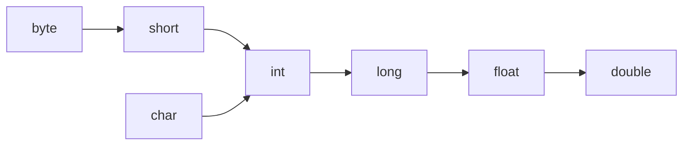

<div class="flex flex-col justify-center items-center h-full" style="background: #ffffff;">
  <p style="color: #5eada0; font-size: 1rem; font-weight: 600; letter-spacing: 0.2em; text-transform: uppercase; margin-bottom: 1.2rem;">Java Programming Masterclass</p>
  <h1 style="color: #1a5c5c; font-size: 3.4rem; font-weight: 900; line-height: 1.15; margin-bottom: 1.5rem;">Java 語言基礎</h1>
  <div style="height: 4px; width: 320px; background: linear-gradient(90deg, #5eada0, #a7d9d0); border-radius: 2px; margin-bottom: 1.5rem;"></div>
  <p style="color: #4a7c7c; font-size: 1.15rem; font-style: italic;">
    「從變數到輸出格式，打好每一塊程式設計的地基」
  </p>
  <Link to="home" style="color: #9dc4c4; font-size: 0.85rem; margin-top: 2rem; text-decoration: none; letter-spacing: 0.05em;">← 返回目錄</Link>
</div>

<!--
【開場白】
嘿！歡迎回來。上一章我們學會了怎麼跟 Java 打招呼，今天我們要來學「怎麼說話」。寫程式如果不存資料，就像是去餐廳吃飯卻不給餐具一樣尷尬。今天我們要聊的是變數、資料型態，還有怎麼把你的輸出印得跟雜誌封面一樣漂亮。

【為什麼要學這個？】
這就像是你要開始玩《魔獸世界》或《艾爾登法環》，你得先知道你的血量（HP）、魔力（MP）是什麼型態。是用數字存？還是用「真/假」存？搞錯了型態，你的英雄可能連怪都打不死就當機了。

【今天學完你會能做什麼】
學完這章，你就能精準控制你的程式要吃掉多少記憶體，還能寫出一個看起來非常專業的「成績單產生器」。
-->

---
layout: default
---

# Outline

- **認識變數（Variable）**
- **基本資料型態（Primitive Data Types）**
- **字串（String）資料型態**
- **常數（Constant）的觀念**
- **精準控制格式化的輸出**

<!--
【核心說明】
今天的課程就像是在教你怎麼「分類物品」。

【生活化比喻】
想像你正在搬家。你要把書放進書箱，把易碎品放進防護箱。這些主題，就是我們在 Java 這個大房子裡搬家時的必備技巧。每個章節都環環相扣，漏掉一個地基就會歪掉喔！
-->

---
layout: section
class: flex flex-col justify-center items-center text-center
---

# 認識變數

<!--
【開場白】
我們先來認識「變數」。變數這名字聽起來很玄，但其實它就是個「抓耙子」...喔不，是個暫時存放資料的「容器」。
-->

---

# 什麼是變數？

```java
int age = 25;
```

| 部分 | 說明 |
| --- | --- |
| `int` | **資料型態**：告訴 Java 要存什麼種類的資料 |
| `age` | **變數名稱**：你替這塊記憶體空間取的名字 |
| `= 25` | **初始值**：變數第一次存入的值（可省略）|
| `;` | **敘述結尾**：每行 Java 敘述必須以分號結束 |

<!--
【生活化比喻】
變數就像是一個貼了標籤的盒子。int age = 25; 這行程式碼的意思是：
1. int：我要租一個「中型整數規格」的櫃子。
2. age：櫃子外面的標籤寫著 "age"。
3. 25：把 25 號球衣丟進去。
4. ;：關上櫃門，搞定。

⚠️ 學生常見誤解：
Java 是個「死腦筋」。如果你租了 int 櫃子卻想塞一罐「可樂」（字串），它會直接報警（編譯錯誤）。這叫「靜態型別」，一旦決定了，這櫃子一輩子都只能裝整數。
-->

---

# 變數命名規則

| 規則 | 說明 | 範例 |
| --- | --- | --- |
| **合法字元** | 字母、數字、`$`、`_`；**不能**以數字開頭 | `name`, `_id`, `$val` |
| **大小寫區分** | `age` 和 `Age` 是不同的變數 | — |
| **不能用關鍵字** | `int`, `class`, `for` 等保留字不能當名稱 | — |
| **camelCase** | 多個單字時：第一字小寫，後續字首大寫 | `userName`, `totalScore` |

<div class="mt-4 p-3 bg-blue-50 border-l-4 border-blue-400 text-gray-700 text-sm text-left">
💡 名稱要有意義，用完整單字而非縮寫。<code>userName</code> 遠比 <code>un</code> 更易讀。
</div>

<!--
【核心說明】
命名規則有兩種：「語法規定」（不遵守會編譯錯誤）和「命名慣例」（不遵守程式能跑但很難讀）。

【生活化比喻】
規則就像是法律，犯了法會被關（編譯不過）。慣例就像是禮儀。你不穿衣服出門（不守慣例）雖然不一定會被抓，但大家會覺得你是個怪人。

💼 業界實務：
在公司裡，如果你把變數取名為 a1, a2, temp_val，你的主管會覺得你是不是昨晚宿醉還沒醒。請用 userName, totalPrice 這種一眼就能看懂的「小駝峰命名法」。
-->

---

# 變數的三種分類

| 類別 | 位置 | 特性 | 預設值 |
| --- | --- | --- | --- |
| **區域變數** | 方法（method）內 | 只在宣告的方法內有效，**無預設值** | 無（必須初始化）|
| **實例變數** | 類別內，方法外 | 每個物件各有獨立一份 | 有（int → 0）|
| **類別變數** | 加上 `static` | 所有物件共用同一份 | 有（int → 0）|

```java
public class Demo {
    int score = 0;          // 實例變數
    static int count = 0;   // 類別變數（static）

    void method() {
        int local = 10;     // 區域變數，必須初始化
    }
}
```

<!--
【核心說明】
變數住的地方不同，脾氣也不同。

【生活化比喻】
「區域變數」就像是你的私房錢，只有你自己（方法內）知道，而且你得自己記得裡面有多少錢（初始化），不然沒得花。
「實例變數」就像是每個房間（物件）各自的冷氣遙控器。
「類別變數」就像是客廳的電視機，全家人（所有物件）共用一台。

⚠️ 學生常見誤解：
初學者最常犯的錯就是宣告了區域變數 int x; 卻不給它值就想拿來用。這時候 Java 會冷冷地回你一句：「你都沒存錢，想領什麼？」
-->

---

# var 型態推斷（Java 10+）

```java
// 傳統寫法
String name = "炭治郎";
int score = 100;

// var：讓編譯器自動推斷型態
var name = "炭治郎";  // 推斷為 String
var score = 100;      // 推斷為 int
var list = new ArrayList<String>(); // 推斷為 ArrayList<String>
```

<div class="mt-4 p-3 bg-blue-50 border-l-4 border-blue-400 text-gray-700 text-sm text-left">
💡 <code>var</code> 只能用在<b>區域變數</b>，且必須在宣告時同時賦值，讓編譯器有足夠資訊推斷型態。型態在編譯後是固定的，不是動態型別。
</div>

<!--
【核心說明】
var 是 Java 10 給懶人工程師的福利。它不是動態型別，只是讓你少打一點字。

【生活化比喻】
這就像是你去便利商店拿了一瓶可樂去結帳，店員（編譯器）看一眼就知道那是可樂，不用你大喊：「這是一瓶可樂！」但注意，你還是得拿著可樂（賦值）去結帳，如果你兩手空空去櫃檯說 var x;，店員會以為你是來搶劫的。

💼 業界實務：
var 在處理很長、很複雜的型態名稱時超好用，可以讓程式碼清爽很多。但別濫用，如果你連 var a = 10; 都寫，別人看程式碼會看到想哭。
-->

---
layout: section
class: flex flex-col justify-center items-center text-center
---

# 基本資料型態

<!--
【開場白】
接下來講「基本資料型態」。Java 就像個嚴格的房東，它準備了 8 種不同大小的房間讓你存資料。它們是語言的原子，直接存在記憶體的 Stack 上。
-->

---

# 8 種基本資料型態

| 型態 | 大小 | 範圍 | 預設值 | 包裝類別 |
| --- | --- | --- | --- | --- |
| `byte` | 8 bit | -128 ~ 127 | `0` | `Byte` |
| `short` | 16 bit | -32,768 ~ 32,767 | `0` | `Short` |
| `int` | 32 bit | -2³¹ ~ 2³¹-1（約 ±21 億）| `0` | `Integer` |
| `long` | 64 bit | -2⁶³ ~ 2⁶³-1 | `0L` | `Long` |
| `float` | 32 bit | IEEE 754 單精度 | `0.0f` | `Float` |
| `double` | 64 bit | IEEE 754 雙精度 | `0.0` | `Double` |
| `boolean` | 1 bit | `true` / `false` | `false` | `Boolean` |
| `char` | 16 bit | `` ~ `￿`（0~65535）| `` | `Character` |

<!--
【核心說明】
這 8 種型態就像是 8 種不同尺寸的樂高積木。這張表要記住：int 是整數預設，double 是小數預設。

【生活化比喻】
byte 就像是一個小火柴盒。int 就像是標準的收納箱，這是我最推薦的「萬用款」。double 就像是一個超級精密的天平。boolean 就像是電燈開關。

⚠️ 學生常見誤解：
很多人分不清楚 int 和 Integer。記住，小寫的 int 是「打工仔」（Primitive）；大寫的 Integer 是「富二代」（Object）。我們現在先跟打工仔打交道。
-->

---

# 整數型態 — 範例

```java
byte b = 127;          // 最大 127
short s = 32_000;      // 底線是合法的數字分隔符（Java 7+）
int population = 23_570_000;
long bigNum = 9_876_543_210L; // L 或 l 結尾代表 long
```

<div class="mt-4 p-3 bg-blue-50 border-l-4 border-blue-400 text-gray-700 text-sm text-left">
💡 <b>注意：</b>long 字面值必須加 <code>L</code> 後綴，否則超出 int 範圍時會編譯錯誤。數字中間可以用 <code>_</code> 分隔提高可讀性，不影響值。
</div>

<!--
【逐步解說】
如果你要存一個幾百億的數字（例如你的年終獎金...夢裡有），int 就裝不下了，這時候得用 long，而且記得在數字後面加個大寫的 L，這就像是在數字後面加個「萬」字一樣重要。

💼 業界實務：
數字中間的底線 _ 就像是千分位符號，寫成 1_000_000 絕對比 1000000 讓你看起來更像專業工程師。
-->

---

# 浮點數型態 — 範例

```java
float f = 3.14f;        // f 或 F 結尾
double d = 3.14159265;  // 預設是 double（不用後綴）
double sci = 1.5E10;    // 科學記號：1.5 × 10¹⁰
```

<div class="mt-4 p-3 bg-blue-50 border-l-4 border-blue-400 text-gray-700 text-sm text-left">
⚠️ <b>精度警告：</b>浮點數無法精確表示所有小數。<code>0.1 + 0.2</code> 在 Java 中並不等於 <code>0.3</code>。需要精確計算（如金融）請使用 <code>BigDecimal</code>。
</div>

<!--
【核心說明】
存小數要小心！float 的後綴 f 不能省略，否則 Java 會以為它是個胖子（double），想把它塞進 float 的小座位會噴錯。

⚠️ 學生常見誤解：
千萬、千萬、千萬（說三次）不要用 double 或 float 來存錢！如果你用它們算帳，那幾分錢的誤差會讓你的銀行帳本爆炸。在 Java 世界，算錢請認明 BigDecimal。
-->

---

# boolean 與 char — 範例

```java
boolean isLoggedIn = true;
boolean hasPassed = (score >= 60); // 運算式結果

char grade = 'A';
char unicode = '彎'; // 弓字，Unicode 表示法
char next = (char)('A' + 1); // 'B'，char 可做算術
```

<!--
【核心說明】
boolean 只有兩種可能，就像你問女朋友「這件衣服好看嗎？」，答案只有「好看」跟「命不想要了」。

【生活化比喻】
char 就像是一個單人座沙發，你塞兩個字進去它會直接壞掉。記得用單引號！
有趣的是，char 其實是個披著字元皮的數字（16位整數），所以你可以拿 'A' 去加 1，它會變成長大後的 'B'。
-->

---

# 型態轉換 — 擴大轉換（Widening）

自動發生，從小型態轉大型態，不會遺失資料：

```java
byte b = 10;
int i = b;      // byte → int，自動轉換
long l = i;     // int → long，自動轉換
double d = l;   // long → double，自動轉換
```

<div class="flex justify-center mt-4">



</div>

<!--
【核心說明】
這叫「自動升級」。

【生活化比喻】
就像是你把小杯的可樂倒進大杯裡，完全不會灑出來。Java 很慷慨，這種安全的轉換它會自動幫你做好，不用你操心。圖裡的箭頭方向就是自動升級的路線。
-->

---

# 型態轉換 — 縮小轉換（Narrowing）

必須手動加上轉型語法 `(目標型態)`，可能遺失資料：

```java
double d = 100.99;
int i = (int) d;   // 強制轉型：小數部分直接截掉 → 100

int big = 257;
byte b = (byte) big; // 257 % 256 = 1（溢位截斷）
```

<div class="mt-4 p-3 bg-blue-50 border-l-4 border-blue-400 text-gray-700 text-sm text-left">
⚠️ <b>資料遺失：</b>縮小轉換不是四捨五入，是直接截斷。<code>100.99</code> 轉成 int 會變成 <code>100</code>，而非 <code>101</code>。
</div>

<!--
【核心說明】
這叫「強迫瘦身」。

【生活化比喻】
這就像是你想把一個大胖子塞進超小號的 T 恤。衣服會撐爆（資料遺失）。所以 Java 要求你寫下 (int) 這種「切結書」，意思是我知道資料會被切掉，出事我自己負責。

⚠️ 學生常見誤解：
轉型不是四捨五入！100.99 轉成 int 就會變成 100。那消失的 0.99 就像我逝去的青春一樣，再也回不來了。
-->

---

# Autoboxing — 自動裝箱

```java
// Autoboxing：primitive → 包裝類別（自動）
int score = 95;
Integer boxed = score; // 等同 Integer.valueOf(95)

// Unboxing：包裝類別 → primitive（自動）
Integer wrapped = Integer.valueOf(100);
int plain = wrapped;   // 等同 wrapped.intValue()
```

<div class="mt-4 p-3 bg-blue-50 border-l-4 border-blue-400 text-gray-700 text-sm text-left">
💡 <b>何時需要包裝類別？</b>泛型容器（如 <code>ArrayList&lt;Integer&gt;</code>）只能存物件，不能存 primitive，這時就需要 <code>Integer</code> 而非 <code>int</code>。
</div>

<!--
【核心說明】
這是 Java 幫「打工仔」和「富二代」之間建立的自動門。

【生活化比喻】
當你需要把 int 帶去參加高檔酒會（存進 ArrayList）時，Java 會自動幫它穿上西裝變成 Integer。回家的話，它會自動脫掉西裝（Unboxing）。

💼 業界實務：
雖然這很方便，但在幾百萬次的迴圈裡一直穿脫西裝是很累的（有效能耗損）。在追求極致效能時，我們會盡量避免這種不必要的裝箱。
-->

---
layout: section
class: flex flex-col justify-center items-center text-center
---

# 字串（String）資料型態

<!--
【開場白】
接下來聊聊 String。如果 Java 是一齣戲，String 絕對是拿最高片酬的男主角，因為它無所不在。但它不是 primitive，而是一個類別。
-->

---

# String 的宣告與特性

```java
String name = "炭治郎";      // 字面值宣告（推薦）
String empty = "";           // 空字串
String nullStr = null;       // null：不指向任何物件
```

| 特性 | 說明 |
| --- | --- |
| **不可變（Immutable）** | 字串一旦建立就不能修改，任何操作都產生新字串 |
| **類別型態** | `String` 是類別，首字大寫；primitive 都是小寫 |
| **字串池（String Pool）** | 相同字面值會指向同一個物件，節省記憶體 |

<!--
【核心說明】
String 最重要的特性就是「它是個頑固的傢伙」（Immutable）。

【生活化比喻】
字串一旦建立，就像刻在石頭上的字。你說你要「修改」它？不，你其實是拿了一塊新石頭重新刻字，然後把舊的那塊丟進垃圾桶。

⚠️ 學生常見誤解：
大家常說 String 是基本型別，錯！看它開頭是大寫 S 就知道它是有身分的「類別」。
-->

---

# String 常用操作（基本篇）

| 方法 | 說明 |
| --- | --- |
| `str.length()` | 字串長度（字元數）|
| `str.charAt(i)` | 取得索引 i 的字元 |
| `str.substring(begin, end)` | 擷取子字串 [begin, end-1] |
| `str.toUpperCase()` | 轉大寫 |
| `str.toLowerCase()` | 转小寫 |

```java
String s = "Hello";
System.out.println(s.length());      // 5
System.out.println(s.charAt(0));     // 'H'
System.out.println(s.substring(1, 4)); // "ell"
```

<div class="mt-4 p-3 bg-blue-50 border-l-4 border-blue-400 text-gray-700 text-sm text-left">
💡 String 完整的方法庫在 <b>Ch12 字元與字串類別</b> 中詳細介紹。
</div>

<!--
【逐步解說】
既然是物件，它就有「技能」（方法）。你可以問它長度（length），或是叫它變大變小。
記住，Java 的索引是從 0 開始的，這就像是工程師的世界裡，第一層樓叫 0 樓。
-->

---

# String 的串接與比較

```java
String first = "炭";
String last = "治郎";

// 串接
String full = first + last;           // "炭治郎"
String full2 = first.concat(last);    // 同上

// 比較（重要！）
String a = "Java";
String b = new String("Java");
System.out.println(a == b);           // false（位址不同）
System.out.println(a.equals(b));      // true（內容相同）
```

<div class="mt-4 p-3 bg-blue-50 border-l-4 border-blue-400 text-gray-700 text-sm text-left">
⚠️ <b>比較字串內容一律用 <code>equals()</code></b>，不能用 <code>==</code>。<code>==</code> 比的是記憶體位址，不是內容。
</div>

<!--
【核心重點 — 必考】
這張投影片，請打三顆星！這是面試地獄題。

⚠️ 學生常見誤解：
比較字串絕對、絕對不要用 ==。== 比的是「你們住的地址一樣嗎？」；equals() 比的是「你們長得一樣嗎？」。有時候兩個人長得一模一樣，但住不同地方，用 == 會回傳 false。
-->

---
layout: section
class: flex flex-col justify-center items-center text-center
---

# 常數（Constant）的觀念

<!--
【開場白】
有些東西這輩子都不能改，比如圓周率，或是你對程式設計的熱愛...（希望啦）。我們用 final 關鍵字來守護它們。
-->

---

# final 關鍵字

```java
final int MAX_SCORE = 100;
MAX_SCORE = 200; // ❌ 編譯錯誤：無法重新賦值
```

| 項目 | 說明 |
| --- | --- |
| `final` | 讓變數在第一次賦值後就不可再更改 |
| 命名慣例 | 全大寫，多字以底線分隔（`MAX_SIZE`、`PI`）|
| 賦值時機 | 宣告時或建構子內（擇一），之後不能再改 |

<!--
【核心說明】
final 就是「最後通牒」。

【生活化比喻】
這就像是你幫變數裝了一個防護罩，一旦給了初吻（賦值），這輩子它就只能屬於那個人。你想改？Java 編譯器會直接給你一個巴掌。

💼 業界實務：
常數我們習慣全大寫，中間用底線。如果你寫 final int a = 10;，你看起來就像個還沒畢業的菜鳥。請寫 final int MAX_RETRY_COUNT = 10;。
-->

---

# static final — 類別層級的常數

```java
public class MathConstants {
    public static final double PI = 3.14159265358979;
    public static final int EARTH_RADIUS_KM = 6371;
}

// 使用（不需要建立物件）
System.out.println(MathConstants.PI);
```

<div class="mt-4 p-3 bg-blue-50 border-l-4 border-blue-400 text-gray-700 text-sm text-left">
💡 <b>static final 組合</b> 是定義「類別常數」的標準寫法。<code>static</code> 讓所有物件共用同一份，<code>final</code> 確保值不被修改。JDK 的 <code>Math.PI</code>、<code>Integer.MAX_VALUE</code> 都是這樣定義的。
</div>

<!--
【業界實務】
這是常數的「完全體」。

【生活化比喻】
static 就像是全家共用的公筷，final 則是這雙公筷不准折斷。我們會把所有的網址、設定都寫成 static final，這樣你要改的時候只要改一個地方就好，不用翻遍幾千個檔案。
-->

---

# 常數的好處

```java
// ❌ 神秘數字（Magic Number）— 難以維護
if (score >= 60) { ... }
double area = 3.14159 * r * r;

// ✅ 使用常數 — 意圖清晰，易於維護
final int PASS_SCORE = 60;
final double PI = 3.14159265;

if (score >= PASS_SCORE) { ... }
double area = PI * r * r;
```

<!--
【業界實務】
別在程式碼裡寫「神秘數字」（Magic Numbers）。

【生活化比喻】
想像你看到一段程式碼寫 if (status == 4) ...，天知道 4 是什麼意思？但如果你寫 if (status == STATUS_SUCCESS) ...，三歲小孩都看得懂。這就是專業！
-->

---
layout: section
class: flex flex-col justify-center items-center text-center
---

# 精準控制格式化的輸出

<!--
【開場白】
最後，我們要學怎麼「漂亮地說話」。System.out.println 已經不夠用了，我們需要更精準的工具。
-->

---

# printf 格式語法

`System.out.printf(格式字串, 引數1, 引數2, ...)`

格式規範語法：`%[旗標][寬度][.精確度]轉換字元`

| 轉換字元 | 說明 | 範例輸入 | 輸出 |
| --- | --- | --- | --- |
| `%d` | 十進位整數 | `printf("%d", 100)` | `100` |
| `%f` | 浮點數（預設 6 位小數）| `printf("%f", 3.14)` | `3.140000` |
| `%s` | 字串 | `printf("%s", "Java")` | `Java` |
| `%c` | 單一字元 | `printf("%c", 'A')` | `A` |
| `%b` | 布林值 | `printf("%b", true)` | `true` |
| `%n` | 平台換行符（推薦取代 `\n`）| — | 換行 |

<!--
【核心說明】
printf 就像是一個填空遊戲。

【生活化比喻】
%d 是留給整數的座位，%f 是留給小數的沙發，%s 則是給字串的大床。%n 是個神奇的換行符號，它會根據系統自動決定怎麼跳行，比 \n 更優雅。
-->

---

# 寬度與精確度控制

```java
// 寬度：最少佔幾個字元（預設右對齊）
System.out.printf("%10d%n", 123);    //        123（補空格至 10 格）
System.out.printf("%-10d|%n", 123);  // 123       |（-：左對齊）

// 精確度：小數點後幾位
System.out.printf("%.2f%n", 3.14159); // 3.14
System.out.printf("%8.2f%n", 3.14159); //     3.14（寬度 8 + 2 位小數）

// 補零
System.out.printf("%05d%n", 42);      // 00042
```

<!--
【逐步解說】
你想讓數字排排站好嗎？用寬度控制。你想讓小數點不要長得像火車尾一樣長嗎？用 .2f。你想讓序號看起來像 FBI 的機密檔案嗎？用 %05d。
-->

---

# 格式化旗標速查

| 旗標 | 說明 | 範例 |
| --- | --- | --- |
| `-` | 左對齊（預設右對齊）| `%-10s` |
| `0` | 以零填充（數字適用）| `%05d` |
| `+` | 強制顯示正負號 | `%+d` → `+100` |
| `,` | 千位分隔符 | `%,d` → `1,000,000` |
| `(` | 負數用括號表示 | `%(d` → `(100)` |

```java
System.out.printf("%,d%n", 1000000);  // 1,000,000
System.out.printf("%+.1f%n", 3.14);  // +3.1
```

<!--
【業界實務】
千分位符號 , 真的是神器。印出 1,000,000 絕對比 1000000 讓老闆更願意付你薪水（因為他看得懂你有多少錢）。正負號旗標 %+d 則常用於財務報表。
-->

---

# String.format( ) — 格式化成字串

```java
String name = "炭治郎";
int score = 95;
double rate = 0.9876;

String report = String.format(
    "姓名：%-6s 分數：%3d 正確率：%.1f%%",
    name, score, rate * 100
);
System.out.println(report);
// 姓名：炭治郎   分數： 95 正確率：98.8%
```

<div class="mt-4 p-3 bg-blue-50 border-l-4 border-blue-400 text-gray-700 text-sm text-left">
💡 <b>printf vs String.format</b>：<code>printf</code> 直接印出；<code>String.format</code> 回傳格式化後的字串，可存入變數繼續使用（如記錄 log、傳給方法）。兩者使用完全相同的格式規則。
</div>

<!--
【業界實務】
String.format 是 printf 的低調版。

【生活化比喻】
printf 就像是你直接對著大家大喊。String.format 則是把要說的話寫在小紙條上遞給別人。在做系統日誌（Logging）時，我們天天都在用它。注意 %% 用來印出一個真正的百分比符號。
-->

---
layout: default
---

# 練習一：個人資料卡
### 任務說明

宣告以下變數，並用 `printf` 整齊排版輸出：

| 資料 | 型態 | 值 |
| --- | --- | --- |
| 姓名 | `String` | 任意 |
| 年齡 | `int` | 任意 |
| 身高 | `double` | 任意（含小數）|
| 是否在學 | `boolean` | 任意 |

**預期格式（對齊欄位）：**

```
姓名：炭治郎
年齡：  16
身高：165.5 cm
在學：true
```

<!--
【出題前的鋪陳】
好了，現在該你們大顯身手了。

【問題引導】
試著幫自己做一張數位名片。姓名、年齡、身高...別在身高上說謊喔，雖然 Java 不會拆穿你，但你的體檢表會。試著讓那些標籤對齊，這會讓你的名片看起來更專業。
-->

---

# 練習一：解題提示
### 提示說明

1. 宣告四個不同型態的變數並賦值
2. 用 `System.out.printf` 搭配以下格式化：
   - 年齡用 `%3d`（右對齊，至少 3 格）
   - 身高用 `%.1f`（1 位小數）
   - 在學用 `%b`

```java
System.out.printf("姓名：%s%n", name);
System.out.printf("年齡：%3d%n", age);
System.out.printf("身高：%.1f cm%n", height);
System.out.printf("在學：%b%n", isStudent);
```

<!--
【逐步解說】
注意每行末尾的 %n 用來換行。注意 %3d 的妙用，它可以幫你的年齡前面補空格，讓數字對齊。這就是細節的力量。
-->

---
layout: default
---

# 練習二：成績單格式化
### 任務說明

宣告三位學生的姓名和分數（用常數定義及格分數 60），並格式化輸出成績單：

**預期格式：**

```
===== 成績單 =====
姓名        分數  是否及格
炭治郎        95  ✓
禰豆子        72  ✓
善逸          58  ✗
==================
及格線：60 分
```

**挑戰：** 用 `static final` 定義及格線，讓程式碼更易維護。

<!--
【出題前的鋪陳】
最後一個挑戰：成績單。這題整合了我們今天學的所有大招。

【問題引導】
想像你是那個決定學生生死的大魔王老師，及格線 60 分。及格的給個「勾」，不及格的給個「叉」。這就是常數、判斷式、格式化輸出的綜合應用。
-->

---

# 練習二：解題提示
### 提示說明

1. 用 `static final int PASS_SCORE = 60` 定義及格線常數
2. 每位學生判斷 `score >= PASS_SCORE`，存入 boolean
3. 用 `printf` 格式化每一行，`%-6s` 讓姓名左對齊，`%3d` 讓分數右對齊

```java
static final int PASS_SCORE = 60;

String name1 = "炭治郎"; int score1 = 95;
boolean pass1 = score1 >= PASS_SCORE;

System.out.printf("%-6s %3d  %s%n",
    name1, score1, pass1 ? "✓" : "✗");
```

<!--
【逐步解說】
提示一下，那個「勾」跟「叉」可以用字串處理，也可以用三元運算子來耍帥。學完這個練習，你已經能用 Java 寫出專業的文字報表了！
-->

---
layout: section
class: flex flex-col justify-center items-center text-center
---

# Q & A

<!--
【開場白】
今天我們打好了 Java 的地基：變數、資料型態、常數、格式化。
現在，這個「置物櫃」已經準備好了，你們想往裡面塞什麼？或者是有人想知道怎麼在不被老闆發現的情況下偷改 MAX_SALARY 常數嗎？（開玩笑的，那是 final，改不掉的！）
-->
