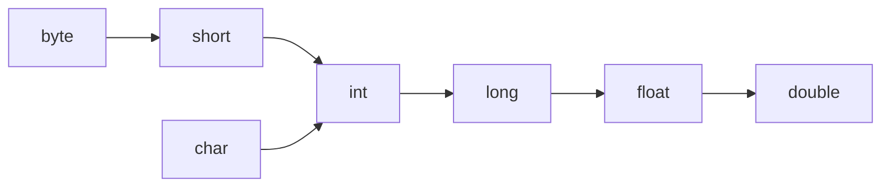

<div class="flex flex-col justify-center items-center h-full" style="background: #ffffff;">
  <p style="color: #5eada0; font-size: 1rem; font-weight: 600; letter-spacing: 0.2em; text-transform: uppercase; margin-bottom: 1.2rem;">Java Programming Masterclass</p>
  <h1 style="color: #1a5c5c; font-size: 3.4rem; font-weight: 900; line-height: 1.15; margin-bottom: 1.5rem;">Java 語言基礎</h1>
  <div style="height: 4px; width: 320px; background: linear-gradient(90deg, #5eada0, #a7d9d0); border-radius: 2px; margin-bottom: 1.5rem;"></div>
  <p style="color: #4a7c7c; font-size: 1.15rem; font-style: italic;">
    「從變數到輸出格式，打好每一塊程式設計的地基」
  </p>
  <Link to="home" style="color: #9dc4c4; font-size: 0.85rem; margin-top: 2rem; text-decoration: none; letter-spacing: 0.05em;">← 返回目錄</Link>
</div>

<!--
大家好，這一章我們要學的是 Java 語言基礎。

寫程式說穿了就是三件事：把資料存起來、處理資料，再把結果清楚地呈現出來。這一章就是在打這三件事的地基，包括變數、資料型態、字串、常數，以及格式化輸出。

學完之後，我們就能宣告各種型態的資料，並且用整齊的格式把結果印出來。
-->

---
layout: default
---

# Outline

- **認識變數（Variable）**
- **基本資料型態（Primitive Data Types）**
- **字串（String）資料型態**
- **常數（Constant）的觀念**
- **精準控制格式化的輸出**

<!--
這一章的內容有一條很清楚的主線。

先學怎麼把資料存起來，也就是變數；接著看可以存哪些種類的資料，也就是資料型態；然後是每天都會用到的字串；再來是不能被修改的常數；最後學怎麼把結果漂亮地印出來。
-->

---
layout: section
class: flex flex-col justify-center items-center text-center
---

# 認識變數

<!--
寫程式就是在處理資料，而資料要放在記憶體裡。為了之後找得到它，我們要幫它取個名字，這就是變數。
-->

---

# 什麼是變數？

```java
int age = 25;
```

| 部分 | 說明 |
| --- | --- |
| `int` | **資料型態**：告訴 Java 要存什麼種類的資料 |
| `age` | **變數名稱**：你替這塊記憶體空間取的名字 |
| `= 25` | **初始值**：變數第一次存入的值（可省略）|
| `;` | **敘述結尾**：每行 Java 敘述必須以分號結束 |

<!--
我們可以把變數想像成貼了標籤的抽屜，抽屜上的標籤就是名稱，裡面放的就是資料。

看這行 `int age = 25`，它分成四個部分。int 是資料型態，告訴 Java 這個抽屜只能放整數。age 是變數名稱，之後我們就用這個名字找到它。等號後面的 25 是初始值，也就是第一次放進去的資料。最後的分號表示這行敘述結束，每一行 Java 敘述都要用分號結尾。

Java 是「靜態型別」的語言，宣告變數時就要決定型態，之後不能改成別的型態。
-->

---

# 變數命名規則

| 規則 | 說明 | 範例 |
| --- | --- | --- |
| **合法字元** | 字母、數字、`$`、`_`；**不能**以數字開頭 | `name`, `_id`, `$val` |
| **大小寫區分** | `age` 和 `Age` 是不同的變數 | — |
| **不能用關鍵字** | `int`, `class`, `for` 等保留字不能當名稱 | — |
| **camelCase** | 多個單字時：第一字小寫，後續字首大寫 | `userName`, `totalScore` |

<div class="mt-4 p-3 bg-blue-50 border-l-4 border-blue-400 text-gray-700 text-sm text-left">
💡 名稱要有意義，用完整單字而非縮寫。<code>userName</code> 遠比 <code>un</code> 更易讀。
</div>

<!--
變數的名字不能隨便取，有幾條規則。

名稱可以用字母、數字、錢字號和底線，但不能用數字開頭。大小寫是有區別的，小寫的 age 和大寫開頭的 Age 是兩個不同的變數。另外，int、class、for 這些 Java 已經使用的關鍵字，也不能拿來當名稱。

除了語法規定，還有命名慣例。多個單字組成的名稱，第一個單字小寫，後面每個單字的第一個字母大寫，這叫 camelCase，例如 userName、totalScore。

下面的提醒也很重要：名稱要有意義。userName 和 un 都合法，但幾個月後回來看，只有 userName 還看得懂。
-->

---

# 變數的三種分類

| 類別 | 位置 | 特性 | 預設值 |
| --- | --- | --- | --- |
| **區域變數** | 方法（method）內 | 只在宣告的方法內有效，**無預設值** | 無（必須初始化）|
| **實例變數** | 類別內，方法外 | 每個物件各有獨立一份 | 有（int → 0）|
| **類別變數** | 加上 `static` | 所有物件共用同一份 | 有（int → 0）|

```java
public class Demo {
    int score = 0;          // 實例變數
    static int count = 0;   // 類別變數（static）

    void method() {
        int local = 10;     // 區域變數，必須初始化
    }
}
```

<!--
變數依照宣告的位置，可以分成三種。

寫在方法裡面的，叫區域變數，只在這個方法裡有效。寫在類別裡、方法外面的，叫實例變數，每個物件都有自己的一份。如果再加上 static，就是類別變數，所有物件共用同一份。

看下面的 Demo 類別，score 是實例變數，count 是類別變數，method 裡面的 local 則是區域變數。

最容易出錯的是區域變數。實例變數和類別變數有預設值，例如 int 會是 0；但區域變數沒有預設值，宣告之後一定要先給值才能使用，不然編譯就會失敗。
-->

---

# var 型態推斷（Java 10+）

```java
// 傳統寫法
String name = "炭治郎";
int score = 100;

// var：讓編譯器自動推斷型態
var name = "炭治郎";  // 推斷為 String
var score = 100;      // 推斷為 int
var list = new ArrayList<String>(); // 推斷為 ArrayList<String>
```

<div class="mt-4 p-3 bg-blue-50 border-l-4 border-blue-400 text-gray-700 text-sm text-left">
💡 <code>var</code> 只能用在<b>區域變數</b>，且必須在宣告時同時賦值，讓編譯器有足夠資訊推斷型態。型態在編譯後是固定的，不是動態型別。
</div>

<!--
從 Java 10 開始，宣告區域變數時可以用 var，讓編譯器自己推斷型態。

看範例，傳統寫法要寫出 String 和 int；改用 var 之後，編譯器會從等號右邊的值，判斷 name 是字串、score 是整數。型態名稱很長的時候，例如最後一行的 ArrayList，用 var 會清爽很多。

不過要注意，var 不是動態型別。編譯之後，型態就固定了，name 一樣是 String，之後不能改放整數。

另外，var 只能用在區域變數，而且宣告時一定要同時給值，編譯器才有足夠的資訊判斷型態。
-->

---
layout: section
class: flex flex-col justify-center items-center text-center
---

# 基本資料型態

<!--
知道怎麼宣告變數之後，接下來看看 Java 有哪些最基本的資料型態可以使用。
-->

---

# 8 種基本資料型態

| 型態 | 大小 | 範圍 | 預設值 | 包裝類別 |
| --- | --- | --- | --- | --- |
| `byte` | 8 bit | -128 ~ 127 | `0` | `Byte` |
| `short` | 16 bit | -32,768 ~ 32,767 | `0` | `Short` |
| `int` | 32 bit | -2³¹ ~ 2³¹-1（約 ±21 億）| `0` | `Integer` |
| `long` | 64 bit | -2⁶³ ~ 2⁶³-1 | `0L` | `Long` |
| `float` | 32 bit | IEEE 754 單精度 | `0.0f` | `Float` |
| `double` | 64 bit | IEEE 754 雙精度 | `0.0` | `Double` |
| `boolean` | 1 bit | `true` / `false` | `false` | `Boolean` |
| `char` | 16 bit | `'\u0000'` ~ `'\uffff'`（0~65535）| `'\u0000'` | `Character` |

<style>
td, th { padding: 6px 8px !important; }
</style>

<!--
Java 有八種基本資料型態。

整數有四種：byte、short、int、long，大小從 8 位元一路加倍到 64 位元，能存的範圍也越來越大。小數有兩種：float 和 double。另外還有只有真和假兩種值的 boolean，以及存放單一字元的 char。

表格最右邊一欄，是每種型態對應的包裝類別，這個等一下會介紹。

這張表不用全部背起來，先記住最常用的選擇就好：「整數預設用 int，小數預設用 double。」其他型態，有需要時再回來查。
-->

---

# 整數型態 — 範例

```java
byte b = 127;          // 最大 127
short s = 32_000;      // 底線是合法的數字分隔符（Java 7+）
int population = 23_570_000;
long bigNum = 9_876_543_210L; // L 或 l 結尾代表 long
```

<div class="mt-4 p-3 bg-blue-50 border-l-4 border-blue-400 text-gray-700 text-sm text-left">
💡 <b>注意：</b>long 字面值必須加 <code>L</code> 後綴，否則超出 int 範圍時會編譯錯誤。數字中間可以用 <code>_</code> 分隔提高可讀性，不影響值。
</div>

<!--
我們看整數型態的實際用法。

byte 最大只能存到 127。short 這一行的數字中間有底線，這是 Java 7 之後支援的數字分隔符號，32_000 和 32000 完全一樣，只是比較好閱讀，就像寫金額時會用逗號分隔千位。

最後一行的 long 要特別注意，數字後面加了一個大寫的 L。整數預設會被當成 int，而 int 大約只能存到正負 21 億，超過這個範圍，就要加上 L，告訴 Java 這是一個 long，否則會編譯錯誤。

實際開發中，大部分情況都用 int，只有存時間戳記這類很大的數字時才會用到 long。
-->

---

# 浮點數型態 — 範例

```java
float f = 3.14f;        // f 或 F 結尾
double d = 3.14159265;  // 預設是 double（不用後綴）
double sci = 1.5E10;    // 科學記號：1.5 × 10¹⁰
```

<div class="mt-4 p-3 bg-blue-50 border-l-4 border-blue-400 text-gray-700 text-sm text-left">
⚠️ <b>精度警告：</b>浮點數無法精確表示所有小數。<code>0.1 + 0.2</code> 在 Java 中並不等於 <code>0.3</code>。需要精確計算（如金融）請使用 <code>BigDecimal</code>。
</div>

<!--
接著是小數，也就是浮點數。

float 的數字後面要加 f，因為 Java 預設的小數是 double。double 則不需要加任何符號。最後一行的 1.5E10 是科學記號，表示 1.5 乘以 10 的 10 次方。

下面的警告非常重要：浮點數沒辦法精確表示所有的小數。0.1 加 0.2，在 Java 裡並不會剛好等於 0.3，而是一個很接近、但有一點誤差的數字。原因是電腦用二進位儲存小數，有些十進位的小數在二進位裡是無限循環的。

所以，如果要處理金額這類需要精確計算的資料，就要改用 BigDecimal，而不是 float 或 double。
-->

---

# boolean 與 char — 範例

```java
boolean isLoggedIn = true;
boolean hasPassed = (score >= 60); // 運算式結果

char grade = 'A';
char unicode = '彎'; // 弓字，Unicode 表示法
char next = (char)('A' + 1); // 'B'，char 可做算術
```

<!--
boolean 只有 true 和 false 兩種值，是之後所有條件判斷的核心。像第二行，score 大於等於 60 這個比較的結果，就可以直接存成一個 boolean。

char 用來存單一字元，要用單引號包起來。字串才是用雙引號，這兩個不要搞混。

最後一行很有趣：char 其實是用數字來儲存字元編碼，所以可以做加法。A 加 1，再轉回 char，就會得到 B，因為 A 和 B 在編碼表上是相鄰的。
-->

---

# 型態轉換 — 擴大轉換（Widening）

自動發生，從小型態轉大型態，不會遺失資料：

```java
byte b = 10;
int i = b;      // byte → int，自動轉換
long l = i;     // int → long，自動轉換
double d = l;   // long → double，自動轉換
```

<div class="flex justify-center mt-4">



</div>

<!--
不同型態之間可以互相轉換，第一種是擴大轉換。

擴大轉換是從小的型態轉成大的型態，Java 會自動幫我們完成，不會遺失資料，就像把小杯子的水倒進大杯子，不會溢出來。

看程式碼，byte 可以直接存進 int，int 可以直接存進 long，long 也可以直接存進 double，不需要多寫任何東西。

下面的圖畫出了轉換的方向，從 byte、short、int、long，一路到 float 和 double，往右都是自動的。char 也可以自動轉成 int。
-->

---

# 型態轉換 — 縮小轉換（Narrowing）

必須手動加上轉型語法 `(目標型態)`，可能遺失資料：

```java
double d = 100.99;
int i = (int) d;   // 強制轉型：小數部分直接截掉 → 100

int big = 257;
byte b = (byte) big; // 257 % 256 = 1（溢位截斷）
```

<div class="mt-4 p-3 bg-blue-50 border-l-4 border-blue-400 text-gray-700 text-sm text-left">
⚠️ <b>資料遺失：</b>縮小轉換不是四捨五入，是直接截斷。<code>100.99</code> 轉成 int 會變成 <code>100</code>，而非 <code>101</code>。
</div>

<!--
反過來，從大的型態轉成小的型態，叫縮小轉換。這時候 Java 不會自動處理，我們要在前面加上括號和目標型態，這叫做「強制轉型」。

就像把大杯子的水倒進小杯子，一定會有水溢出來。強制轉型，就是在告訴 Java：「我知道可能會遺失資料，我願意承擔。」

看第一個例子，100.99 轉成 int，結果是 100，不是 101。縮小轉換不會四捨五入，而是直接把小數部分截掉。

第二個例子更特別，257 轉成 byte，結果是 1。因為 byte 最大只能存到 127，超過範圍的部分會被截斷。這種溢位的錯誤，在初學者的程式裡很常見。
-->

---

# Autoboxing — 自動裝箱

```java
// Autoboxing：primitive → 包裝類別（自動）
int score = 95;
Integer boxed = score; // 等同 Integer.valueOf(95)

// Unboxing：包裝類別 → primitive（自動）
Integer wrapped = Integer.valueOf(100);
int plain = wrapped;   // 等同 wrapped.intValue()
```

<div class="mt-4 p-3 bg-blue-50 border-l-4 border-blue-400 text-gray-700 text-sm text-left">
💡 <b>何時需要包裝類別？</b>泛型容器（如 <code>ArrayList&lt;Integer&gt;</code>）只能存物件，不能存 primitive，這時就需要 <code>Integer</code> 而非 <code>int</code>。
</div>

<!--
剛才的表格提到，每種基本型態都有一個對應的包裝類別，例如 int 對應 Integer。

為什麼需要它？因為之後會學到的 ArrayList 這類容器，只能存物件，不能直接存基本型態，這時候就要用 Integer 而不是 int。

好消息是，Java 會自動幫我們轉換。把 int 存進 Integer，叫做自動裝箱；把 Integer 取出來當 int 用，叫做自動拆箱。看程式碼，兩個方向都不用多寫任何轉換的程式。

可以把它想成便當和便當盒：要放進公司的冰箱，就要先裝進便當盒；要吃的時候，再把便當拿出來。
-->

---
layout: section
class: flex flex-col justify-center items-center text-center
---

# 字串（String）資料型態

<!--
接下來，我們來看每天都會用到的資料型態：字串。

姓名、地址、訊息，這些文字資料全都要靠 String。要注意的是，String 和剛才的基本型態不一樣，它是一個類別。
-->

---

# String 的宣告與特性

```java
String name = "炭治郎";      // 字面值宣告（推薦）
String empty = "";           // 空字串
String nullStr = null;       // null：不指向任何物件
```

| 特性 | 說明 |
| --- | --- |
| **不可變（Immutable）** | 字串一旦建立就不能修改，任何操作都產生新字串 |
| **類別型態** | `String` 是類別，首字大寫；primitive 都是小寫 |
| **字串池（String Pool）** | 相同字面值會指向同一個物件，節省記憶體 |

<!--
宣告字串很簡單，用雙引號把文字包起來就好。空字串是什麼字都沒有的字串，而 null 則代表這個變數沒有指向任何字串物件，兩者不一樣。

String 有三個重要特性。

第一，它是「不可變的」。字串一旦建立，就不能修改，任何看起來在修改字串的操作，其實都是產生一個新字串。就像改不了紙上的字，只好拿一張新紙重寫。

第二，String 是類別，所以名字是大寫開頭；而基本型態全部都是小寫。

第三是字串池。內容相同的字串字面值，Java 會讓它們共用同一個物件，節省記憶體。
-->

---

# String 常用操作（基本篇）

| 方法 | 說明 |
| --- | --- |
| `str.length()` | 字串長度（字元數）|
| `str.charAt(i)` | 取得索引 i 的字元 |
| `str.substring(begin, end)` | 擷取子字串 [begin, end-1] |
| `str.toUpperCase()` / `str.toLowerCase()` | 轉大寫 / 轉小寫 |

```java
String s = "Hello";
System.out.println(s.length());      // 5
System.out.println(s.charAt(0));     // 'H'
System.out.println(s.substring(1, 4)); // "ell"
```

<div class="mt-4 p-3 bg-blue-50 border-l-4 border-blue-400 text-gray-700 text-sm text-left">
💡 String 完整的方法庫在 <b>Ch12 字元與字串類別</b> 中詳細介紹。
</div>

<!--
因為 String 是類別，所以它有很多方法可以使用。

length 會回傳字串的長度，charAt 可以取出指定位置的字元，要注意位置是從 0 開始算的。substring 可以擷取一段子字串，第二個參數那個位置的字元是不包含的。另外還有轉大寫和轉小寫。

看範例，Hello 的長度是 5，位置 0 的字元是 H；substring 1 到 4，取出的是位置 1、2、3 的字元，也就是 ell。

字串還有很多好用的方法，在後面的字元與字串章節會再詳細介紹。
-->

---

# String 的串接與比較

```java
String first = "炭";
String last = "治郎";

// 串接
String full = first + last;           // "炭治郎"
String full2 = first.concat(last);    // 同上

// 比較（重要！）
String a = "Java";
String b = new String("Java");
System.out.println(a == b);           // false（位址不同）
System.out.println(a.equals(b));      // true（內容相同）
```

<div class="mt-4 p-3 bg-blue-50 border-l-4 border-blue-400 text-gray-700 text-sm text-left">
⚠️ <b>比較字串內容一律用 <code>equals()</code></b>，不能用 <code>==</code>。<code>==</code> 比的是記憶體位址，不是內容。
</div>

<!--
字串可以用加號，或是 concat 方法串接起來，兩種寫法的結果一樣，都會得到炭治郎。

接著是比較字串，這是 Java 最常見的陷阱之一。

看下面的例子，a 用字面值宣告，b 用 new 建立了一個新的字串物件。兩個內容都是 Java，但用兩個等號比較，結果卻是 false；用 equals 比較，結果才是 true。

原因是，兩個等號比較的是「是不是同一個物件」，也就是記憶體位址；equals 比較的才是內容。

所以要記住：「比較字串內容，一律用 equals，不要用兩個等號。」
-->

---
layout: section
class: flex flex-col justify-center items-center text-center
---

# 常數（Constant）的觀念

<!--
接下來是常數。有些值在程式執行過程中不應該被改變，例如圓周率、及格分數或稅率，Java 用 final 關鍵字來保護這些值。
-->

---

# final 關鍵字

```java
final int MAX_SCORE = 100;
MAX_SCORE = 200; // ❌ 編譯錯誤：無法重新賦值
```

| 項目 | 說明 |
| --- | --- |
| `final` | 讓變數在第一次賦值後就不可再更改 |
| 命名慣例 | 全大寫，多字以底線分隔（`MAX_SIZE`、`PI`）|
| 賦值時機 | 宣告時或建構子內（擇一），之後不能再改 |

<!--
在宣告變數時加上 final，這個變數第一次給值之後，就不能再修改了。

看範例，MAX_SCORE 設成 100 之後，下一行如果想改成 200，編譯器就會直接報錯。這個錯誤在編譯時就會被抓出來，不用等到程式執行，非常安全。

常數的命名慣例是全部大寫，多個單字之間用底線分隔，例如 MAX_SIZE、PI。這樣一看名字，就知道這是不能修改的值。
-->

---

# static final — 類別層級的常數

```java
public class MathConstants {
    public static final double PI = 3.14159265358979;
    public static final int EARTH_RADIUS_KM = 6371;
}

// 使用（不需要建立物件）
System.out.println(MathConstants.PI);
```

<div class="mt-4 p-3 bg-blue-50 border-l-4 border-blue-400 text-gray-700 text-sm text-left">
💡 <b>static final 組合</b> 是定義「類別常數」的標準寫法。<code>static</code> 讓所有物件共用同一份，<code>final</code> 確保值不被修改。JDK 的 <code>Math.PI</code>、<code>Integer.MAX_VALUE</code> 都是這樣定義的。
</div>

<!--
如果再加上 static，就變成類別層級的常數。

static 表示這個值屬於類別本身，所有物件共用同一份；final 表示這個值不能被修改。兩個合在一起，就是定義常數最標準的寫法。

看範例，MathConstants 類別裡定義了 PI 和地球半徑。使用時不需要建立物件，直接用類別名稱點 PI 就可以了。JDK 裡的 Math.PI，也是用這種方式定義的。

在實際專案裡，常數通常會集中寫在同一個類別裡，之後要修改時，只要改一個地方就好。
-->

---

# 常數的好處

```java
// ❌ 神秘數字（Magic Number）— 難以維護
if (score >= 60) { ... }
double area = 3.14159 * r * r;

// ✅ 使用常數 — 意圖清晰，易於維護
final int PASS_SCORE = 60;
final double PI = 3.14159265;

if (score >= PASS_SCORE) { ... }
double area = PI * r * r;
```

<!--
我們來比較兩段程式碼，看看常數的好處。

第一段直接寫了 60 和 3.14159。幾個月後回來看，60 代表什麼？是及格分數，還是年齡限制？這種直接寫在程式裡、意思不明的數字，業界稱為「神秘數字」，英文是 Magic Number。

第二段改用常數，條件變成 score 大於等於 PASS_SCORE，一看就知道是在判斷及格。

而且，如果哪天及格分數從 60 改成 70，只要修改常數這一個地方就好，不用在整個程式裡到處尋找 60，再一個一個確認。
-->

---
layout: section
class: flex flex-col justify-center items-center text-center
---

# 精準控制格式化的輸出

<!--
最後一個部分是格式化輸出。println 雖然夠用，但沒辦法控制小數位數，也沒辦法讓欄位對齊。這時候就要用 printf。
-->

---

# printf 格式語法

`System.out.printf(格式字串, 引數1, 引數2, ...)`

格式規範語法：`%[旗標][寬度][.精確度]轉換字元`

| 轉換字元 | 說明 | 範例輸入 | 輸出 |
| --- | --- | --- | --- |
| `%d` | 十進位整數 | `printf("%d", 100)` | `100` |
| `%f` | 浮點數（預設 6 位小數）| `printf("%f", 3.14)` | `3.140000` |
| `%s` | 字串 | `printf("%s", "Java")` | `Java` |
| `%c` | 單一字元 | `printf("%c", 'A')` | `A` |
| `%b` | 布林值 | `printf("%b", true)` | `true` |
| `%n` | 平台換行符（推薦取代 `\n`）| — | 換行 |

<!--
printf 的第一個參數是格式字串，後面依序放要輸出的資料。

格式字串裡用百分比符號開頭的格式碼，代表資料要放的位置和格式。我們可以把格式字串想成一個模板，格式碼就是模板裡的空格，後面的資料會依序填進去。

最常用的有這幾個：`%d` 是整數，`%f` 是浮點數，預設會印出六位小數，`%s` 是字串，`%c` 是單一字元，`%b` 是布林值。

最後的 `%n` 代表換行。不同作業系統的換行符號不一樣，用 `%n` 就不需要擔心這個問題。
-->

---

# 寬度與精確度控制

```java
// 寬度：最少佔幾個字元（預設右對齊）
System.out.printf("%10d%n", 123);    //        123（補空格至 10 格）
System.out.printf("%-10d|%n", 123);  // 123       |（-：左對齊）

// 精確度：小數點後幾位
System.out.printf("%.2f%n", 3.14159); // 3.14
System.out.printf("%8.2f%n", 3.14159); //     3.14（寬度 8 + 2 位小數）

// 補零
System.out.printf("%05d%n", 42);      // 00042
```

<!--
格式碼還可以加上寬度和精確度。

寬度是最少要佔幾個字元。`%10d` 會讓整數至少佔 10 格，預設靠右對齊，前面不足的地方補空格。加上減號變成 `%-10d`，就會改成靠左對齊。

精確度控制小數點後要顯示幾位。`%.2f` 會把 3.14159 印成 3.14。寬度和精確度也可以一起使用，例如 `%8.2f`。

最後一行的 `%05d`，前面的 0 代表用零補滿，所以 42 會印成 00042，常用在編號上。
-->

---

# 格式化旗標速查

| 旗標 | 說明 | 範例 |
| --- | --- | --- |
| `-` | 左對齊（預設右對齊）| `%-10s` |
| `0` | 以零填充（數字適用）| `%05d` |
| `+` | 強制顯示正負號 | `%+d` → `+100` |
| `,` | 千位分隔符 | `%,d` → `1,000,000` |
| `(` | 負數用括號表示 | `%(d` → `(100)` |

```java
System.out.printf("%,d%n", 1000000);  // 1,000,000
System.out.printf("%+.1f%n", 3.14);  // +3.1
```

<!--
這一頁整理了常用的格式化旗標。

減號是靠左對齊，0 是用零補滿，加號會強制顯示正負號，逗號會加上千位分隔符號，左括號則會把負數用括號表示，在財務報表裡很常見。

看下面的例子，`%,d` 會把一百萬印成有千位逗號的格式；`%+.1f` 會印出帶正號、一位小數的 3.1。
-->

---

# String.format( ) — 格式化成字串

```java
String name = "炭治郎";
int score = 95;
double rate = 0.9876;

String report = String.format(
    "姓名：%-6s 分數：%3d 正確率：%.1f%%",
    name, score, rate * 100
);
System.out.println(report);
// 姓名：炭治郎   分數： 95 正確率：98.8%
```

<div class="mt-4 p-3 bg-blue-50 border-l-4 border-blue-400 text-gray-700 text-sm text-left">
💡 <b>printf vs String.format</b>：<code>printf</code> 直接印出；<code>String.format</code> 回傳格式化後的字串，可存入變數繼續使用（如記錄 log、傳給方法）。兩者使用完全相同的格式規則。
</div>

<!--
printf 會直接把結果印出來。但有時候我們想先把格式化好的字串存起來，之後再使用，這時候就用 String.format。

它的格式規則和 printf 完全一樣，差別只在於它不會印出來，而是回傳一個字串。看範例，我們把姓名、分數和正確率格式化之後，存進 report 這個變數，最後再印出來。

注意格式字串最後的兩個百分比符號。單一個百分比符號會被當成格式碼的開頭，要印出真正的百分比符號，就要連寫兩個。
-->

---
layout: default
---

# 練習一：個人資料卡
### 任務說明

宣告以下變數（值任意），並用 `printf` 整齊排版輸出：

- 姓名 `String`、年齡 `int`、身高 `double`（含小數）、是否在學 `boolean`

**預期格式（對齊欄位）：**

```
姓名：炭治郎
年齡：  16
身高：165.5 cm
在學：true
```

<!--
接下來我們動手練習。

第一題是個人資料卡。請宣告四個變數：字串型態的姓名、整數型態的年齡、double 型態的身高，以及 boolean 型態的是否在學，再用 printf 把它們整齊地印出來。

注意預期的格式：年齡要靠右對齊，身高只顯示一位小數。

我們先暫停一下，自己動手試試看。

【講師】給學生約 10 分鐘實作。
-->

---

# 練習一：解題提示
### 提示說明

1. 宣告四個不同型態的變數並賦值
2. 用 `System.out.printf` 搭配以下格式化：
   - 年齡用 `%3d`（右對齊，至少 3 格）
   - 身高用 `%.1f`（1 位小數）
   - 在學用 `%b`

```java
System.out.printf("姓名：%s%n", name);
System.out.printf("年齡：%3d%n", age);
System.out.printf("身高：%.1f cm%n", height);
System.out.printf("在學：%b%n", isStudent);
```

<!--
我們來看提示。

先宣告四個不同型態的變數並給值。輸出時，年齡用 `%3d`，讓它靠右對齊並至少佔 3 格；身高用 `%.1f`，只顯示一位小數；是否在學用 `%b`，直接印出 true 或 false。每一行最後記得加上 `%n` 換行。
-->

---
layout: default
---

# 練習二：成績單格式化
### 任務說明

宣告三位學生的姓名和分數（用常數定義及格分數 60），並格式化輸出成績單：

**預期格式：**

```
===== 成績單 =====
姓名        分數  是否及格
炭治郎        95  ✓
禰豆子        72  ✓
善逸          58  ✗
==================
及格線：60 分
```

**挑戰：** 用 `static final` 定義及格線，讓程式碼更易維護。

<!--
第二題是成績單。

請宣告三位學生的姓名和分數，用常數定義及格分數 60，再判斷每位學生是否及格，印出一份對齊的成績單。

這一題會用到這一章的大部分內容：字串對齊、整數格式化、布林判斷，還有常數。挑戰看看用 static final 來定義及格線。

一樣先暫停一下，自己動手寫寫看。

【講師】給學生約 15 分鐘實作。
-->

---

# 練習二：解題提示
### 提示說明

1. 用 `static final int PASS_SCORE = 60` 定義及格線常數
2. 每位學生判斷 `score >= PASS_SCORE`，存入 boolean
3. 用 `printf` 格式化每一行，`%-6s` 讓姓名左對齊，`%3d` 讓分數右對齊

```java
static final int PASS_SCORE = 60;

String name1 = "炭治郎"; int score1 = 95;
boolean pass1 = score1 >= PASS_SCORE;

System.out.printf("%-6s %3d  %s%n",
    name1, score1, pass1 ? "✓" : "✗");
```

<!--
我們來看提示。

先用 static final 定義及格線 PASS_SCORE。每位學生用分數大於等於 PASS_SCORE 判斷是否及格，結果存成 boolean。

輸出時，`%-6s` 讓姓名靠左對齊，`%3d` 讓分數靠右對齊。最後的問號冒號寫法叫三元運算子，意思是如果及格就印出打勾，否則印出叉叉。這個寫法在下一章會詳細介紹。
-->

---
layout: section
class: flex flex-col justify-center items-center text-center
---

# Q & A

<!--
這一章我們打好了 Java 程式的地基。

我們學會了宣告和命名變數，知道區域變數沒有預設值；認識了八種基本型態，整數預設用 int，小數預設用 double；擴大轉換是自動的，縮小轉換要強制轉型，而且小數會被直接截掉。

接著我們知道 String 是不可變的類別，比較內容要用 equals；用 final 和 static final 定義常數，避免神秘數字；最後學會用 printf 和 String.format 控制輸出格式。

我們下一章見。

【講師】開放 Q&A。
-->
