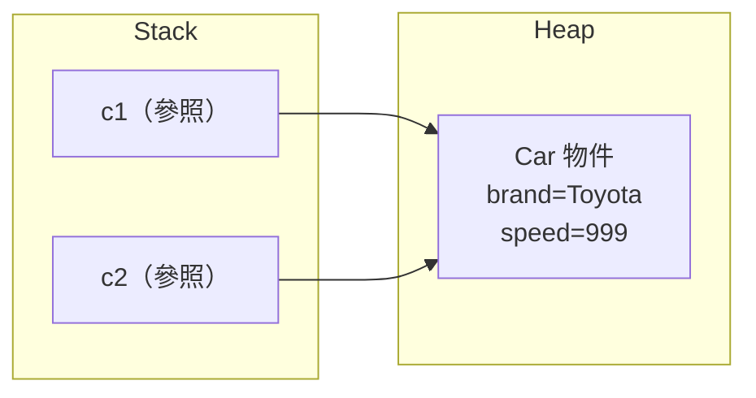
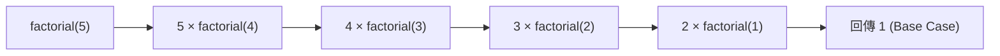
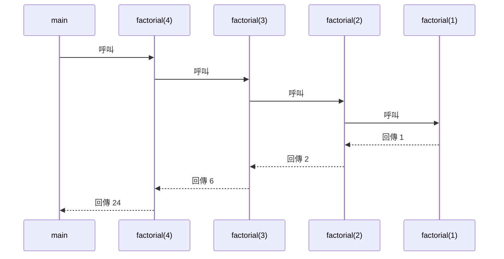
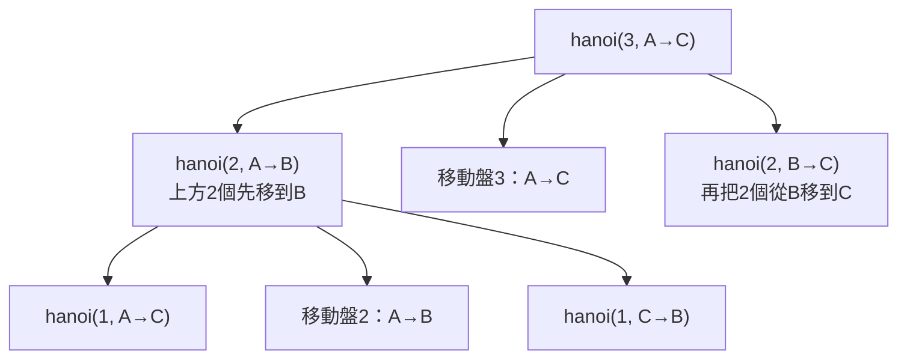

<div class="flex flex-col justify-center items-center h-full" style="background: #ffffff;">
  <p style="color: #5eada0; font-size: 1rem; font-weight: 600; letter-spacing: 0.2em; text-transform: uppercase; margin-bottom: 1.2rem;">Java Programming Masterclass</p>
  <h1 style="color: #1a5c5c; font-size: 3.4rem; font-weight: 900; line-height: 1.15; margin-bottom: 1.5rem;">類別與物件</h1>
  <div style="height: 4px; width: 320px; background: linear-gradient(90deg, #5eada0, #a7d9d0); border-radius: 2px; margin-bottom: 1.5rem;"></div>
  <p style="color: #4a7c7c; font-size: 1.15rem; font-style: italic;">「用類別定義世界，用物件描述個體」</p>
  <Link to="home" style="color: #9dc4c4; font-size: 0.85rem; margin-top: 2rem; text-decoration: none; letter-spacing: 0.05em;">← 返回目錄</Link>
</div>

<!--
大家好，這一章我們要學的是「類別與物件」，也就是物件導向程式設計的核心。

到目前為止，我們寫的程式都是一堆變數加上幾個方法。但想像一下，如果我們要寫一個管理一百台車的系統，每台車都有品牌、顏色、時速，光是變數就會多到管不動。

類別與物件，就是用來解決這個問題的。學完這一章，我們會自己設計類別、用它建立好幾個物件，還會寫出會呼叫自己的遞迴方法。
-->

---
layout: default
---

# Outline

- **認識物件與類別**：類別是藍圖、物件是實例
- **定義類別與物件**：class 語法、欄位、方法、new 建立物件
- **類別的基本實例**：完整 Car 類別範例
- **多個物件的應用**：物件陣列與遍歷
- **參照資料型態**：複製參照、null 參照
- **再談方法**：pass by value、多載、this 關鍵字
- **變數的有效範圍**：local vs instance scope
- **匿名陣列**：`new int[]{1,2,3}` 直接傳入方法
- **遞迴式方法**：base case、factorial
- **河內塔問題**：遞迴解法

<!--
這一章的內容不少，我們會從最基本的「類別和物件是什麼」開始，接著動手寫出一個 Car 類別，再看怎麼一次管理很多個物件。

中段會談參照型態和方法的進階用法，這是最多人踩坑的地方。最後我們用遞迴和河內塔，來練習「方法呼叫自己」這種思考方式。

【講師】這章概念密度高，可視情況分兩次上完，建議切在「再談方法」之後。
-->

---
layout: section
class: flex flex-col justify-center items-center text-center
---

# 認識物件與類別

<!--
那我們就從最基本的問題開始：到底什麼是類別，什麼是物件？
-->

---
layout: default
---

# 類別與物件的關係

物件導向程式設計（OOP）的核心思維：

| 概念 | 說明 | 現實比喻 |
| --- | --- | --- |
| **類別 (Class)** | 物件的藍圖／設計圖 | 汽車設計圖 |
| **物件 (Object)** | 類別建立出來的實例 | 根據設計圖製造的汽車 |
| **欄位 (Field)** | 物件的「狀態」（資料） | 顏色、品牌、時速 |
| **方法 (Method)** | 物件的「行為」（動作） | 加速、煞車、開燈 |

<div class="mt-4 p-3 bg-blue-50 border-l-4 border-blue-400 text-gray-700 text-sm text-left">
💡 <b>核心觀念：</b>同一張藍圖可以建造出多台汽車，每台都是獨立的物件，各自擁有不同的狀態（顏色、里程），但行為相同（方法共用）。
</div>

<!--
建築師在蓋房子之前，會先畫設計圖，寫清楚有幾個房間、客廳多大、窗戶開在哪裡。工人再照著這張圖，蓋出一棟一棟實際的房子。

類別和物件就是這個關係。「類別是設計圖，物件是照著設計圖做出來的東西。」

以車子來說，Car 類別規定了一台車有品牌、顏色、時速，也能加速、煞車。我們的 Toyota 是一個物件，同學的 Honda 是另一個物件，它們都照同一張設計圖做出來，但彼此獨立。

表格裡的欄位，就是物件的狀態，例如現在時速 80。方法，就是物件的行為，例如加速。每台車的狀態各自不同，但行為是共用的，方法只需要寫一次。
-->

---

# 現實世界比喻

以「學生」為例：

| 面向 | 類別 (Student) | 物件 (s1, s2) |
| --- | --- | --- |
| **是什麼** | 定義「學生」的設計圖 | 具體的某一位學生 |
| **欄位** | `name`, `id`, `grade` | s1: "小明", 1001, 90 |
| **方法** | `study()`, `getGrade()` | s1.study() 讓小明讀書 |

```java
// 類別 = 設計圖
class Student { ... }

// 物件 = 根據設計圖建立的實例
Student s1 = new Student();
Student s2 = new Student();
```

<!--
我們換一個更貼近大家的例子：學生。

全校每個學生都有學號、名字、成績，也都會讀書、考試。這些共同的特徵，就寫在 Student 這個類別裡。

但每個學生的資料又不一樣。小明的學號是 1001，成績 90 分；小華是另一個學號、另一個成績。他們就是兩個不同的物件。

看下面的程式碼，`new Student()` 就是「照著設計圖做出一個學生」。這裡呼叫了兩次 new，所以我們得到了 s1 和 s2 兩個獨立的物件。
-->

---
layout: section
class: flex flex-col justify-center items-center text-center
---

# 定義類別與物件

<!--
概念有了，接下來我們實際動手，看看在 Java 裡要怎麼寫出一個類別。
-->

---
layout: default
---

# class 語法結構

| 語法元素 | 說明 |
| --- | --- |
| `class 類別名稱` | 宣告類別（名稱首字大寫） |
| 欄位宣告 | 類別內的成員變數（instance variables） |
| 方法定義 | 類別內的行為描述 |
| `new 類別名稱()` | 建立物件實例，回傳參照 |

```java
class Car {
    String brand;   // 欄位：品牌
    int speed;      // 欄位：時速

    void accelerate() {   // 方法：加速
        speed += 10;
    }
}
```

<!--
寫一個類別，從 `class Car` 加上一對大括號開始，大括號裡面放兩種東西。

第一種是欄位，也就是資料。這裡的 brand 是品牌，speed 是時速。第二種是方法，也就是行為。這裡的 accelerate 代表加速，每呼叫一次，時速就加 10。

要注意，欄位寫在類別裡面、方法外面。如果寫進方法的大括號裡，它就變成只屬於那個方法的變數了。

另外，在命名上，類別名稱的第一個字母大寫，例如 Car、Student。欄位和方法則是第一個字母小寫。這不是編譯器的規定，但整個 Java 社群都這樣寫，我們也要從一開始就養成習慣。
-->

---

# 建立物件與存取成員

```java
// 宣告參照變數並建立物件
Car myCar = new Car();

// 透過「.」存取欄位
myCar.brand = "Toyota";
myCar.speed = 0;

// 透過「.」呼叫方法
myCar.accelerate();
System.out.println(myCar.speed); // 10
```

<div class="mt-4 p-3 bg-blue-50 border-l-4 border-blue-400 text-gray-700 text-sm text-left">
💡 <b>new 的作用：</b>在 Heap 記憶體中配置空間、將欄位初始化為預設值（數值為 0、boolean 為 false、物件為 null），並回傳該物件的參照（記憶體位址）。
</div>

<!--
類別寫好了，接著我們要用 new 把車子真的做出來。

第一行 `Car myCar = new Car()`，建立一台車，交給 myCar 這個變數。接下來用「點」來操作它：myCar 點 brand，就是這台車的品牌；myCar 點 accelerate，就是讓這台車加速。

時速從 0 加速一次，所以最後印出來的是 10。

下面的提醒值得多看一眼。new 會在記憶體裡挖一塊空間，把欄位設成預設值，數字是 0，布林值是 false，物件是 null，最後把這塊空間的位址交給我們。所以 myCar 裡面存的不是車子本身，而是車子的地址。這個觀念，等一下談參照型態的時候會非常重要。
-->

---
layout: section
class: flex flex-col justify-center items-center text-center
---

# 類別的基本實例

<!--
剛才的 Car 只有兩個欄位，接下來我們把它做得更完整一點。
-->

---
layout: default
---

# 完整 Car 類別（欄位 + 方法）

```java
class Car {
    String brand;
    String color;
    int speed;

    void accelerate(int amount) {
        speed += amount;
    }

    void displayInfo() {
        System.out.println(brand + " / " + color
            + " / 時速：" + speed + " km/h");
    }
}
```

<!--
這一版的 Car 有三個欄位：品牌、顏色和時速。

注意 accelerate 這個方法，這次括號裡多了一個參數 amount。原本每次固定加 10，現在可以由呼叫的人決定要加速多少，彈性就大多了。

另外我們多了一個 displayInfo 方法，把品牌、顏色和時速組成一句話印出來。讓物件自己負責「介紹自己」，在實際專案裡很常見，之後我們會學到更標準的寫法，叫做 toString。
-->

---

# 建立 Car 物件並操作

```java
public class Main {
    public static void main(String[] args) {
        Car c1 = new Car();
        c1.brand = "Toyota";
        c1.color = "紅色";
        c1.speed = 0;

        c1.accelerate(60);
        c1.displayInfo();
        // 輸出：Toyota / 紅色 / 時速：60 km/h
    }
}
```

<div class="mt-4 p-3 bg-blue-50 border-l-4 border-blue-400 text-gray-700 text-sm text-left">
💡 <b>慣例：</b>類別名稱使用 PascalCase（首字大寫），欄位與方法名稱使用 camelCase（首字小寫）。
</div>

<!--
有了完整的 Car 類別，我們在 main 裡面實際用用看。

先建立一台車 c1，設定成紅色的 Toyota，時速從 0 開始。接著呼叫 `c1.accelerate(60)`，讓它加速 60，再呼叫 displayInfo。

執行後會印出：Toyota、紅色、時速 60 公里。

到這裡，物件導向最基本的模式就出來了：用類別定義，用 new 建立，用點來操作。後面所有的內容，都建立在這個模式上。

【講師】可請學生自己加一個 brake 煞車方法，讓時速減少，當作隨堂小練習。
-->

---
layout: section
class: flex flex-col justify-center items-center text-center
---

# 類別含多個物件的應用

<!--
一張設計圖可以蓋很多棟房子，一個類別當然也能建立很多個物件。我們來看看要怎麼管理它們。
-->

---
layout: default
---

# 建立多個物件

每次呼叫 `new` 都會在記憶體中建立一個獨立的物件：

```java
Car c1 = new Car();
c1.brand = "Toyota";
c1.color = "紅色";
c1.speed = 80;

Car c2 = new Car();
c2.brand = "Honda";
c2.color = "白色";
c2.speed = 100;

c1.displayInfo(); // Toyota / 紅色 / 時速：80 km/h
c2.displayInfo(); // Honda / 白色 / 時速：100 km/h
```

<div class="mt-4 p-3 bg-blue-50 border-l-4 border-blue-400 text-gray-700 text-sm text-left">
💡 <b>獨立性：</b>c1 和 c2 是兩個獨立的物件，修改 c1 的欄位不會影響 c2。
</div>

<!--
每呼叫一次 new，就會建立一個全新的物件。

這裡我們建立了兩台車：c1 是時速 80 的紅色 Toyota，c2 是時速 100 的白色 Honda。分別呼叫 displayInfo，它們會各自印出自己的資料。

重點在下面這句：c1 和 c2 是兩個獨立的物件。就像雙胞胎長得很像，但終究是兩個人，修改 c1 的時速，c2 完全不受影響。
-->

---

# 物件陣列：宣告與初始化

| 步驟 | 說明 |
| --- | --- |
| 1. 宣告陣列 | `Car[] cars = new Car[3];` |
| 2. 建立每個物件 | `cars[0] = new Car();` |
| 3. 設定欄位 | `cars[0].brand = "Toyota";` |

```java
Car[] cars = new Car[3];

cars[0] = new Car();
cars[0].brand = "Toyota";
cars[0].speed = 80;

cars[1] = new Car();
cars[1].brand = "Honda";
cars[1].speed = 100;
```

<!--
那如果有一百台車呢？一台一台宣告變數實在太累了，這時候我們就需要「物件陣列」。

不過物件陣列有一個兩步驟的陷阱。第一步 `new Car[3]`，只是蓋好一個有三個停車格的停車場，每一格現在都還是空的，也就是 null。

第二步，要一格一格 `new Car()`，把車真的開進去，接著才能設定品牌和時速。

很多人只做了第一步，就直接去設定 `cars[0]` 的品牌，結果程式丟出 NullPointerException。原因很單純，停車格裡根本還沒有車。

【講師】可以現場把第二步註解掉，讓大家看錯誤訊息長什麼樣子。
-->

---

# 物件陣列遍歷

```java
Car[] cars = new Car[3];
// ... 初始化三台車 ...

for (int i = 0; i < cars.length; i++) {
    cars[i].displayInfo();
}

// 使用 for-each（更簡潔）
for (Car c : cars) {
    c.displayInfo();
}
```

<div class="mt-4 p-3 bg-blue-50 border-l-4 border-blue-400 text-gray-700 text-sm text-left">
💡 <b>注意：</b>宣告 <code>new Car[3]</code> 只是建立「放車的停車場」，每個停車格預設為 null。還需要逐一 <code>new Car()</code> 才算真正建立車輛物件。
</div>

<!--
車都停進停車場之後，要把每台車的資料印出來，用迴圈就很方便。

第一種寫法是一般的 for 迴圈，用索引 i 從 0 跑到陣列長度。第二種是 for-each，意思是「陣列裡的每一台車，都做一次」，不需要管索引，寫起來更簡潔。

在實際專案裡，只是要依序處理每個元素時，我們通常用 for-each；需要知道目前是第幾個的時候，才用一般的 for 迴圈。

最後再提醒一次下面這段：如果有哪一格沒有放車，迴圈跑到那一格就會出錯。
-->

---
layout: section
class: flex flex-col justify-center items-center text-center
---

# 類別的參照資料型態

<!--
接下來這個部分非常重要，也是初學者最容易搞混的地方：參照資料型態。
-->

---
layout: default
---

# 物件賦值 = 複製參照

物件變數儲存的是**記憶體位址（參照）**，不是物件本身：

```java
Car c1 = new Car();
c1.brand = "Toyota";
c1.speed = 80;

Car c2 = c1;  // c2 複製的是「位址」，不是物件
c2.speed = 999;

System.out.println(c1.speed); // 999（c1 也被改了！）
```

<div class="mt-4 p-3 bg-blue-50 border-l-4 border-blue-400 text-gray-700 text-sm text-left">
💡 <b>關鍵：</b>c1 和 c2 指向同一個物件。透過 c2 修改欄位，c1 看到的也會改變，因為它們是同一塊記憶體。
</div>

<!--
我們先來想一個問題。

c1 是一台時速 80 的 Toyota。接著寫 `c2 = c1`，再把 c2 的時速改成 999。這時候印出 c1 的時速，會是多少？

很多人會回答 80，但答案是 999。

原因是，`c2 = c1` 並不是複製一台新車，而是把 c1 存的地址抄一份給 c2。所以 c1 和 c2 指向的，其實是同一台車。透過 c2 改時速，c1 看到的當然也跟著變。

如果我們要的是一台真正獨立的車，就要再 new 一次，而不是用等號。

【講師】先讓學生猜答案再揭曉，效果比較好。
-->

---

# 參照賦值的記憶體圖解



`c2 = c1` 讓 c2 也指向同一個 Car 物件，任一方修改欄位，另一方都會感受到。

<!--
這張圖把剛才的狀況畫出來了。左邊是 Stack，放的是變數；右邊是 Heap，放的是物件。

我們看到 c1 和 c2 兩個變數，兩支箭頭都指向右邊同一個 Car 物件。

可以把 c1 和 c2 想像成兩張便利貼，上面都寫著同一個停車位的號碼。不管拿哪一張去找車，找到的都是同一台。

這就是參照型態的核心：「物件變數存的是地址，不是物件本身。」後面學到方法傳遞物件、集合這些內容時，都會一直用到這個觀念。
-->

---

# null 參照

| 狀態 | 說明 |
| --- | --- |
| `Car c = null;` | c 不指向任何物件 |
| `c.brand` | 拋出 `NullPointerException` |
| `c == null` | 判斷是否為 null 的安全寫法 |

```java
Car c = null;

if (c != null) {
    c.displayInfo();   // 安全
} else {
    System.out.println("尚未建立車輛");
}
```

<!--
那如果一張便利貼上什麼都沒寫呢？在 Java 裡，這就是 null。

`Car c = null` 代表 c 沒有指向任何物件。這時候如果去存取 c 的欄位，就像拿著空白便利貼去停車場找車，當然找不到，程式就會丟出 NullPointerException，大家常簡稱 NPE。

安全的做法是先檢查。像下面這段程式，先判斷 c 不等於 null，才呼叫 displayInfo，否則就印出「尚未建立車輛」。

NPE 是 Java 工程師最常遇到的錯誤之一，養成先檢查再使用的習慣，可以省下很多除錯的時間。
-->

---
layout: section
class: flex flex-col justify-center items-center text-center
---

# 再談方法

<!--
方法是物件的行為。接下來我們再深入看三件事：參數怎麼傳遞、方法多載，還有 this 關鍵字。
-->

---
layout: default
---

# 方法參數：Pass by Value（一）

Java 的方法參數傳遞**永遠是「複製值」**：

| 傳入型態 | 傳遞內容 | 方法內修改是否影響外部 |
| --- | --- | --- |
| 基本型態 (int/double) | 複製數值 | **否** |
| 物件參照 | 複製位址 | 修改欄位：**是**；重新賦值：**否** |

```java
static void addTen(int x) {
    x += 10;
}
int n = 5;
addTen(n);
System.out.println(n); // 5（不受影響）
```

<!--
Java 有一個規則，不管什麼情況都成立：「方法的參數，永遠是複製一份值傳進去。」

我們先看基本型態。addTen 這個方法，會把傳進來的 x 加上 10。外面的 n 是 5，呼叫 addTen 之後再印出 n，結果還是 5。

因為傳進去的是 n 的副本。就像我們把合約影印一份給別人，對方在影本上怎麼塗改，正本都不會變。

如果我們希望拿到加完的結果，就要讓方法用 return 把值回傳，再用變數接起來。
-->

---

# 方法參數：Pass by Value（二）

```java
static void changeSpeed(Car c) {
    c.speed = 999;   // 修改欄位：有影響
}

static void reassign(Car c) {
    c = new Car();   // 重新賦值：無影響
    c.speed = 0;
}

Car myCar = new Car();
myCar.speed = 80;

changeSpeed(myCar);
System.out.println(myCar.speed); // 999

reassign(myCar);
System.out.println(myCar.speed); // 999（未受影響）
```

<!--
那如果傳進去的是物件呢？規則一樣是複製，只是這次複製的是「地址」。

changeSpeed 拿到地址的副本，透過它把時速改成 999。因為地址指向的是同一台車，所以外面的 myCar 也看到 999。

但 reassign 不一樣。它在方法裡把 c 改指向一台新車，這只是換掉了副本上的地址，外面的 myCar 還是指著原本那台車，所以印出來仍然是 999。

這邊可以記一句話：「改欄位會影響外面，換地址不會。」

【講師】這頁是本章最難的觀念之一，建議畫便利貼和停車位的圖輔助說明。
-->

---

# 方法多載（Overloading）

| 規則 | 說明 |
| --- | --- |
| 方法名稱相同 | 多個方法共用同一名稱 |
| 參數**數量**不同 | 可區分為不同方法 |
| 參數**型別**不同 | 可區分為不同方法 |
| 僅回傳型別不同 | **不算**多載，編譯錯誤 |

```java
class Multiplier {
    int multiply(int a, int b) { return a * b; }
    int multiply(int a, int b, int c) { return a * b * c; }
    double multiply(double a, double b) { return a * b; }
}
```

<!--
有時候，我們希望同一個動作可以接受不同的資料。例如「相乘」，可能是兩個整數、三個整數，或是兩個小數。

Java 允許好幾個方法用同一個名字，只要參數不同就好，這就叫做「方法多載」。

看 Multiplier 類別，三個方法都叫 multiply，差別在參數的數量和型別。呼叫的時候，Java 會根據我們傳進去的參數，自動挑出對應的版本。

要注意的是，如果兩個方法只有回傳型別不同，那不算多載，會編譯錯誤。因為光看呼叫的那一行，Java 沒辦法判斷我們要哪一個。

其實我們早就在用多載了，System.out.println 可以印整數、小數、字串，就是好幾個同名、但參數不同的方法。
-->

---

# this 關鍵字

`this` 代表「目前這個物件自己」，主要用途：

| 用途 | 說明 |
| --- | --- |
| 區分同名變數 | `this.brand` vs 參數 `brand` |
| 呼叫其他建構子 | `this(...)` |

```java
class Car {
    String brand;
    int speed;

    Car(String brand, int speed) {
        this.brand = brand;  // this.brand = 欄位
        this.speed = speed;  // speed = 參數
    }
}
```

<!--
最後一個主題是 this。this 的意思很單純，就是「目前這個物件自己」。

它最常出現在建構子裡。建構子是 new 物件時會自動執行的方法，下一章會詳細介紹。

看這段程式，建構子的參數叫 brand，欄位也叫 brand。如果直接寫 `brand = brand`，Java 會以為兩邊都是參數，欄位根本沒被設定到。

加上 this 就清楚了：`this.brand` 指的是這個物件的欄位，等號右邊的 brand 是參數。

表格裡還提到另一個用法：用 this 加上括號，可以呼叫同一個類別的其他建構子，這個我們下一章再看。
-->

---
layout: section
class: flex flex-col justify-center items-center text-center
---

# 變數的有效範圍

<!--
剛才講到參數和欄位同名的問題，這其實跟變數的有效範圍有關。我們來看看變數在哪裡看得到、在哪裡看不到。
-->

---
layout: default
---

# Local vs Instance 變數

| 變數類型 | 宣告位置 | 生命週期 | 預設值 |
| --- | --- | --- | --- |
| **Instance 變數** | 類別內、方法外 | 物件存在期間 | 有（0/false/null） |
| **Local 變數** | 方法或區塊內 | 方法執行期間 | **無（必須手動初始化）** |

```java
class Counter {
    int count = 0;   // instance 變數

    void increment() {
        int step = 1;  // local 變數
        count += step;
    }
    // step 在此處無法存取
}
```

<!--
變數依照宣告的位置，分成兩種。

寫在類別裡、方法外面的，叫做實例變數，英文是 instance variable。只要物件還在，它就一直存在，而且有預設值。

寫在方法或區塊裡面的，叫做區域變數，英文是 local variable。方法執行完，它就消失了，而且沒有預設值。

看 Counter 這個例子，count 寫在方法外面，整個物件都看得到。step 寫在 increment 方法裡，只有這個方法看得到，方法結束後就不存在了。

要特別注意，區域變數一定要先給值才能使用，Java 不會自動幫它設成 0，沒給值的話編譯就會失敗。
-->

---

# Scope 遮蔽（Shadowing）

當 local 變數與 instance 變數同名時，local 會遮蔽 instance：

```java
class Car {
    int speed = 100;  // instance 變數

    void setSpeed(int speed) {
        // 這裡的 speed 是參數（local）
        // 需用 this.speed 才能存取 instance 變數
        this.speed = speed;
    }
}
```

<div class="mt-4 p-3 bg-blue-50 border-l-4 border-blue-400 text-gray-700 text-sm text-left">
💡 <b>最佳實踐：</b>建構子或 setter 方法的參數名稱常與欄位同名，此時必須使用 <code>this.欄位名稱</code> 明確指定 instance 變數。
</div>

<!--
當區域變數和實例變數同名時，會發生一件事，叫做「遮蔽」，英文是 Shadowing。意思是區域變數會把實例變數蓋住。

看 setSpeed 這個方法，參數叫 speed，欄位也叫 speed。在方法裡直接寫 speed，指的是參數。如果要指的是欄位，就要寫 `this.speed`。

最容易出錯的情況，是忘了加 this，寫成 `speed = speed`。這行程式不會報錯，但欄位根本沒有被改到，是很難發現的 bug。

在實際專案裡，建構子和 setter 的參數通常就取跟欄位一樣的名字，再用 this 區分，所以這個寫法我們一定要熟悉。
-->

---
layout: section
class: flex flex-col justify-center items-center text-center
---

# 匿名陣列

<!--
接下來是一個簡短但實用的小技巧：有時候一個陣列只會用一次，那我們何必幫它取名字呢？
-->

---
layout: default
---

# 匿名陣列（Anonymous Array）

| 概念 | 說明 |
| --- | --- |
| 定義 | 沒有名稱的陣列，建立後立即使用 |
| 語法 | `new 型別[]{ 值1, 值2, ... }` |
| 用途 | 直接傳入方法，不需暫存變數 |

```java
// 一般寫法（有名稱）
int[] nums = {1, 2, 3};
printSum(nums);

// 匿名陣列（直接傳入）
printSum(new int[]{1, 2, 3});
```

<!--
先看一般的寫法：宣告一個陣列變數 nums，放進 1、2、3，再把它傳給 printSum。

如果這個陣列傳進去之後就不會再用到，幫它取名字就有點多餘。匿名陣列的寫法是 `new int[]{1, 2, 3}`，在呼叫方法的地方直接建立陣列、直接傳進去。

語法上要注意兩件事。第一，方括號裡不寫長度，長度由大括號裡有幾個值決定。第二，前面的 `new int[]` 不能省略。只寫一對大括號的簡寫，只能用在宣告變數的時候。
-->

---

# 匿名陣列範例

```java
static void printSum(int[] arr) {
    int total = 0;
    for (int n : arr) total += n;
    System.out.println("總和：" + total);
}

public static void main(String[] args) {
    // 直接傳入，不需宣告暫存變數
    printSum(new int[]{10, 20, 30});
    // 輸出：總和：60
}
```

<div class="mt-4 p-3 bg-blue-50 border-l-4 border-blue-400 text-gray-700 text-sm text-left">
💡 <b>適用時機：</b>當陣列只需使用一次，不需要在後續程式中再度存取時，使用匿名陣列可讓程式碼更簡潔。
</div>

<!--
我們看一個完整的例子。

printSum 這個方法接收一個整數陣列，用 for-each 把每個數字加起來，最後印出總和。

在 main 裡面，我們直接傳入 `new int[]{10, 20, 30}`，不需要先宣告變數。執行後會印出：總和 60。

所以當一個陣列只需要用一次、之後不會再存取時，用匿名陣列可以少一個多餘的變數，讓程式更簡潔。
-->

---
layout: section
class: flex flex-col justify-center items-center text-center
---

# 遞迴式方法設計

<!--
接下來，我們要進入這一章的重頭戲：遞迴。第一次接觸可能會覺得有點繞，我們一步一步來。
-->

---
layout: default
---

# 遞迴的基本概念

| 元素 | 說明 |
| --- | --- |
| **Base Case（終止條件）** | 不再遞迴、直接回傳結果 |
| **Recursive Case（遞迴步驟）** | 呼叫自己，並縮小問題規模 |
| **Call Stack（呼叫堆疊）** | 每次呼叫都會在 stack 新增一層 |

<div class="mt-4 p-3 bg-blue-50 border-l-4 border-blue-400 text-gray-700 text-sm text-left">
💡 <b>關鍵規則：</b>遞迴必須保證每次呼叫都「往 Base Case 靠近」，否則會無限遞迴，最終拋出 <code>StackOverflowError</code>。
</div>

<!--
大家玩過俄羅斯套娃嗎？大娃娃裡有中娃娃，中娃娃裡有小娃娃，一直打開，直到最小的那一個，裡面沒有東西了，就停下來。

遞迴就是這樣的概念：「方法呼叫自己，但每次把問題縮小一點，直到遇到終止條件就停下來。」

所以遞迴一定要有兩個部分。第一是終止條件，英文叫 Base Case，也就是最小的那個娃娃，遇到它就直接回傳答案。第二是遞迴步驟，呼叫自己，而且問題規模要變小。

每次呼叫方法，Java 都會在呼叫堆疊上疊一層紀錄。如果沒有終止條件，或是問題沒有變小，就會無限疊下去，最後堆疊放不下，丟出 StackOverflowError。
-->

---

# Factorial 階乘範例

```java
static int factorial(int n) {
    if (n <= 1) return 1;       // Base Case
    return n * factorial(n - 1); // Recursive Case
}

System.out.println(factorial(5)); // 120
```

呼叫堆疊展開示意：



<!--
最經典的遞迴範例是階乘。5 的階乘，就是 5 乘 4 乘 3 乘 2 乘 1，等於 120。

看程式碼，第一行是終止條件：如果 n 小於等於 1，就直接回傳 1。第二行是遞迴步驟：回傳 n 乘上 `factorial(n - 1)`。

所以 factorial 5 等於 5 乘 factorial 4，factorial 4 又等於 4 乘 factorial 3，一路往下，直到 factorial 1 回傳 1。下面的圖就是這個一路往下問的過程。

要注意 n 減 1 這個地方，它確保問題每次都在縮小。如果不小心寫成 n，程式就會無限呼叫下去。
-->

---

# 遞迴呼叫堆疊展開

以 `factorial(4)` 為例，呼叫與回傳過程：



<!--
這張圖把 factorial 4 的完整過程畫了出來，我們從左上角開始看。

main 呼叫 factorial 4，它再呼叫 factorial 3，接著是 factorial 2，最後是 factorial 1。

factorial 1 是終止條件，直接回傳 1。factorial 2 拿到 1，算出 2 乘 1 等於 2，再往上回傳。factorial 3 算出 3 乘 2 等於 6，factorial 4 算出 4 乘 6 等於 24，最後把 24 交回給 main。

整個過程是「先一路往下呼叫，再一路往上回傳」。理解了這個來回，遞迴就懂了一大半。
-->

---
layout: section
class: flex flex-col justify-center items-center text-center
---

# 河內塔問題

<!--
學會了遞迴，我們來挑戰它最經典的題目：河內塔。這題看起來很難，但用遞迴來想，其實很簡潔。
-->

---
layout: default
---

# 河內塔問題說明

| 規則 | 說明 |
| --- | --- |
| 三根柱子 | 起點（A）、中轉（B）、終點（C） |
| n 個圓盤 | 從大到小疊放在 A 上 |
| 目標 | 將所有圓盤移到 C |
| 限制 | 大盤不可壓在小盤上 |

<!--
河內塔的規則是這樣的：有三根柱子，A 是起點，B 是中轉，C 是終點。A 上面疊著好幾個圓盤，由大到小往上疊。

我們的目標，是把所有圓盤都移到 C。限制是一次只能移一個盤子，而且大盤子不能壓在小盤子上面。

大家可以先想想看，如果只有三個盤子，最少要移幾次？答案等一下揭曉。

【講師】可以給 30 秒讓大家在紙上畫畫看。
-->

---

# 河內塔遞迴程式

```java
static void hanoi(int n, char from, char aux, char to) {
    if (n == 1) {
        System.out.println("移動盤 1：" + from + " → " + to);
        return;
    }
    hanoi(n - 1, from, to, aux);
    System.out.println("移動盤 " + n + "：" + from + " → " + to);
    hanoi(n - 1, aux, from, to);
}
```

<!--
用遞迴的方式來想，不管有幾個盤子，都只要三個步驟。

第一，把上面 n 減 1 個盤子，從 A 搬到 B。第二，把最大的那個盤子，從 A 直接搬到 C。第三，再把剛才那 n 減 1 個盤子，從 B 搬到 C。至於只剩一個盤子的時候，直接搬過去就好，這就是終止條件。

程式碼完全照著這個想法寫：n 等於 1 時直接印出移動方式；否則先呼叫一次 hanoi 搬上面的盤子，印出最大盤子的移動，再呼叫一次 hanoi 把盤子搬到終點。

兩次遞迴呼叫時，柱子參數的順序不一樣，這是最容易抄錯的地方，記得對照剛才的三個步驟來看。
-->

---

# 河內塔遞迴邏輯

以 n=3 為例，遞迴思維：



<div class="mt-4 p-3 bg-blue-50 border-l-4 border-blue-400 text-gray-700 text-sm text-left">
💡 <b>移動次數：</b>n 個盤子需要 2ⁿ - 1 次移動。n=3 需 7 次，n=10 需 1023 次。
</div>

<!--
這張圖是三個盤子時的拆解過程，我們從上往下看。

最上面是要把三個盤子從 A 搬到 C，它被拆成三件事：先把上面兩個盤子搬到 B，再把第三個盤子從 A 搬到 C，最後把那兩個盤子從 B 搬到 C。

而「搬兩個盤子」這件事，又可以用同樣的方式往下拆。每一層都只處理自己那一小塊，就像主管把任務分給組長，組長再分給組員。

下面也整理了移動次數的規律：n 個盤子需要 2 的 n 次方減 1 次。三個盤子要 7 次，十個盤子就要 1023 次。
-->

---

# 執行 hanoi(3) 的輸出

```java
hanoi(3, 'A', 'B', 'C');
```

輸出結果：
```
移動盤 1：A → C
移動盤 2：A → B
移動盤 1：C → B
移動盤 3：A → C
移動盤 1：B → A
移動盤 2：B → C
移動盤 1：A → C
```

共 7 次（2³ - 1 = 7）

<!--
我們實際執行三個盤子的河內塔，看看輸出結果。

總共 7 行，也就是 7 步，剛才的問題答案就是 7。大家可以拿紙畫三根柱子，照著輸出一步一步移動，會發現每一步都符合規則。

7 步聽起來不多，但如果是 64 個盤子，就需要 2 的 64 次方減 1 步。就算一秒移一步，也要好幾千億年才搬得完。

這也提醒我們，有些遞迴的計算量會隨著 n 快速暴增，寫遞迴之前，要先想想資料量有多大。
-->

---
layout: section
class: flex flex-col justify-center items-center text-center
---

# 練習題

<!--
理論的部分到這裡告一段落，接下來我們用兩題練習，把這一章學到的東西實際寫寫看。
-->

---
layout: default
---

# 練習一：設計 BankAccount 類別
### 任務說明

設計一個 `BankAccount` 類別，包含：

- 欄位：`String owner`（戶主姓名）、`double balance`（餘額）
- 方法：
  - `deposit(double amount)` — 存款，餘額增加
  - `withdraw(double amount)` — 提款，餘額不足時印出警告
  - `displayInfo()` — 印出戶主與餘額

在 `main` 方法中建立兩個帳戶物件，各別進行存款、提款後印出結果。

<!--
第一題，我們要設計一個銀行帳戶類別 BankAccount。

它有兩個欄位：戶主姓名 owner 和餘額 balance。還有三個方法：存款 deposit、提款 withdraw，以及顯示資訊 displayInfo。

寫的時候想一想：如果帳戶裡只有 100 元，卻要提領 500 元，程式應該怎麼處理？

最後在 main 裡建立兩個帳戶，各自存款、提款，觀察兩個帳戶的餘額是不是互不影響。

我們先暫停一下，自己動手寫寫看。

【講師】給學生約 10 分鐘實作，再進入提示頁。
-->

---
layout: default
---

# 練習一：解題提示
### 提示說明

1. 先定義類別與欄位：`class BankAccount { String owner; double balance; ... }`
2. `deposit` 方法：`balance += amount;`
3. `withdraw` 方法：加入 `if (balance >= amount)` 判斷再扣款
4. `displayInfo` 方法：`System.out.println(owner + " 餘額：" + balance);`
5. 在 main 中：
   ```java
   BankAccount a1 = new BankAccount();
   a1.owner = "小明";
   a1.balance = 1000;
   a1.deposit(500);
   a1.withdraw(300);
   a1.displayInfo();
   ```

<!--
我們來看提示。

存款很單純，把餘額加上金額就好。重點在提款：要先判斷餘額夠不夠，夠才扣款，不夠就印出「餘額不足」。這種先檢查、再操作的寫法，在實務上非常重要，真實的銀行系統雖然複雜得多，但核心邏輯是一樣的。

照提示裡的例子，小明的帳戶一開始有 1000 元，存 500、領 300，最後印出的餘額應該是 1200。

另外補充一點，實際的金融系統不會用 double 來存金額，因為小數運算會有誤差，而是改用 BigDecimal。我們今天練習用 double 就可以了。
-->

---
layout: default
---

# 練習二：多載計算機
### 任務說明

設計一個 `Calculator` 類別，對 `add` 方法進行**多載**：

- `add(int a, int b)` — 兩整數相加
- `add(int a, int b, int c)` — 三整數相加
- `add(double a, double b)` — 兩浮點數相加

在 `main` 中分別呼叫三種版本，並觀察 Java 如何根據參數自動選擇正確的方法。

<!--
第二題，我們來練習方法多載。

請設計一個 Calculator 類別，讓 add 方法有三個版本：兩個整數相加、三個整數相加，以及兩個小數相加。

寫好之後，在 main 裡分別呼叫這三個版本，觀察 Java 怎麼根據我們傳進去的參數，自動選出正確的方法。

一樣先暫停一下，自己動手試試看。

【講師】給學生約 5 分鐘實作。
-->

---
layout: default
---

# 練習二：解題提示
### 提示說明

1. 在同一個類別中定義三個名稱都叫 `add` 的方法，只需讓參數不同：
   ```java
   int add(int a, int b) { return a + b; }
   int add(int a, int b, int c) { return a + b + c; }
   double add(double a, double b) { return a + b; }
   ```
2. 在 main 中呼叫時，Java 編譯器會依照傳入的參數**型別與數量**自動挑選對應的方法
3. 嘗試呼叫 `add(1, 2)`、`add(1, 2, 3)`、`add(1.5, 2.5)` 並印出結果
4. 思考：如果只有 `int` 版本而呼叫 `add(1.5, 2.5)` 會發生什麼？

<!--
提示其實很簡單：在同一個類別裡，寫三個都叫 add 的方法，只要參數的數量或型別不同就可以了。

呼叫 `add(1, 2)` 會用兩個整數的版本，`add(1, 2, 3)` 會用三個整數的版本，`add(1.5, 2.5)` 則會用小數的版本。

最後來回答提示裡的思考題：如果只有整數版本，卻呼叫 `add(1.5, 2.5)`，會發生什麼事？

答案是編譯錯誤。Java 不會自動把 double 轉成 int，因為這樣會遺失小數部分。這種可能遺失資料的轉換，Java 一定要我們自己明確寫出來。
-->

---
layout: section
class: flex flex-col justify-center items-center text-center
---

# Q & A

有任何問題歡迎提出！

<!--
這一章的內容很多，我們快速回顧一下重點。

第一，類別是設計圖，物件是用 new 建立出來的實體。第二，物件變數存的是地址，用等號只會複製地址。第三，參數傳遞永遠是複製值，改欄位會影響外面，換地址不會。第四，遞迴要有終止條件，而且每次都要讓問題變小。

如果覺得腦袋有點滿，這很正常。建議大家把這章的程式碼自己手打一遍，不要複製貼上，打的過程會發現很多細節。遞迴尤其需要時間消化，多看幾次就會通了。

我們下一章見。

【講師】開放 Q&A，可以先問大家遞迴的部分有沒有卡住。
-->
