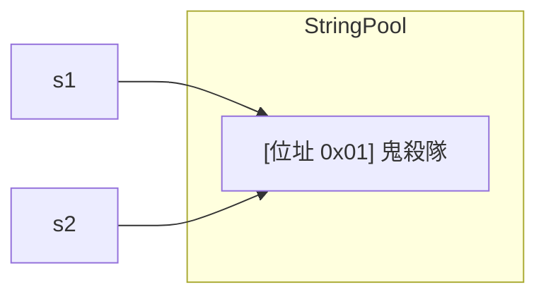
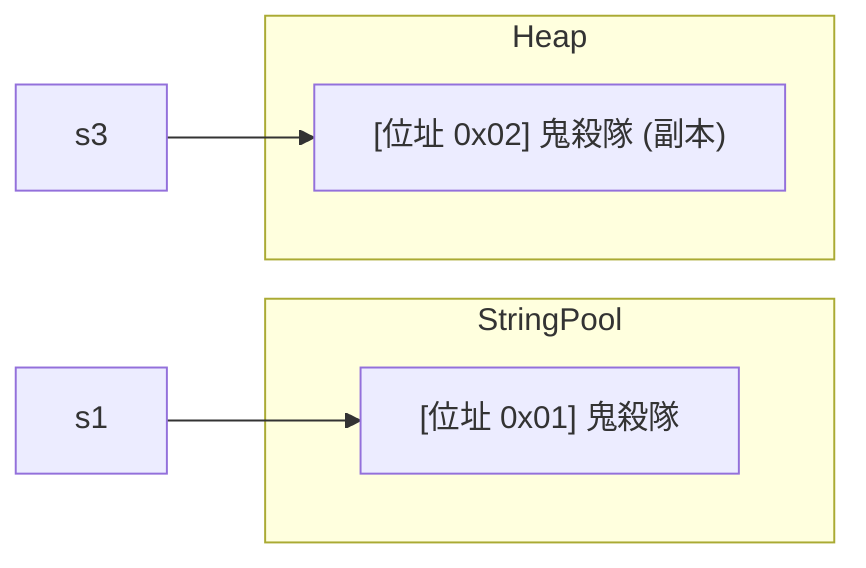
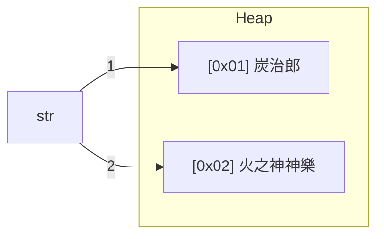
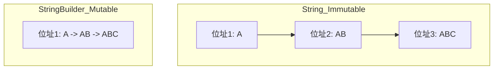

<div class="flex flex-col justify-center items-center h-full" style="background: #ffffff;">
  <p style="color: #5eada0; font-size: 1rem; font-weight: 600; letter-spacing: 0.2em; text-transform: uppercase; margin-bottom: 1.2rem;">Java Programming Masterclass</p>
  <h1 style="color: #1a5c5c; font-size: 3.8rem; font-weight: 900; line-height: 1.15; margin-bottom: 1.5rem;">字元與字串類別</h1>
  <div style="height: 4px; width: 320px; background: linear-gradient(90deg, #5eada0, #a7d9d0); border-radius: 2px; margin-bottom: 1.5rem;"></div>
  <p style="color: #4a7c7c; font-size: 1.15rem; font-style: italic;">
    「掌握 Java 呼吸法：全面解析 Character 與 String」
  </p>
  <Link to="home" style="color: #9dc4c4; font-size: 0.85rem; margin-top: 2rem; text-decoration: none; letter-spacing: 0.05em;">← 返回目錄</Link>
</div>

<!--
大家好，這一章的主題是字元與字串類別。

不管是使用者輸入的帳號、網頁上的文章，還是要輸出的報表，程式處理的資料裡，文字佔了非常大的比例。檢查格式、搜尋關鍵字、取代內容、切割資料，這些都是每天會遇到的工作。

學完這一章，我們就能熟練地使用 Character 和 String 類別的方法，也知道什麼時候該改用 StringBuilder 來提升效能。
-->

---
layout: default
---

# Outline

- **字元 Character 類別**
- **字串的建立與記憶體觀念**
- **String 類別的方法 (搜尋、擷取、取代、比較、格式化)**
- **StringBuffer 與 StringBuilder 類別**
- **實作練習與邏輯挑戰**

<!--
這一章分成四個部分。

第一部分是 Character 類別，處理單一字元的判斷和轉換。第二部分看字串的建立方式，以及字串在記憶體裡的運作。第三部分是這一章的重點，String 類別的各種方法，包括搜尋、擷取、取代、比較和格式化。第四部分是 StringBuffer 和 StringBuilder。中間穿插了幾題練習。
-->

---
layout: section
class: flex flex-col justify-center items-center text-center
---

# 字元 Character 類別

<!--
我們先從最小的單位開始：單一的字元，以及處理字元的 Character 類別。
-->

---
layout: default
---

# 字元類別方法 (一)
### 常用判斷方法

| 方法名稱 | 說明 |
| --- | --- |
| `isDigit(char ch)` | 是否為數字字元 (0-9) |
| `isLetter(char ch)` | 是否為字母字元 (包含中文) |
| `isLetterOrDigit(char ch)` | 是否為數字或字母字元 |
| `isLowerCase(char ch)` | 是否為小寫字母字元 |
| `isUpperCase(char ch)` | 是否為大寫字母字元 |

<!--
Character 類別提供了一組判斷字元種類的靜態方法，回傳 true 或 false。

isDigit 判斷是不是數字字元，也就是 0 到 9。isLetter 判斷是不是字母，要注意它也包含中文字。isLetterOrDigit 判斷是不是字母或數字。isLowerCase 和 isUpperCase 則分別判斷是不是小寫和大寫字母。

這些方法在檢查密碼強度、驗證輸入格式時，非常常用。
-->

---
layout: full
class: px-8
---

# 字元類別方法 (一) — 範例

```java
char c1 = '9';
char c2 = 'A';
char c3 = '炭'; // 中文字元

System.out.println(Character.isDigit(c1)); // true
System.out.println(Character.isLetter(c3)); // true (中文也算字母)
System.out.println(Character.isUpperCase(c2)); // true
System.out.println(Character.isLetterOrDigit(c1)); // true
```

<!--
我們看實際的結果。

c1 是字元 9，所以 isDigit 是 true。c3 是中文字「炭」，isLetter 一樣是 true，因為 Java 的字母判斷是以 Unicode 為準，中文字也算是字母。c2 是大寫的 A，isUpperCase 是 true。最後，9 是數字，所以 isLetterOrDigit 也是 true。
-->

---

# 字元類別方法補充：isAlphabetic / isWhitespace

| 方法名稱 | 說明 |
| --- | --- |
| `isAlphabetic(int codePoint)` | 是否為 Unicode 字母字元（比 `isLetter` 涵蓋更廣）|
| `isWhitespace(char ch)` | 是否為 Java 定義的空白（含 `\t`、`\n`、`\r` 等控制字元）|
| `isSpaceChar(char ch)` | 是否為 Unicode 空格字元（**不含** Tab、換行等控制字元）|

```java
System.out.println(Character.isAlphabetic('A'));   // true
System.out.println(Character.isAlphabetic('炭'));  // true
System.out.println(Character.isWhitespace('\t'));  // true
System.out.println(Character.isSpaceChar('\t'));   // false
```

<!--
這一頁補充三個方法。

isAlphabetic 也是判斷字母，但涵蓋的 Unicode 範圍比 isLetter 更廣。isWhitespace 判斷是不是 Java 定義的空白，包括空格、Tab 和換行。isSpaceChar 則只判斷 Unicode 定義的空格字元，不包含 Tab、換行這類控制字元。

所以看範例最後兩行，Tab 用 isWhitespace 判斷是 true，用 isSpaceChar 判斷卻是 false，兩者的範圍不一樣。
-->

---

# 字元類別方法 (二)
### 轉換與特殊判斷

| 方法名稱 | 說明 |
| --- | --- |
| `toLowerCase(char ch)` | 將字元轉成小寫 |
| `toUpperCase(char ch)` | 將字元轉成大寫 |
| `isSpaceChar(char ch)` | 是否為 Unicode 的空白字元 |
| `isISOControl(char ch)` | 是否為 ISO 控制字元 |

```java
System.out.println(Character.toLowerCase('A'));    // 'a'
System.out.println(Character.toUpperCase('z'));    // 'Z'

char fullWidthSpace = '\u3000'; // 全型空白
System.out.println(Character.isSpaceChar(fullWidthSpace)); // true
```

<!--
Character 也提供了轉換方法。toLowerCase 把字元轉成小寫，toUpperCase 轉成大寫，所以大寫 A 會變成小寫 a，小寫 z 會變成大寫 Z。

表格裡還有 isSpaceChar 和 isISOControl。範例最後用 isSpaceChar 判斷全形空白，結果是 true。全形空白在中文輸入時很常出現，看起來和一般空格差不多，但它是不同的字元，處理使用者輸入時要特別注意。
-->

---

# 跳脫字元 (Escape Character)

控制字元（如換行、Tab）可以使用 `isISOControl()` 測試：

```java
char ch1 = '\n'; // 換行符號（Enter 鍵效果）
char ch2 = '\t'; // 水平 Tab 符號（Tab 鍵效果）

System.out.println("\\n 是控制字元：" + Character.isISOControl(ch1)); 
System.out.println("\\t 是控制字元：" + Character.isISOControl(ch2));
```

<div class="mt-4 p-3 bg-blue-50 border-l-4 border-blue-400 text-gray-700 text-sm text-left">
💡 <b>常見跳脫字元：</b> <code>\n</code> 換行、<code>\t</code> Tab、<code>\\</code> 反斜線、<code>\"</code> 雙引號、<code>\'</code> 單引號；兩行皆輸出 <code>true</code>。
</div>

<!--
有些字元沒辦法直接打在程式碼裡，例如換行和 Tab。這時候要用跳脫字元，也就是反斜線加上一個字母。

反斜線 n 代表換行，反斜線 t 代表 Tab。用 isISOControl 檢查，這兩個都是控制字元，所以兩行都會印出 true。

注意程式裡印出文字的部分寫了兩個反斜線，因為要印出反斜線本身，也需要跳脫。下面整理了常見的跳脫字元：換行、Tab、反斜線、雙引號和單引號。
-->

---
layout: section
class: flex flex-col justify-center items-center text-center
---

# 字串的建立

<!--
認識了字元之後，我們來看字串。先從字串的建立方式，以及它在記憶體裡的運作開始。
-->

---
layout: default
---

# 基本字串型態宣告

只要在內容前後加上雙引號即為字串物件。

```java
String hero = "炭治郎"; // hero 是字串變數
```

<div class="mt-6">

### 常用建構方法 (Constructor)

| 建構方法 | 說明 |
| --- | --- |
| `String()` | 建立一個空字串 |
| `String(char[] data)` | 由字元陣列組成字串 |
| `String(String original)` | **建立副本 (新位址)** |
| `String(StringBuffer buf)` | 由 StringBuffer 建立 |

</div>

<!--
最常見的建立方式，就是用雙引號把內容包起來，例如這裡的 hero 等於炭治郎。

String 也是類別，所以也可以用建構子建立。表格列出了常用的幾種：不帶參數會建立空字串；傳入字元陣列，可以把字元組成字串；傳入另一個字串，會建立一個副本，放在新的記憶體位置；也可以從 StringBuffer 建立。
-->

---

# 建構方法 — 範例

```java
String s1 = new String();                      // 空字串 ""
char[] chars = {'炭', '治', '郎'};
String s2 = new String(chars);                 // "炭治郎"
String s3 = new String("炭治郎");              // 建立副本（新位址）
StringBuffer sb = new StringBuffer("炭治郎");
String s4 = new String(sb);                    // "炭治郎"
```

<!--
我們看建構子的實際寫法。

s1 是空字串。s2 把炭、治、郎三個字元組成字串。s3 用 new 建立一個內容是炭治郎的新字串。s4 則是從 StringBuffer 轉換而來。

實際開發中，最常用的還是直接用雙引號宣告，s3 這種 new String 的寫法很少需要，等一下我們就會看到它在記憶體上的差別。
-->

---

# Text Blocks（多行字串）

以三個雙引號 `"""` 開頭並**換行**，結尾加 `"""`，省去字串拼接與跳脫：

```java
// 傳統字串（需加 \n）
String msg = "Hello\n鬼殺隊\nGoodbye";

// Text Block（直覺可讀）
String tb = """
            Hello
            鬼殺隊
            Goodbye
            """;
```

<div class="mt-4 p-3 bg-blue-50 border-l-4 border-blue-400 text-gray-700 text-sm text-left">
💡 Text Blocks（Java 15+）的型別仍是 <code>String</code>，所有 String 方法都可使用。各行（含結尾 <code>"""</code>）共同的前置縮排會被自動移除。
</div>

<!--
如果字串的內容有好幾行，傳統寫法要在中間加上反斜線 n，閱讀起來很不方便。

Java 15 開始提供 Text Blocks，用三個雙引號開頭並換行，最後再用三個雙引號結尾。中間的內容怎麼排，字串就長怎麼樣，不需要加換行符號，也不需要跳脫雙引號。

Text Block 的型別仍然是 String，所有字串方法都能使用。另外，每一行共同的前置縮排會被自動移除，所以可以放心地讓它跟著程式碼縮排。
-->

---

# indent( )

| 方法名稱 | 說明 |
| --- | --- |
| `indent(int n)` | n > 0 每行開頭加 n 個空白；n < 0 移除每行開頭最多 \|n\| 個空白；自動補上換行 |

```java
String text = "炭治郎\n禰豆子";

String moved = text.indent(4);      // n > 0：加縮排
System.out.print(moved);            // "    炭治郎\n    禰豆子\n"

System.out.print(moved.indent(-2)); // n < 0：移除縮排
                                    // "  炭治郎\n  禰豆子\n"
```

<!--
indent 方法可以調整每一行的縮排。

參數是正數時，每一行開頭會加上指定數量的空白；是負數時，則會移除每一行開頭最多那麼多個空白。另外，它會自動在最後補上換行。

看範例，text 有兩行，indent 4 之後，每行前面都多了四個空白。再對結果 indent 負 2，就移除兩個空白，剩下兩格縮排。
-->

---

# 記憶體觀念：字串池 (String Pool)

直接使用雙引號宣告時，Java 會優先檢查字串池：

```java
String s1 = "鬼殺隊";
String s2 = "鬼殺隊";
System.out.println(s1 == s2); // true
```

<div class="flex justify-center mt-4">

</div>

<!--
接下來是字串在記憶體裡的運作。

用雙引號宣告字串時，Java 會先到一個叫做字串池的地方檢查，有沒有內容相同的字串。如果有，就直接使用那一個，不會再建立新的。

所以看範例，s1 和 s2 都是鬼殺隊，它們指向的是字串池裡同一個物件，用兩個等號比較，結果是 true。下面的圖就畫出了 s1 和 s2 都指向同一個位址。
-->

---

# 記憶體觀念：使用 new 建立副本

使用 `new` 關鍵字會在 Heap 區建立一個獨立的新物件位址：

```java
String s1 = "鬼殺隊";
String s3 = new String("鬼殺隊");
System.out.println(s1 == s3); // false
System.out.println(s1.equals(s3)); // true
```

<div class="flex justify-center mt-4">

</div>

<!--
如果改用 new 建立，就不一樣了。

new 會在 Heap 上建立一個全新的字串物件，就算內容相同，位址也不一樣。看下面的圖，s1 指向字串池裡的鬼殺隊，s3 則指向 Heap 上的副本。

所以 s1 兩個等號 s3 是 false，但 equals 比較內容，結果是 true。這就是為什麼我們一再強調：「比較字串內容，一定要用 equals。」
-->

---

# 字串內容不可更改性

String 物件一旦建立就無法改變。修改動作會產生**新位址**。

```java
String str = "炭治郎"; // 原本指向 A
str = "火之神神樂";    // 指向新的位址 B
```

<div class="flex justify-center mt-4 bg-gray-50 p-2 rounded-xl">

</div>

<!--
String 還有一個重要的特性：它是不可變的。

字串物件一旦建立，內容就不能改變。看範例，str 一開始是炭治郎，接著指定成火之神神樂。這並不是把原本的字串改掉，而是讓 str 改指向另一個新的字串物件。

下面的圖畫出了這個過程：箭頭 1 原本指向炭治郎，箭頭 2 改指向火之神神樂，原本的炭治郎還留在記憶體裡，之後會被垃圾回收。
-->

---
layout: section
class: flex flex-col justify-center items-center text-center
---

# String 類別的方法

<!--
接下來是這一章的重點：String 類別的各種方法。我們會依照用途，一類一類來看。
-->

---
layout: default
---

# 字串長度與空白判斷

| 方法 | 說明 |
| --- | --- |
| `int length()` | 回傳字串長度 |
| `boolean isEmpty()` | `length()` 為 0 時傳回 true |
| `boolean isBlank()` | `length()` 為 0 或**內容純空白**時傳回 true |

```java
String s1 = "炭治郎";
String s2 = "";
System.out.println(s1.length()); // 3
System.out.println(s2.length()); // 0
```

<!--
先看最基本的長度和空白判斷。

length 回傳字串的長度，炭治郎是 3，空字串是 0。注意字串的 length 有括號，因為它是方法，這和陣列的 length 屬性不同。

isEmpty 在長度為 0 時回傳 true。isBlank 則更寬鬆，除了長度為 0，如果內容全部都是空白，也會回傳 true。
-->

---

# isEmpty vs isBlank 實戰

```java
String s1 = " "; // 包含一個空格

// false (長度是 1)
System.out.println(s1.isEmpty()); 

// true (被判定為無效空白內容)
System.out.println(s1.isBlank()); 
```

<!--
我們看兩者的差別。s1 裡面只有一個空格。

isEmpty 只看長度，長度是 1，所以是 false。isBlank 則會判斷內容是不是只有空白，所以是 true。

在驗證表單時，使用者如果只輸入了幾個空格，用 isEmpty 會被當成有填寫，用 isBlank 才能正確擋下來。
-->

---

# 大小寫轉換

| 方法 | 說明 |
| --- | --- |
| `String toLowerCase()` | 將字串轉換為小寫 |
| `String toUpperCase()` | 將字串轉換為大寫 |

```java
String s = "Kamado Tanjiro";
System.out.println(s.toLowerCase()); // "kamado tanjiro"
System.out.println(s.toUpperCase()); // "KAMADO TANJIRO"
```

<!--
大小寫轉換很簡單：toLowerCase 把整個字串轉成小寫，toUpperCase 轉成大寫。

看範例，Kamado Tanjiro 轉小寫後全部變成小寫字母，轉大寫後全部變成大寫字母。

要記得，字串是不可變的，所以這些方法不會修改原本的字串，而是回傳一個新的字串。
-->

---

# 安全處理：當字串為 null 時

當變數為 `null` 時，直接調用方法會觸發 `NullPointerException`。

```java
String hero = null;
// hero.isEmpty(); // ❌ 程式會崩潰！
```

<!--
使用字串方法時，有一個很常見的錯誤：變數是 null。

hero 是 null，代表它沒有指向任何字串物件。這時候如果呼叫 hero.isEmpty，程式就會拋出 NullPointerException，直接中斷。

所以在呼叫方法之前，要先確認變數不是 null。
-->

---

# 原生 null 安全寫法

```java
String s = null;

// 手動 null 檢查（最常用）
boolean hasText = s != null && !s.isBlank();
System.out.println(hasText); // false

// Objects 工具轉換 null → 空字串
String safe = Objects.requireNonNullElse(s, "");
System.out.println(safe.isBlank()); // true
```

<div class="mt-4 p-3 bg-blue-50 border-l-4 border-blue-400 text-gray-700 text-sm text-left">
💡 使用 <code>Objects.requireNonNullElse()</code> 需要 <code>import java.util.Objects;</code>
</div>

<!--
最常用的寫法，是先檢查 s 不等於 null，再檢查它不是空白。因為 AND 有短路求值，如果 s 是 null，後面的 isBlank 根本不會執行，就不會出錯。

另一種做法是用 Objects.requireNonNullElse。如果 s 是 null，就換成第二個參數，也就是空字串，之後就能放心地呼叫字串方法。使用前要 import java.util.Objects。
-->

---

# 安全處理：StringUtils 類別

為了避免崩潰，開發中常使用 `StringUtils` 工具 (可同時判斷 `null`)：

| 方法 | 回傳 true 的條件 | 全空白字串 |
| --- | --- | --- |
| `StringUtils.hasLength(str)` | 不為 `null` 且長度 > 0 | `true` (空白算長度) |
| `StringUtils.hasText(str)` | 不為 `null` 且有非空白內容 | `false` |

<div class="mt-4 p-3 bg-blue-50 border-l-4 border-blue-400 text-gray-700 text-sm text-left">
💡 <b>需要 Spring 依賴：</b> <code>org.springframework.util.StringUtils</code>，非 JDK 標準函式庫
</div>

<!--
在實際專案裡，很多人會使用工具類別來處理這個問題，例如 Spring 框架的 StringUtils。它的方法會同時處理 null 的情況，不用自己先檢查。

hasLength 在字串不是 null、而且長度大於 0 時回傳 true，所以全部是空白的字串也算有長度。hasText 則要求一定要有非空白的內容。

要注意，StringUtils 來自 Spring 框架，不是 JDK 內建的類別，要在有 Spring 的專案裡才能使用。
-->

---

# StringUtils 應用範例

```java
String name = " ";

System.out.println(StringUtils.hasLength(name)); // true
System.out.println(StringUtils.hasText(name));   // false

name = "Nezuko";
System.out.println(StringUtils.hasText(name));   // true
```

<div class="mt-4 p-3 bg-blue-50 border-l-4 border-blue-400 text-gray-700 text-sm text-left">
💡 <b>需要 Spring 依賴：</b> <code>org.springframework.util.StringUtils</code>，非 JDK 標準函式庫
</div>

<!--
我們看實際的效果。

name 是一個空格，hasLength 是 true，因為它有長度；hasText 是 false，因為裡面沒有真正的內容。name 改成 Nezuko 之後，hasText 就是 true。

這和剛才 isEmpty、isBlank 的差別是一樣的，只是多了 null 的保護。
-->

---

# 字元的搜尋 (indexOf)

| 方法名稱 | 說明 |
| --- | --- |
| `indexOf(int ch)` | 傳回字元第一次出現的索引 |
| `indexOf(int ch, int from)` | 從指定索引開始往右找 |

- 索引 (Index) 從 **0** 開始計算。
- 若找不到目標，一律回傳 **-1**。

<!--
接下來是搜尋。indexOf 會回傳某個字元第一次出現的位置。也可以多傳一個參數，指定從哪個位置開始往右找。

要記得兩件事：索引從 0 開始算；如果找不到，一律回傳負 1。
-->

---

# 字元搜尋實例

```java
String str = "Demon Slayer";

// 找 'e'
System.out.println(str.indexOf('e')); // 1

// 從 index 2 開始找 'e'
System.out.println(str.indexOf('e', 2)); // 10
```

<!--
我們在 Demon Slayer 裡搜尋字母 e。

第一個 e 在索引 1，所以 indexOf e 是 1。如果從索引 2 開始找，就會跳過第一個 e，找到 Slayer 裡的 e，位置是 10。
-->

---

# 字元的逆向搜尋 (lastIndexOf)

| 方法名稱 | 說明 |
| --- | --- |
| `lastIndexOf(int ch)` | 傳回字元**最後一次**出現的索引 |
| `lastIndexOf(int ch, int from)` | 從指定索引開始**向左**找 |

```java
String str = "Demon Slayer";

// 從右往左找 'e'，找到最後一個
System.out.println(str.lastIndexOf('e')); // 10

// 從 index 5 開始往左找 'e'
System.out.println(str.lastIndexOf('e', 5)); // 1
```

<!--
lastIndexOf 則是從右邊往左找，回傳最後一次出現的位置。

同樣是 Demon Slayer，最後一個 e 在索引 10。如果從索引 5 開始往左找，就會找到第一個 e，位置是 1。

當我們要找副檔名前的那個點，或是路徑裡最後一個斜線時，lastIndexOf 就很好用。
-->

---

# 子字串的搜尋

與字元搜尋邏輯一致，參數改為字串：

| 方法名稱 | 說明 |
| --- | --- |
| `indexOf(String str)` | 子字串第一次出現的位置 |
| `lastIndexOf(String str)` | 子字串最後一次出現的位置 |
| `contains(CharSequence s)`| 是否包含該子字串 |

```java
String str = "炭治郎與禰豆子";
System.out.println(str.indexOf("禰豆子"));    // 4
System.out.println(str.lastIndexOf("炭"));    // 0
System.out.println(str.contains("禰豆子"));   // true
```

<!--
搜尋的對象也可以是一段子字串，邏輯完全一樣，只是參數改成字串。

在炭治郎與禰豆子裡搜尋禰豆子，它從索引 4 開始。lastIndexOf 炭，結果是 0。

如果只想知道有沒有包含某段文字，不在乎位置，就用 contains，它直接回傳 true 或 false，讀起來也更清楚。
-->

---

# startsWith( ) 與 endsWith( )

| 方法名稱 | 說明 |
| --- | --- |
| `startsWith(String prefix)` | 是否以指定字串**開頭** |
| `endsWith(String suffix)` | 是否以指定字串**結尾** |

```java
String hero = "炭治郎の日記";
System.out.println(hero.startsWith("炭治郎")); // true
System.out.println(hero.endsWith("日記"));     // true
System.out.println(hero.startsWith("禰豆子")); // false
```

<!--
startsWith 判斷字串是不是以某段文字開頭，endsWith 判斷是不是以某段文字結尾。

炭治郎の日記，以炭治郎開頭，所以是 true；以日記結尾，也是 true；但不是以禰豆子開頭，所以是 false。

實際應用上，判斷網址是不是 https 開頭、檔案是不是 jpg 結尾，都會用到這兩個方法。
-->

---

# matches( )

| 方法名稱 | 說明 |
| --- | --- |
| `matches(String regex)` | 字串整體是否符合正規表達式，回傳 boolean |

```java
String email = "tanjiro@kimetsu.jp";
System.out.println(email.matches(".*@.*\\..*")); // true
String code = "ABC123";
System.out.println(code.matches("[A-Z]+\\d+"));  // true
System.out.println(code.matches("\\d+"));        // false
```

<div class="mt-4 p-3 bg-blue-50 border-l-4 border-blue-400 text-gray-700 text-sm text-left">
💡 <b>注意：</b> <code>matches()</code> 要求整個字串完整符合，等同 regex 前後加上 <code>^...$</code>
</div>

<!--
matches 用來判斷整個字串，是否符合某個正規表達式。正規表達式是描述文字規則的語法，下一章會詳細介紹。

看範例，email 符合「有小老鼠、後面有一個點」的規則，所以是 true。code 是 ABC123，符合「大寫字母後面接數字」，是 true；但不符合「全部都是數字」，所以是 false。

要注意，matches 要求整個字串完全符合，不是只有其中一部分符合就好。
-->

---

# 擷取子字串 (substring)

| 方法名稱 | 說明 |
| --- | --- |
| `charAt(int index)` | 返回指定索引的 char 字元 |
| `substring(int begin)` | 從指定位置擷取到最後 |
| `substring(int begin, int end)`| 擷取範圍 [begin, end-1] |

<!--
接下來是擷取字串。

charAt 取出指定位置的單一字元。substring 只給一個參數時，從那個位置擷取到最後；給兩個參數時，擷取開始到結束之間的部分，但不包含結束那個位置。
-->

---

# 視覺化擷取圖解 (substring)
### 索引與內容對應關係

```java
String str = "鬼滅之刃是炭治郎的故事";
System.out.println(str.substring(5, 8));
```

<div class="index-table">

| 索引 (Index) | 0 | 1 | 2 | 3 | 4 | 5 | 6 | 7 | 8 | 9 | 10 |
| :--- | :---: | :---: | :---: | :---: | :---: | :---: | :---: | :---: | :---: | :---: | :---: |
| **內容 (Char)** | 鬼 | 滅 | 之 | 刃 | 是 | **炭** | **治** | **郎** | 的 | 故 | 事 |

</div>

<div class="mt-4 p-4 bg-blue-50 border border-blue-200 rounded-lg text-center">
  <span class="text-blue-600 font-bold">結果：</span> 
  <span class="text-2xl font-mono text-gray-800">"炭治郎"</span>
  <p class="text-sm text-gray-500 mt-1">注意：包含起始索引 5，但<b>不包含</b>結束索引 8</p>
</div>

<!--
我們用一個圖解，看清楚 substring 的範圍。

字串是鬼滅之刃是炭治郎的故事，表格標出了每個字的索引。substring 5 到 8，會從索引 5 的炭開始，取到索引 7 的郎，結果是炭治郎。

重點是：「包含起始索引，不包含結束索引。」一個好記的方法是，結束減開始，剛好就是擷取的長度，8 減 5 等於 3 個字。
-->

---

# getChars( ) 方法應用

當需要將字串內容複製到現有的字元陣列時：

```java
String str = "鬼滅之刃與禰豆子的故事";
char[] ch = new char[3];

// 參數：(字串起, 字串終, 目標陣列, 陣列起)
str.getChars(5, 8, ch, 0); 

System.out.println(ch); // 禰豆子
```

<!--
getChars 可以把字串的一部分，複製到一個現有的字元陣列裡。

它有四個參數：字串的起始位置、結束位置、目標陣列，以及從陣列的哪個位置開始放。

看範例，從字串索引 5 到 8，複製三個字元到 ch 陣列，從位置 0 開始放，印出來就是禰豆子。
-->

---
layout: default
---

# 練習一：出現次數計算
### 任務說明

宣告一段長字串：
「鬼滅之刃是炭治郎與禰豆子的故事，我不喜歡禰豆子的那田蜘蛛山，雖然禰豆子在炭治郎眼中是清新脫俗」

**請計算「禰豆子」在上述字串中出現了幾次？**

<!--
接下來我們動手練習。

第一題，給你一段長字串，請計算禰豆子在裡面總共出現了幾次。

我們先暫停一下，自己動手試試看。

【講師】給學生約 10 分鐘實作。
-->

---

# 練習一：解題邏輯
### 提示說明

1. 使用 `indexOf("禰豆子")` 找到第一次出現位置。
2. 計算次數 `count++`。
3. **關鍵：** 下一次搜尋的起點為 `目前索引 + "禰豆子".length()`。
4. 重複搜尋直到回傳 `-1` 為止。

<!--
我們來看解題邏輯。

先用 indexOf 找到第一個禰豆子的位置，找到就讓 count 加 1。

關鍵在於下一次搜尋的起點：要從目前找到的位置，加上禰豆子的長度開始，才不會一直找到同一個。

重複這個步驟，直到 indexOf 回傳負 1，代表後面已經沒有了，這時候 count 就是答案。用 while 迴圈來寫很適合。
-->

---
layout: default
---

# 練習二：指定取代
### 任務說明

針對同一段長字串：
「鬼滅之刃是炭治郎與禰豆子的故事... (略)」

**請將「最後一個」禰豆子，取代為「竹筒」。**

<!--
第二題，針對同一段字串，請把「最後一個」禰豆子取代成竹筒。

注意是只取代最後一個，前面的禰豆子要保持不變。一樣先暫停一下，自己動手寫寫看。
-->

---

# 練習二：解題邏輯
### 提示說明

1. 使用 `lastIndexOf("禰豆子")` 找出最後一個目標的位置。
2. 利用 `substring` 將字串切開。
3. 重新拼接：`前半段 + "竹筒" + 後半段`。

<!--
我們來看解題邏輯。

先用 lastIndexOf 找出最後一個禰豆子的位置。接著用 substring 把字串切成兩段：前半段是從開頭到這個位置；後半段則是從這個位置加上禰豆子的長度，一直到結尾。

最後把前半段、竹筒、後半段串接起來，就完成了。
-->

---
layout: default
---

# 練習三：字母頻率統計
### 任務說明

宣告字串：「AABCBDCDACBDA」

**1. 請計算 A、B、C、D 分別出現幾次？**

**2. 挑戰：若輸入為任意字串，該如何統計次數？**

<!--
第三題，統計字串 AABCBDCDACBDA 裡，A、B、C、D 各出現了幾次。

挑戰題是：如果輸入是任意的字串，事先不知道會有哪些字母，該怎麼統計？

可以想一想，用 charAt 搭配迴圈逐一檢查每個字元，再思考要用什麼方式記錄每個字母的次數。

【講師】給學生約 10 分鐘實作，挑戰題可提示使用陣列以字元編碼為索引計數。
-->

---

# 字串的取代與刪除空白 (一)

| 方法 | 說明 |
| --- | --- |
| `replace(char old, char new)` | 取代全部符合的**字元** |
| `replace(String old, String new)` | 取代全部符合的**子字串** |

```java
String str = "炭治郎炭治郎";

System.out.println(str.replace('炭', '火'));        // "火治郎火治郎"
System.out.println(str.replace("炭治郎", "禰豆子")); // "禰豆子禰豆子"
```

<!--
接下來是取代。replace 有兩種用法：取代字元，或是取代子字串，而且會把所有符合的地方都換掉。

看範例，把炭換成火，兩個炭都被換掉，變成火治郎火治郎。把炭治郎換成禰豆子，也是兩個都被換掉。
-->

---

# replaceAll( ) / replaceFirst( )

| 方法名稱 | 說明 |
| --- | --- |
| `replaceAll(String regex, String rep)` | 取代全部符合正規表達式的部分 |
| `replaceFirst(String regex, String rep)` | 只取代第一個符合的部分 |

```java
String s = "炭123治郎456";
System.out.println(s.replaceAll("\\d+", "#"));   // "炭#治郎#"
System.out.println(s.replaceFirst("\\d+", "#")); // "炭#治郎456"
```

<div class="mt-4 p-3 bg-blue-50 border-l-4 border-blue-400 text-gray-700 text-sm text-left">
💡 <b>vs replace()：</b> <code>replace()</code> 接受純字串；<code>replaceAll()</code> 接受正規表達式，適合複雜條件取代
</div>

<!--
如果取代的條件比較複雜，可以用 replaceAll 和 replaceFirst，它們接受正規表達式。

範例裡的反斜線 d 加號，代表一個以上連續的數字。replaceAll 會把所有的連續數字都換成井字號，得到炭井字號治郎井字號；replaceFirst 只換掉第一組，後面的 456 保持不變。

簡單的文字取代用 replace 就好，需要依照規則取代時，再用 replaceAll。
-->

---

# 字串的取代與刪除空白 (二)

| 方法 | 說明 |
| --- | --- |
| `trim()` | 刪除字串**前後**的空白，中間空白不受影響 |

```java
String str = "  水之呼吸  ";
System.out.println(str.trim()); // "水之呼吸"

// 中間空白 trim 無法移除
String str2 = "  水 之 呼 吸  ";
System.out.println(str2.trim()); // "水 之 呼 吸"
```

<!--
trim 可以刪除字串前後的空白，處理使用者輸入時很常用。

前後有空白的水之呼吸，trim 之後就乾淨了。但要注意，trim 只會處理前後，字和字中間的空白不會被移除，所以第二個例子印出來中間的空格還在。
-->

---

# strip( ) / stripLeading( ) / stripTrailing( )

| 方法名稱 | 說明 |
| --- | --- |
| `strip()` | 移除前後所有空白（含 Unicode 空白） |
| `stripLeading()` | 只移除**開頭**空白 |
| `stripTrailing()` | 只移除**結尾**空白 |

```java
String s = "  水之呼吸  ";
System.out.println(s.strip());          // "水之呼吸"
System.out.println(s.stripLeading());   // "水之呼吸  "
System.out.println(s.stripTrailing());  // "  水之呼吸"
```

<div class="mt-4 p-3 bg-blue-50 border-l-4 border-blue-400 text-gray-700 text-sm text-left">
💡 <b>trim() vs strip()：</b> <code>trim()</code> 只處理 ASCII 空白；<code>strip()</code> 能正確處理所有 Unicode 空白字元，建議優先使用 <code>strip()</code>
</div>

<!--
Java 11 之後，提供了 strip 系列的方法。

strip 移除前後的空白，stripLeading 只移除開頭的空白，stripTrailing 只移除結尾的空白。

strip 和 trim 最大的差別是：trim 只處理一般的英文空白，strip 能正確處理所有 Unicode 的空白字元，例如中文的全形空白。所以現在建議優先使用 strip。
-->

---

# 刪除中間空白的技巧

如果要移除字串中間的所有空格，應使用 `replace` 方法：

```java
String skill = "水 之 呼 吸";
// 將 " " 換成 ""
String result = skill.replace(" ", "");
System.out.println(result); // "水之呼吸"
```

<!--
如果要移除字串中間的所有空格，可以用 replace，把空格換成空字串。

水之呼吸中間的空格全部被移除之後，就變成連在一起的水之呼吸。
-->

---

# 字串的串接 (Concatenation)

除了常用的 `+` 運算子，Java 也提供 `concat()` 方法：

```java
String s1 = "無限";
String s2 = "列車";

String r1 = s1 + s2;
String r2 = s1.concat(s2);
```

<!--
串接字串，除了常用的加號，也可以用 concat 方法。兩種寫法的結果一樣，都會得到無限列車。

一般情況下用加號就好，寫起來最直覺。
-->

---

# repeat( )

| 方法名稱 | 說明 |
| --- | --- |
| `repeat(int count)` | 將字串重複 count 次，回傳新字串（count 為 0 回傳空字串）|

```java
String s = "鬼滅";
System.out.println(s.repeat(3));    // "鬼滅鬼滅鬼滅"
System.out.println("-".repeat(20)); // "--------------------"
System.out.println("Ha".repeat(0)); // ""
```

<!--
repeat 會把字串重複指定的次數，回傳一個新字串。

鬼滅重複 3 次，就是鬼滅鬼滅鬼滅。它很適合用來產生分隔線，例如減號重複 20 次。如果次數是 0，就會得到空字串。
-->

---

# 字串的比較：== vs equals

| 比較方式 | 比較目標 | 說明 |
| --- | --- | --- |
| `==` | 記憶體**位址** | 同一個物件才為 true |
| `equals()` | 字串**內容** | 內容相同即為 true |

```java
String s1 = "Muzan";
String s2 = new String("Muzan");

System.out.println(s1 == s2);      // false (位址不同)
System.out.println(s1.equals(s2)); // true  (內容相同)
```

<!--
我們再複習一次字串的比較。

兩個等號比較的是記憶體位址，只有同一個物件才會是 true；equals 比較的是內容，內容一樣就是 true。

s1 用雙引號宣告，s2 用 new 建立，內容都是 Muzan，所以兩個等號是 false，equals 是 true。這是 Java 面試最常出現的題目之一。
-->

---

# 字典順序比較 (compareTo)

- 回傳 `0`: 兩字串內容相等。
- 回傳 `正值`: 目前字串大於參數字串。
- 回傳 `負值`: 目前字串小於參數字串。

```java
String s1 = "apple";
String s2 = "banana";
String s3 = "apple";

System.out.println(s1.compareTo(s2)); // 負值 ('a' < 'b')
System.out.println(s2.compareTo(s1)); // 正值 ('b' > 'a')
System.out.println(s1.compareTo(s3)); // 0 (內容相同)
```

<!--
如果要比較兩個字串的先後順序，例如排序姓名，就用 compareTo。

它依照字典順序比較，回傳一個整數：0 代表兩個字串相等；正數代表目前的字串排在後面；負數代表目前的字串排在前面。

apple 和 banana 比較，a 排在 b 前面，所以是負數；反過來是正數；apple 和 apple 比較，結果是 0。
-->

---

# equalsIgnoreCase( ) 與 compareToIgnoreCase( )

| 方法名稱 | 說明 |
| --- | --- |
| `equalsIgnoreCase(String other)` | 忽略大小寫比較內容，回傳 boolean |
| `compareToIgnoreCase(String other)` | 忽略大小寫的字典順序比較，回傳數值 |

```java
String s1 = "JAVA";
String s2 = "java";
System.out.println(s1.equals(s2));              // false
System.out.println(s1.equalsIgnoreCase(s2));    // true
System.out.println(s1.compareToIgnoreCase(s2)); // 0
```

<!--
如果比較時不想區分大小寫，就在方法名稱後面加上 IgnoreCase。

全大寫的 JAVA 和全小寫的 java，用 equals 比較是 false，用 equalsIgnoreCase 就是 true。compareToIgnoreCase 也一樣，忽略大小寫之後兩者相等，所以回傳 0。

使用者輸入的指令或 email，通常都會用忽略大小寫的方式比較。
-->

---

# 字串的轉換 valueOf( )

`valueOf()` 可以將各種型態轉為字串：

```java
int score = 100;
String s = String.valueOf(score); // "100"
```

<!--
String.valueOf 可以把各種型態的資料轉成字串。

看範例，把整數 100 轉成字串 100。不管是 int、double、boolean，還是字元陣列，都可以用 valueOf 轉換。
-->

---

# String.format( )

| 格式符號 | 說明 | 對應型別 |
| --- | --- | --- |
| `%s` | 字串 | `String` |
| `%d` | 整數 | `int`、`long` |
| `%.nf` | 浮點數（n 位小數）| `double`、`float` |
| `%n` | 換行（跨平台）| — |

```java
String name = "炭治郎";
int score = 95;
double rate = 0.9876;
String s = String.format("姓名：%s 分數：%d 勝率：%.1f%%", name, score, rate * 100);
System.out.println(s); // 姓名：炭治郎 分數：95 勝率：98.8%
```

<!--
String.format 可以依照格式樣板產生字串，規則和之前學的 printf 一樣。

`%s` 代表字串，`%d` 代表整數，`%.1f` 代表一位小數的浮點數，`%n` 是換行。

看範例，把姓名、分數和勝率依序填進樣板，勝率乘以 100 之後保留一位小數。最後的兩個百分比符號，會印出一個真正的百分比符號，結果是勝率 98.8%。
-->

---

# formatted( )

| 方法名稱 | 說明 |
| --- | --- |
| `formatted(Object... args)` | 以當前字串為格式樣板帶入參數，等同 `String.format()` 的實例方法版本 |

```java
String name = "炭治郎";
int score = 95;
String s = "姓名：%s 分數：%d".formatted(name, score);
System.out.println(s); // 姓名：炭治郎 分數：95
```

<div class="mt-4 p-3 bg-blue-50 border-l-4 border-blue-400 text-gray-700 text-sm text-left">
💡 <b>vs String.format()：</b> <code>"樣板".formatted(參數)</code> 比 <code>String.format("樣板", 參數)</code> 更直觀，格式樣板即呼叫者
</div>

<!--
Java 15 之後，還可以用 formatted 方法，達到一樣的效果。

差別在於寫法：formatted 是直接在格式樣板這個字串上呼叫，把參數傳進去。樣板寫在最前面，讀起來更直觀。

看範例，樣板點 formatted，傳入 name 和 score，結果和 String.format 完全一樣。
-->

---

# 分割成字串陣列 split( )

`split()` 依據正規表達式分割字串：

```java
String list = "炭治郎,禰豆子,善逸";
String[] heros = list.split(","); 
// heros[0]="炭治郎", heros[1]="禰豆子"...
```

<!--
split 可以依照指定的分隔符號，把字串切成字串陣列。

看範例，一串用逗號分隔的名字，用逗號 split 之後，就得到一個陣列，第一個元素是炭治郎，第二個是禰豆子。

讀取 CSV 這類用逗號分隔的資料時，split 是最常用的工具。要注意，split 的參數其實是正規表達式。
-->

---

# 分割空白字元：`\s` 正規表達式

使用 `"\\s"` 可以依照空白字符（空格、Tab、換行）分割：

```java
String sentence = "炭治郎 禰豆子 善逸";
String[] parts = sentence.split("\\s");
// parts[0]="炭治郎", parts[1]="禰豆子", parts[2]="善逸"
```

<div class="mt-4 p-3 bg-blue-50 border-l-4 border-blue-400 text-gray-700 text-sm text-left">
💡 <b>注意：</b> <code>\s</code> 屬於正規表達式 (Regex)，在 Java 字串中需寫成 <code>"\\s"</code> (雙反斜線)。
</div>

<!--
既然 split 的參數是正規表達式，就能使用更彈性的規則。

反斜線 s 在正規表達式裡代表空白字元，包括空格、Tab 和換行。用它來切割，就能把用空白隔開的名字拆成陣列。

要注意，在 Java 字串裡，反斜線本身需要跳脫，所以要寫成兩個反斜線加上 s。
-->

---

# 分割成單一字元技巧

使用空字串 `""` 可以將字串拆成單一字元陣列：

```java
String name = "ABCD";
String[] letters = name.split(""); 
// ["A", "B", "C", "D"]
```

<!--
如果用空字串當作 split 的參數，就能把字串拆成一個一個的字元。

ABCD 切割之後，得到 A、B、C、D 四個元素的字串陣列。
-->

---

# 字串與字元陣列的互轉

```java
String str = "Tanjiro";

// 1. 轉為陣列
char[] data = str.toCharArray();

// 2. 印出陣列內容
System.out.println(Arrays.toString(data)); 
// [T, a, n, j, i, r, o]
```

<!--
如果需要的是 char 陣列，可以用 toCharArray，把字串轉成字元陣列。

看範例，Tanjiro 轉換之後，用 Arrays.toString 印出來，就是七個字元。反過來，要把字元陣列轉回字串，可以用之前學過的 new String 或 String.valueOf。
-->

---

# 進階串接：String.join( )

在 Java 8 之後，可以使用 `join` 快速串接陣列：

```java
String[] team = {"炭", "治", "郎"};
String result = String.join("-", team);
System.out.println(result); // "炭-治-郎"
```

<!--
Java 8 之後，可以用 String.join 把多個字串串接起來，中間加上指定的分隔符號。

看範例，把炭、治、郎三個字，用減號串接，得到炭減治減郎。它剛好和 split 是相反的動作：split 把字串拆開，join 把字串接起來。
-->

---

# transform( )

| 方法名稱 | 說明 |
| --- | --- |
| `transform(Function<? super String, R> f)` | 將函式套用在字串上並回傳結果，型別由函式決定 |

```java
String raw = "  hello world  ";

// 傳統寫法：鏈到一半必須斷開，用變數承接
String mid = raw.strip().replace(" ", "-");
String result1 = "[" + mid + "]";

// transform：整條鏈不中斷
String result2 = raw.strip().replace(" ", "-")
                    .transform(s -> "[" + s + "]");
System.out.println(result2); // "[hello-world]"
```

<div class="mt-4 p-3 bg-blue-50 border-l-4 border-blue-400 text-gray-700 text-sm text-left">
💡 字串拼接（<code>"[" + s + "]"</code>）沒有對應的 String 方法，傳統寫法只能斷開鏈存變數。<code>transform(s -> ...)</code> 讓你把這個步驟也接在呼叫鏈上，<code>s</code> 就是前面鏈傳來的字串。
</div>

<!--
transform 可以把一個函式套用在字串上，並回傳結果。

看範例，我們想把字串去掉前後空白、空格換成減號，最後再加上中括號。傳統寫法因為加中括號沒有對應的字串方法，只能把方法串接斷開，先用變數存起來再處理。

用 transform，就可以把這一步也接在同一條呼叫串裡。括號裡的 s 箭頭，是之後會學到的 Lambda 寫法，s 就是前面傳過來的字串。結果是中括號包住的 hello-world。
-->

---

# lines( )

| 方法名稱 | 說明 |
| --- | --- |
| `lines()` | 以換行符（`\n`、`\r`、`\r\n`）切割，回傳 `Stream<String>` |

```java
String text = "炭治郎\n禰豆子\n善逸";
text.lines().forEach(System.out::println);
// 炭治郎
// 禰豆子
// 善逸
System.out.println(text.lines().count()); // 3
```

<div class="mt-4 p-3 bg-blue-50 border-l-4 border-blue-400 text-gray-700 text-sm text-left">
💡 與 <code>split("\n")</code> 不同，<code>lines()</code> 同時支援三種換行符，且回傳 Stream 可直接串接後續操作
</div>

<!--
lines 會依照換行符號，把字串切成一行一行。

它回傳的是 Stream，可以直接接著做後續的處理。看範例，用 forEach 把每一行印出來，用 count 計算有幾行，結果是 3。

和 split 反斜線 n 相比，lines 能同時處理三種不同的換行符號，處理來自不同作業系統的文字時更可靠。Stream 會在後面的章節詳細介紹。
-->

---
layout: section
class: flex flex-col justify-center items-center text-center
---

# StringBuffer 與 StringBuilder

<!--
最後一個部分，我們來看 StringBuffer 和 StringBuilder，以及為什麼需要它們。
-->

---
layout: default
---

# 為什麼需要緩衝區類別？

`String` 是不可變的，頻繁修改會造成效能低落。

```java
// ❌ 效能差 (產生大量暫存物件)
String s = "";
for(int i=0; i<100; i++) s += i;

// ✅ 效能佳 (在同一個緩衝區操作)
StringBuilder sb = new StringBuilder();
for(int i=0; i<100; i++) sb.append(i);
```

<!--
因為 String 是不可變的，每次修改都會產生一個新的字串物件。

看第一段程式，用迴圈把數字一個一個接到字串後面。迴圈跑了 100 次，就產生了大約 100 個暫時的字串物件，大部分很快就變成垃圾，效能很差。

第二段改用 StringBuilder，所有的 append 都在同一個緩衝區裡完成，不會產生大量的暫存物件。在迴圈裡大量組合字串時，一定要用 StringBuilder。
-->

---

# 記憶體變更對比

<div class="flex justify-center mt-6">

</div>

<!--
這張圖比較了兩者在記憶體上的差別。

左邊是 String，每串接一次，就產生一個新位址的新物件：A、AB、ABC 是三個不同的物件。右邊是 StringBuilder，始終是同一個物件，內容從 A 變成 AB，再變成 ABC。

就像寫字，String 是每改一個字就換一張新紙重寫；StringBuilder 則是用一張可以擦掉重寫的白板。
-->

---

# 建立與容量管理

| 方法 / 建構子 | 說明 |
| --- | --- |
| `new StringBuilder()` | 預設容量 16 |
| `new StringBuilder(int capacity)` | 指定初始容量 |
| `new StringBuilder(String str)` | 以字串初始化 |
| `capacity()` | 目前緩衝區的總容量 |
| `length()` | 實際存放的字元長度 |

<!--
建立 StringBuilder 有三種方式：不給參數，預設容量是 16 個字元；給一個整數，指定初始容量；給一個字串，用它當作初始內容。

另外，capacity 回傳緩衝區目前的總容量，length 回傳實際存放了幾個字元。這兩個數字不一樣，容量不夠時，StringBuilder 會自動擴充。
-->

---

# 建立與容量管理 — 範例

```java
StringBuilder sb1 = new StringBuilder();
StringBuilder sb2 = new StringBuilder(50);
StringBuilder sb3 = new StringBuilder("炭治郎");

System.out.println(sb1.capacity()); // 16
System.out.println(sb2.capacity()); // 50
System.out.println(sb3.capacity()); // 19 (16 + 3字)
System.out.println(sb3.length());   // 3
```

<!--
看範例的結果。

sb1 沒有給參數，容量是 16。sb2 指定了 50，容量就是 50。sb3 用炭治郎初始化，容量是 16 加上 3 個字，也就是 19，而實際長度是 3。

如果事先知道大概要放多少字，可以直接指定容量，減少自動擴充的次數。
-->

---

# 內容修訂方法 (一)

| 方法名稱 | 說明 |
| --- | --- |
| `append(data)` | 將內容加在尾端 |
| `insert(pos, data)` | 在指定位置插入內容 |

```java
StringBuilder sb1 = new StringBuilder("Muzan");
sb1.append("Kibutsuji");
System.out.println(sb1); // "MuzanKibutsuji"

StringBuilder sb2 = new StringBuilder("MuzanKibutsuji");
sb2.insert(5, " "); // 在索引 5 插入空格
System.out.println(sb2); // "Muzan Kibutsuji"
```

<!--
接下來看修改內容的方法。append 把內容加在最後面，insert 則在指定的位置插入內容。

看範例，Muzan 後面 append Kibutsuji，變成連在一起的 MuzanKibutsuji。接著在索引 5 的位置 insert 一個空格，就變成 Muzan Kibutsuji。

和 String 不同，這些方法會直接修改 StringBuilder 物件本身。
-->

---

# 內容修訂方法 (二)

| 方法名稱 | 說明 |
| --- | --- |
| `delete(start, end)` | 刪除 [start, end-1] 範圍的內容 |
| `reverse()` | **反轉字串內容** |

```java
StringBuilder sb1 = new StringBuilder("鬼滅之刃大戰");
sb1.delete(4, 6); // 刪除索引 4~5
System.out.println(sb1); // "鬼滅之刃"

StringBuilder sb2 = new StringBuilder("炭治郎");
sb2.reverse();
System.out.println(sb2); // "郎治炭"
```

<!--
delete 會刪除指定範圍的內容，一樣包含開始、不包含結束。reverse 則會把整個內容反轉。

看範例，鬼滅之刃大戰刪除索引 4 到 5，也就是大戰兩個字，剩下鬼滅之刃。炭治郎反轉之後，變成郎治炭。

String 沒有反轉的方法，所以要反轉字串時，通常會先轉成 StringBuilder。
-->

---

# 設定與取代方法

| 方法名稱 | 說明 |
| --- | --- |
| `setCharAt(int index, char ch)` | 修改指定位置的字元 |
| `replace(int start, int end, String str)` | 取代 [start, end-1] 範圍的內容 |

```java
StringBuilder sb1 = new StringBuilder("TANJIRO");
sb1.setCharAt(6, 'A');
System.out.println(sb1); // "TANJIRA"

StringBuilder sb2 = new StringBuilder("鬼滅之刃");
sb2.replace(2, 4, "大戰");
System.out.println(sb2); // "鬼滅大戰"
```

<!--
setCharAt 可以修改指定位置的單一字元，replace 則可以把一段範圍取代成新的內容。

看範例，TANJIRO 把索引 6 的 O 改成 A，變成 TANJIRA。鬼滅之刃把索引 2 到 3 的之刃，取代成大戰，變成鬼滅大戰。

要注意，StringBuilder 的 replace 參數是位置範圍，和 String 的 replace 參數是要被取代的文字，兩者用法不同。
-->

---

# 複製子字串 (substring)

| 方法名稱 | 說明 |
| --- | --- |
| `substring(int start)` | 從 start 擷取到結尾 (不修改原物件) |
| `substring(int start, int end)` | 擷取 [start, end-1] 範圍 |

```java
StringBuilder sb = new StringBuilder("鬼滅之刃是炭治郎");

System.out.println(sb.substring(5));    // "炭治郎"
System.out.println(sb.substring(0, 4)); // "鬼滅之刃"
// 原物件內容不變
System.out.println(sb); // "鬼滅之刃是炭治郎"
```

<!--
StringBuilder 也有 substring，用法和 String 一樣，可以擷取一段內容。

看範例，從索引 5 擷取到最後是炭治郎，從 0 到 4 是鬼滅之刃。

要注意，substring 回傳的是一個新的 String，不會修改原本的 StringBuilder，所以最後印出 sb，內容還是完整的。
-->

---

# StringBuffer vs StringBuilder

| 類別名稱 | 執行緒安全 | 執行速度 |
| --- | --- | --- |
| **StringBuffer** | **安全 (同步化)** | 較慢 |
| **StringBuilder**| **不安全** | **較快** |

<!--
StringBuffer 和 StringBuilder 的方法幾乎一模一樣，差別在於執行緒安全。

StringBuffer 的方法有同步化，多個執行緒同時使用也安全，但速度比較慢。StringBuilder 沒有同步化，所以速度比較快。

大部分的情況下，字串只在一個方法裡使用，所以一般建議用 StringBuilder，只有在多執行緒共用時，才需要 StringBuffer。
-->

---
layout: default
---

# 練習四：迴文判斷
### 任務說明

撰寫一個程式，判斷使用者輸入是否為「迴文」（正讀反讀結果一致）。

- 例如：`禰豆子豆禰` $\rightarrow$ 是
- 例如：`鬼滅之刃` $\rightarrow$ 否

<!--
接下來是練習四：迴文判斷。

迴文就是正著讀和反著讀都一樣的文字。例如禰豆子豆禰，反過來還是禰豆子豆禰，所以是迴文；鬼滅之刃反過來是刃之滅鬼，就不是迴文。

請寫一個程式，判斷使用者輸入的文字是不是迴文。我們先暫停一下，自己動手試試看。
-->

---

# 練習四：解題提示
### 提示說明

1. 建立 `StringBuilder` 物件。
2. 使用 `.reverse()` 方法。
3. 比對反轉後的內容與原內容是否相等。

<!--
我們來看提示。

把輸入的字串放進 StringBuilder，呼叫 reverse 反轉，再轉回字串，和原本的內容用 equals 比較。相等就是迴文，不相等就不是。

記得要用 equals 比較內容，而不是兩個等號。
-->

---
layout: default
---

# 練習五：進位運算
### 任務說明

給予代表數字的陣列 `[1, 9]` (代表 19)。請計算 `+1` 後的結果。

- **範例 1:** `[1, 9]` $\rightarrow$ `[2, 0]`
- **範例 2:** `[9, 9, 9]` $\rightarrow$ `[1, 0, 0, 0]`

<!--
練習五是進位運算。

給一個代表數字的陣列，例如 1、9，代表 19。請計算加 1 之後的結果，並用陣列表示。所以 1、9 會變成 2、0；9、9、9 會變成 1、0、0、0，陣列的長度也變長了。

一樣先暫停一下，自己動手寫寫看。

【講師】給學生約 15 分鐘實作，可另外討論直接處理進位、不轉成數字的解法。
-->

---

# 練習五：解題提示
### 邏輯挑戰

1. 將陣列內容轉為字串拼接。
2. 轉成數字進行運算。
3. 將結果重新拆回陣列。

<!--
我們來看提示。

一種做法是：先把陣列裡的數字串接成字串，例如 19；再轉成整數，加 1 得到 20；最後把 20 轉回字串，再拆成一個一個的數字放回陣列。

這個方法很直觀，但數字太長時會超出 int 的範圍。另一種做法，是從陣列的最後一位開始，直接處理進位，大家可以想想看要怎麼寫。
-->

---
layout: section
class: flex flex-col justify-center items-center text-center
---

# Q & A

<!--
這一章我們完整認識了字元與字串。

Character 類別可以判斷和轉換單一字元。字串用雙引號宣告時會放進字串池，用 new 則會建立新物件，所以比較內容一定要用 equals。String 是不可變的，提供了搜尋、擷取、取代、比較、格式化和切割等大量方法。需要大量修改字串時，就改用 StringBuilder。

下一章，我們要學習正規表達式，用規則來描述和處理文字。

【講師】開放 Q&A。
-->
