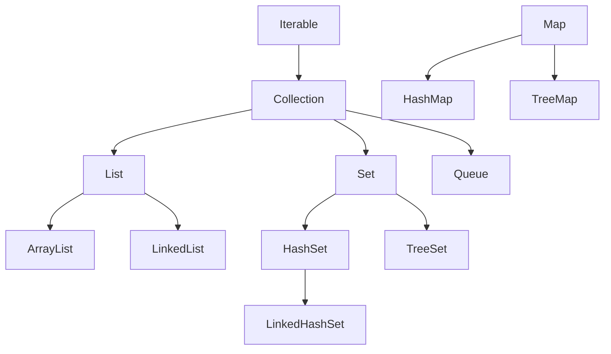

<div class="flex flex-col justify-center items-center h-full" style="background: #ffffff;">
  <p style="color: #5eada0; font-size: 1rem; font-weight: 600; letter-spacing: 0.2em; text-transform: uppercase; margin-bottom: 1.2rem;">Java Programming Masterclass</p>
  <h1 style="color: #1a5c5c; font-size: 3.8rem; font-weight: 900; line-height: 1.15; margin-bottom: 1.5rem;">集合框架</h1>
  <div style="height: 4px; width: 320px; background: linear-gradient(90deg, #5eada0, #a7d9d0); border-radius: 2px; margin-bottom: 1.5rem;"></div>
  <p style="color: #4a7c7c; font-size: 1.15rem; font-style: italic;">
    「用正確的容器，裝下所需的每一筆資料」
  </p>
  <Link to="home" style="color: #9dc4c4; font-size: 0.85rem; margin-top: 2rem; text-decoration: none; letter-spacing: 0.05em;">← 返回目錄</Link>
</div>

<!--
大家好，這一章的主題是集合框架。

陣列的大小一建立就固定了，但真實世界的資料常常是變動的：購物車裡的商品會增加、會刪除；會員名單不能重複；查詢成績時，希望用名字直接找到分數。如果都用陣列自己處理，程式會寫得很辛苦。

集合框架就是 Java 準備好的一組資料結構。學完這一章，我們就能依照需求，選擇最合適的容器來存放資料。
-->

---
layout: default
---

# Outline

- **集合框架概覽**
  - 什麼是集合框架、介面層次
  - Collection 介面常用方法
- **List 介面**
  - ArrayList、LinkedList 特性與常用方法
- **Set 介面**
  - HashSet、LinkedHashSet、TreeSet 比較
- **Map 介面**
  - HashMap、LinkedHashMap、TreeMap 比較與遍歷
- **選用指南與 Collections 工具類別**
- **實作練習**

<!--
這一章我們會先認識集合框架的整體架構，以及共同的方法。接著依序學習三大介面：有順序、可重複的 List；不能重複的 Set；以及用鍵值對應的 Map。

最後整理選用的原則，認識 Collections 工具類別，並用一個選課系統的綜合練習，把所有內容串起來。
-->

---
layout: section
class: flex flex-col justify-center items-center text-center
---

# 集合框架概覽

<!--
我們先來看集合框架的全貌。
-->

---
layout: default
---

# 什麼是集合框架？

集合框架 (Collection Framework) 是 Java 提供的一組**標準資料結構**，讓你不必手刻就能儲存、管理與操作一群物件。

- **自動調整大小** — 無需像陣列一樣預先指定長度
- **豐富的操作方法** — 新增、刪除、搜尋、排序一應俱全
- **多種結構選擇** — 依需求選擇 List、Set 或 Map

<div class="mt-4 p-3 bg-blue-50 border-l-4 border-blue-400 text-gray-700 text-sm text-left">
💡 <b>使用時機：</b> 當元素數量不確定、需要快速搜尋、或需要鍵值對應時，集合框架比原始陣列更有效率。
</div>

<!--
集合框架是 Java 提供的一組標準資料結構，讓我們不必自己從頭寫，就能儲存、管理和操作一群物件。

它有三個優點。第一，會自動調整大小，不用像陣列一樣事先決定長度。第二，提供了豐富的方法，新增、刪除、搜尋、排序都有現成的。第三，有多種結構可以選擇，依照需求使用 List、Set 或 Map。

所以，當資料的數量不確定、需要快速搜尋，或是需要用一個鍵找到對應的值時，集合框架都比陣列更適合。
-->

---

# 集合框架的介面層次

<div class="flex justify-center mt-4">



</div>

<div class="mt-4 p-3 bg-blue-50 border-l-4 border-blue-400 text-gray-700 text-sm text-left">
💡 <code>Map</code> 不繼承 <code>Collection</code>，是獨立的介面體系，但同屬集合框架
</div>

<!--
這張圖是集合框架的介面層次。

最上層是 Iterable，代表可以被逐一走訪。下面是 Collection，它分成三種：List、Set 和 Queue。List 常用的實作是 ArrayList 和 LinkedList；Set 常用的實作是 HashSet 和 TreeSet，LinkedHashSet 則是 HashSet 的子類別。

要注意，Map 並沒有繼承 Collection，它是一個獨立的介面體系，常用的實作是 HashMap 和 TreeMap。但它一樣屬於集合框架的一部分。
-->

---

# Collection 介面常用方法

| 方法名稱 | 說明 |
| --- | --- |
| `add(E e)` | 加入一個元素 |
| `remove(Object o)` | 移除指定元素 |
| `contains(Object o)` | 是否包含該元素 |
| `size()` | 回傳元素數量 |
| `isEmpty()` | 是否為空集合 |
| `clear()` | 清空所有元素 |
| `iterator()` | 取得迭代器，用於逐一遍歷 |

<!--
Collection 介面定義了所有集合共同的方法。

add 加入元素，remove 移除元素，contains 判斷是否包含某個元素，size 回傳元素的數量，isEmpty 判斷是否為空，clear 清空所有元素，iterator 則取得一個迭代器，用來逐一走訪。

因為這些方法是共同的，學會之後，不管用哪一種集合，用法都差不多。
-->

---

# Collection 介面方法 — 範例

```java
import java.util.*;

List<String> fruits = new ArrayList<>();
fruits.add("蘋果");
fruits.add("橘子");
fruits.add("香蕉");

System.out.println(fruits.size());            // 3
System.out.println(fruits.contains("橘子"));  // true
fruits.remove("橘子");
System.out.println(fruits.size());            // 2
fruits.clear();
System.out.println(fruits.isEmpty());         // true
```

<!--
我們用一個水果清單來看看這些方法。

宣告時，變數的型別寫 List 介面，實際建立的是 ArrayList，這是業界的標準寫法，之後想換成其他實作，只要改 new 的那一邊。

加入蘋果、橘子、香蕉之後，size 是 3，contains 橘子是 true。移除橘子之後，size 變成 2。最後 clear 清空，isEmpty 就是 true。
-->

---

# Iterator — 迭代器遍歷

`iterator()` 回傳一個 `Iterator` 物件，可逐一取出元素，並在遍歷中安全地移除：

| 方法 | 說明 |
| --- | --- |
| `hasNext()` | 是否還有下一個元素 |
| `next()` | 取出下一個元素並前進 |
| `remove()` | 移除 `next()` 最後回傳的元素 |

```java
List<String> fruits = new ArrayList<>(List.of("蘋果", "橘子", "香蕉"));
Iterator<String> it = fruits.iterator();
while (it.hasNext()) {
    System.out.println(it.next());
}
```

<!--
iterator 方法會回傳一個迭代器，用來逐一取出集合裡的元素。

它有三個方法：hasNext 判斷還有沒有下一個元素，next 取出下一個元素並往前移動，remove 則會移除剛剛 next 取出的那一個元素。

看範例，用 while 迴圈，只要 hasNext 是 true，就用 next 取出並印出。迭代器最大的用處，是可以在走訪的過程中，安全地移除元素，等一下的練習會看到。
-->

---

# 不可變集合工廠方法 (Immutable Collections)

Java 9 引入了更簡潔的方式來建立**不可變** (Immutable) 的集合。
- 這些集合一旦建立，**不能新增、修改或刪除**元素 (會拋出 `UnsupportedOperationException`)。
- **不允許 null 元素** (會拋出 `NullPointerException`)。

| 方法名稱 | 說明 |
| --- | --- |
| `List.of(E... elements)` | 建立不可變的 List |
| `Set.of(E... elements)` | 建立不可變的 Set |
| `Map.of(K k1, V v1, ...)` | 建立不可變的 Map (最多 10 組鍵值) |

```java
List<String> fruits = List.of("蘋果", "橘子", "香蕉");
Set<Integer> numbers = Set.of(1, 2, 3);
Map<String, Integer> scores = Map.of("炭治郎", 95, "善逸", 70);

// fruits.add("葡萄"); // 執行期會拋出例外！
```

<!--
Java 9 之後，可以用更簡潔的方式，建立不可變的集合。

List.of、Set.of 和 Map.of，可以直接列出元素，一行就建立好集合。這些集合一旦建立，就不能新增、修改或刪除，否則會拋出 UnsupportedOperationException；而且也不允許 null 元素。

看範例，水果清單、數字集合和成績對照表，都用一行建立。最後一行如果真的呼叫 add，執行時就會拋出例外。

不可變的集合適合存放不會改變的資料，例如設定值，可以避免被意外修改。
-->

---

# 複製為不可變集合

Java 10 新增了 `copyOf()` 方法，可以將現有的集合**複製**成不可變集合。
- 如果來源已經是不可變集合 (例如用 `List.of` 建立)，則直接回傳原物件，不會浪費記憶體。

| 方法名稱 | 說明 |
| --- | --- |
| `List.copyOf(Collection)` | 將集合複製為不可變 List |
| `Set.copyOf(Collection)` | 將集合複製為不可變 Set |
| `Map.copyOf(Map)` | 將 Map 複製為不可變 Map |

```java
List<String> mutableList = new ArrayList<>();
mutableList.add("A");
mutableList.add("B");

// 複製一份不可變的 List
List<String> immutableList = List.copyOf(mutableList);
// immutableList.add("C"); // 拋出 UnsupportedOperationException
```

<!--
Java 10 又加入了 copyOf 方法，可以把一個現有的集合，複製成不可變的集合。

看範例，mutableList 是一般的 ArrayList，加入 A 和 B 之後，用 List.copyOf 複製一份不可變的版本。之後對 immutableList 呼叫 add，就會拋出例外。

如果來源本身已經是不可變的集合，copyOf 會直接回傳原本的物件，不會浪費記憶體。
-->

---
layout: default
---

# 練習 1-1：水果攤的 Collection 操作
### 任務說明

建立 `List<String> fruits`，初始內容為「蘋果、香蕉、橘子、葡萄」，完成以下操作：

1. 印出 `size()`
2. 用 `contains()` 檢查是否有「西瓜」
3. 用 `Iterator` 遍歷整個清單，並移除「香蕉」
4. 印出移除後的清單與 `isEmpty()` 的結果

<!--
接下來我們動手練習。

練習 1-1，建立一個水果清單，內容是蘋果、香蕉、橘子和葡萄。印出數量，檢查有沒有西瓜，接著用 Iterator 走訪整個清單，並移除香蕉，最後印出移除後的清單，以及 isEmpty 的結果。

我們先暫停一下，自己動手試試看。
-->

---
layout: default
---

# 練習 1-1：解題提示
### 提示說明

```java
List<String> fruits = new ArrayList<>(List.of("蘋果", "香蕉", "橘子", "葡萄"));
System.out.println(fruits.size());
System.out.println(fruits.contains("西瓜"));

Iterator<String> it = fruits.iterator();
while (it.hasNext()) {
    if (it.next().equals("香蕉")) {
        it.remove();
    }
}
System.out.println(fruits);
System.out.println(fruits.isEmpty());
```

- 若改用 `for (String f : fruits) { if (f.equals("香蕉")) fruits.remove(f); }`，會拋出 `ConcurrentModificationException`
- 邊遍歷邊刪除，務必使用 `Iterator.remove()`

<!--
我們來看提示。

用 ArrayList 包住 List.of 建立清單，這樣得到的就是一個可以修改的清單。接著用 iterator 走訪，用 next 取出每一個元素，如果等於香蕉，就呼叫迭代器的 remove。

要特別注意：如果改用 for-each 迴圈，在迴圈裡直接呼叫清單的 remove，會拋出 ConcurrentModificationException。所以邊走訪邊刪除時，一定要用 Iterator 的 remove。
-->

---
layout: default
---

# 練習 1-2：不可變集合的應用
### 任務說明

1. 使用 `List.of()` 建立不可變清單 `weekdays`，內容為一週七天
2. 對 `weekdays` 呼叫 `add()`，用 try-catch 捕捉並印出拋出的例外名稱
3. 建立一個可變的 `ArrayList<String> mutable`，加入幾筆資料後，使用 `List.copyOf(mutable)` 建立 `copy`
4. 對 `copy` 呼叫 `add()`，驗證同樣會拋出例外；但驗證 `mutable` 仍可正常新增元素

<!--
練習 1-2，練習不可變的集合。

用 List.of 建立一週七天的清單，對它呼叫 add，用 try-catch 捕捉並印出例外。接著建立一個可以修改的 ArrayList，用 List.copyOf 複製一份，驗證複製出來的版本不能新增，但原本的清單仍然可以。

一樣先暫停一下，自己動手寫寫看。
-->

---
layout: default
---

# 練習 1-2：解題提示
### 提示說明

```java
List<String> weekdays = List.of("一", "二", "三", "四", "五", "六", "日");
try {
    weekdays.add("補假");
} catch (UnsupportedOperationException e) {
    System.out.println("weekdays 不可變：" + e);
}

List<String> mutable = new ArrayList<>();
mutable.add("A");
mutable.add("B");
List<String> copy = List.copyOf(mutable);

try {
    copy.add("C");
} catch (UnsupportedOperationException e) {
    System.out.println("copy 不可變：" + e);
}

mutable.add("C"); // 正本仍可修改
System.out.println("mutable: " + mutable);
System.out.println("copy: " + copy);
```

<!--
我們來看提示。

對 weekdays 呼叫 add，會拋出 UnsupportedOperationException，在 catch 裡印出來。

接著建立 mutable，加入 A 和 B，用 copyOf 複製成 copy。對 copy 呼叫 add，一樣會拋出例外；但對 mutable 呼叫 add 沒有問題。最後把兩者印出來，會看到 mutable 有三個元素，copy 仍然只有兩個，證明它們是獨立的。
-->

---
layout: section
class: flex flex-col justify-center items-center text-center
---

# List 介面

<!--
接下來，我們學習第一個重要的介面：List。
-->

---
layout: default
---

# List 介面特性

`List` 是**有序**且**允許重複**元素的集合，支援透過索引 (index) 存取。

```java
List<String> list = new ArrayList<>();
list.add("A");
list.add("B");
list.add("A"); // 允許重複

System.out.println(list.get(0)); // "A"
System.out.println(list.size()); // 3
```

<div class="mt-4 p-3 bg-blue-50 border-l-4 border-blue-400 text-gray-700 text-sm text-left">
💡 索引從 <code>0</code> 開始，和陣列相同。宣告時通常用介面型態 <code>List</code>，實作類別用 <code>new ArrayList<>()</code>。
</div>

<!--
List 是有順序、而且允許重複元素的集合，可以用索引存取元素。

看範例，加入 A、B，再加入一次 A，重複的 A 也會被保留，所以 size 是 3。用 get 0 取得第一個元素 A。

和陣列一樣，索引從 0 開始。另外再提醒一次，宣告時通常用介面型別 List，建立時才用 ArrayList。
-->

---

# List 常用方法

| 方法名稱 | 說明 |
| --- | --- |
| `get(int index)` | 取得指定索引的元素 |
| `set(int index, E e)` | 替換指定位置的元素，回傳舊元素 |
| `add(int index, E e)` | 在指定位置插入元素 |
| `remove(int index)` | 移除指定位置的元素 |
| `indexOf(Object o)` | 首次出現的索引（找不到回傳 -1） |
| `subList(int from, int to)` | 取得子串列，範圍 [from, to-1] |

<!--
List 因為有順序，所以多了一些和索引有關的方法。

get 取得指定位置的元素，set 把指定位置的元素換掉，並回傳舊的元素。add 加上索引，可以在指定位置插入元素。remove 加上索引，移除指定位置的元素。indexOf 回傳元素第一次出現的位置，找不到就回傳負 1。subList 則取出一段子清單，一樣包含開始、不包含結束。
-->

---

# List 常用方法 — 範例

```java
List<String> heroes = new ArrayList<>();
heroes.add("炭治郎");
heroes.add("禰豆子");
heroes.add("善逸");

heroes.set(1, "伊之助");         // 替換索引 1
heroes.add(0, "煉獄");           // 在開頭插入
System.out.println(heroes.get(0));       // "煉獄"
System.out.println(heroes.indexOf("善逸")); // 3
List<String> sub = heroes.subList(0, 2);
System.out.println(sub);         // [煉獄, 炭治郎]
```

<!--
我們一步一步看這個範例。

一開始清單是炭治郎、禰豆子、善逸。set 1 把索引 1 的禰豆子換成伊之助。接著 add 0，在最前面插入煉獄，所以清單變成煉獄、炭治郎、伊之助、善逸。

這時候 get 0 是煉獄，indexOf 善逸是 3。最後 subList 0 到 2，取出前兩個：煉獄和炭治郎。
-->

---

# ArrayList vs LinkedList

| 特性 | ArrayList | LinkedList |
| --- | --- | --- |
| 底層結構 | 動態陣列 | 雙向鏈結串列 |
| 隨機存取 `get(i)` | 快 O(1) | 慢 O(n) |
| 修改元素 `set(i, e)` | 快 O(1) | 慢 O(n) |
| 中間插入 / 刪除 | 慢 O(n) | 快 O(1) |
| 記憶體用量 | 較少 | 較多（需儲存前後節點指標） |
| 適用場景 | 多讀取、少插入 | 多插入 / 刪除 |

<div class="mt-4 p-3 bg-blue-50 border-l-4 border-blue-400 text-gray-700 text-sm text-left">
💡 <b>預設選 ArrayList</b>，除非需要頻繁在中間插入或刪除元素，才考慮 LinkedList
</div>

<!--
List 最常用的兩個實作，是 ArrayList 和 LinkedList，它們的底層結構不同。

ArrayList 底層是動態陣列，用索引取得或修改元素非常快；但在中間插入或刪除時，後面的元素都要搬移，就比較慢。LinkedList 底層是雙向鏈結串列，每個元素都記住前後是誰；插入和刪除只要改連結，很快，但要找到第幾個元素，就得從頭一個一個數，所以存取比較慢，記憶體也用得比較多。

就像電影院的座位和排隊的人龍：座位有編號，直接走到第 10 號很快；排隊的人龍要插隊很容易，但要找第 10 個人，就得從頭數。

所以預設選擇 ArrayList，只有需要頻繁在中間插入或刪除時，才考慮 LinkedList。
-->

---

# LinkedList 的雙端操作

`LinkedList` 同時實作 `Deque` 介面，可當作**雙端佇列**使用：

| 方法名稱 | 說明 |
| --- | --- |
| `addFirst(E e)` | 加到串列開頭 |
| `addLast(E e)` | 加到串列末端 |
| `removeFirst()` | 移除並回傳開頭元素 |
| `removeLast()` | 移除並回傳末端元素 |

```java
LinkedList<String> queue = new LinkedList<>();
queue.addLast("任務A");
queue.addLast("任務B");
System.out.println(queue.removeFirst()); // "任務A"
```

<!--
LinkedList 還實作了 Deque 介面，可以當作雙端佇列使用，也就是兩端都能加入和取出元素。

addFirst 和 addLast 分別加到開頭和末端，removeFirst 和 removeLast 分別移除並回傳開頭和末端的元素。

看範例，依序把任務 A 和任務 B 加到最後面，再用 removeFirst 從前面取出，得到任務 A。先進來的先出去，這就是佇列。
-->

---
layout: default
---

# 練習 2-1：管理英雄名單
### 任務說明

請宣告一個 `ArrayList<String>`，儲存以下鬼殺隊成員：
「炭治郎、禰豆子、善逸、伊之助、蜜璃」

完成以下操作：
1. 在「善逸」前面插入「甘露寺」
2. 將「禰豆子」替換為「時透無一郎」
3. 移除最後一個成員
4. 用 `Collections.sort()` 依字典順序排序後印出

<!--
練習 2-1，請用 ArrayList 存放五位鬼殺隊成員：炭治郎、禰豆子、善逸、伊之助和蜜璃。

接著依序完成：在善逸前面插入甘露寺；把禰豆子換成時透無一郎；移除最後一位成員；最後用 Collections.sort 依照字典順序排序後印出。

我們先暫停一下，自己動手試試看。
-->

---
layout: default
---

# 練習 2-1：解題提示
### 提示說明

1. 善逸在索引 2，使用 `list.add(2, "甘露寺")` 插入
2. 禰豆子在索引 1，使用 `list.set(1, "時透無一郎")` 替換
3. `list.remove(list.size() - 1)` 移除最後一個元素
4. `Collections.sort(list)` 排序

```java
List<String> m = new ArrayList<>(
    List.of("炭治郎","禰豆子","善逸","伊之助","蜜璃"));
m.add(2, "甘露寺");
m.set(1, "時透無一郎");
m.remove(m.size() - 1);
Collections.sort(m);
System.out.println(m);
```

<!--
我們來看提示。

善逸在索引 2，用 add 2 插入甘露寺。禰豆子在索引 1，用 set 1 換成時透無一郎。移除最後一個，用 remove 加上 size 減 1。最後呼叫 Collections.sort 排序。

要注意操作的順序。插入之後，後面元素的索引都會往後移，所以每一步都要想清楚，當下的索引是多少。
-->

---
layout: default
---

# 練習 2-2：待辦事項佇列
### 任務說明

使用 `LinkedList<String>` 模擬一個「待辦事項佇列」：

1. 用 `addLast()` 依序加入「買菜」、「寫作業」、「運動」
2. 用 `addFirst()` 將「澆花」加到最前面
3. 用 `removeFirst()` 取出並印出第一項待辦事項
4. 印出剩餘的待辦事項

完成後，請說明：若改用 `ArrayList` 實作 `addFirst`/`removeFirst`（即 `add(0, ...)`/`remove(0)`），時間複雜度會有什麼差異？

<!--
練習 2-2，用 LinkedList 模擬一個待辦事項佇列。

先用 addLast 依序加入買菜、寫作業和運動，再用 addFirst 把澆花放到最前面。接著用 removeFirst 取出第一項並印出，最後印出剩下的待辦事項。

完成之後想一想：如果改用 ArrayList，用 add 0 和 remove 0 做同樣的事，效能會有什麼差別？

一樣先暫停一下，自己動手寫寫看。
-->

---
layout: default
---

# 練習 2-2：解題提示
### 提示說明

```java
LinkedList<String> todos = new LinkedList<>();
todos.addLast("買菜");
todos.addLast("寫作業");
todos.addLast("運動");

todos.addFirst("澆花");

System.out.println("處理：" + todos.removeFirst()); // 澆花
System.out.println("剩餘待辦：" + todos);
```

- `ArrayList` 沒有 `addFirst`/`removeFirst`，只能用 `add(0, ...)`/`remove(0)`
- 這兩個操作在 `ArrayList` 是 **O(n)**（要搬移其餘元素），在 `LinkedList` 則是 **O(1)**

<!--
我們來看提示。

依序加入之後，澆花在最前面，所以 removeFirst 取出的是澆花，剩下買菜、寫作業和運動。

至於效能：ArrayList 沒有 addFirst 和 removeFirst，只能在索引 0 新增或移除，這時候其他所有元素都要搬移一格，資料越多越慢。LinkedList 只要改變開頭的連結，不管有多少資料，速度都一樣。
-->

---
layout: section
class: flex flex-col justify-center items-center text-center
---

# Set 介面

<!--
接下來是第二個介面：Set。
-->

---
layout: default
---

# Set 介面特性

`Set` 是**不允許重複**元素的集合，加入重複元素時會被自動忽略。

```java
Set<String> names = new HashSet<>();
names.add("禰豆子");
names.add("炭治郎");
names.add("禰豆子"); // 重複，被忽略

System.out.println(names.size());             // 2
System.out.println(names.contains("炭治郎")); // true
```

<div class="mt-4 p-3 bg-blue-50 border-l-4 border-blue-400 text-gray-700 text-sm text-left">
💡 <code>Set</code> 沒有 <code>get(index)</code> 方法，通常用 for-each 或 Iterator 遍歷
</div>

<!--
Set 是不允許重複元素的集合。加入重複的元素時，會被自動忽略。

看範例，加入禰豆子、炭治郎，再加入一次禰豆子，重複的那一次會被忽略，所以 size 是 2。

Set 沒有索引，所以沒有 get 方法，通常用 for-each 或 Iterator 走訪。
-->

---

# Set 常用方法

| 方法名稱 | 說明 |
| --- | --- |
| `add(E e)` | 加入元素；若元素已存在則不變，回傳 `false` |
| `remove(Object o)` | 移除指定元素，回傳是否成功移除 |
| `contains(Object o)` | 是否包含指定元素 |
| `size()` / `isEmpty()` | 元素數量 / 是否為空 |
| `addAll(Collection c)` | 聯集：加入另一個集合的所有元素 |
| `retainAll(Collection c)` | 交集：只保留兩者都有的元素 |
| `removeAll(Collection c)` | 差集：移除另一個集合中也有的元素 |
| `clear()` | 清空所有元素 |

```java
Set<String> names = new HashSet<>();
System.out.println(names.add("炭治郎")); // true，新增成功
System.out.println(names.add("炭治郎")); // false，已存在
System.out.println(names.contains("炭治郎")); // true
System.out.println(names.remove("炭治郎"));   // true
System.out.println(names.isEmpty());          // true
```

<!--
Set 常用的方法，大部分和 Collection 一樣。

特別的是 add 的回傳值：如果元素已經存在，就不會加入，並回傳 false。所以看範例，第一次加入炭治郎是 true，第二次就是 false。

另外，Set 很適合做集合運算：addAll 是聯集，retainAll 是交集，removeAll 則是差集。
-->

---

# HashSet / LinkedHashSet / TreeSet 比較

| 類別 | 順序 | 允許 Null | 效能 |
| --- | --- | --- | --- |
| `HashSet` | 不保證順序 | 允許一個 | 最快 |
| `LinkedHashSet` | 維持**插入順序** | 允許一個 | 中 |
| `TreeSet` | 依**自然排序**（升序） | 不允許 | 較慢 |

```java
Set<Integer> hs = new HashSet<>(List.of(3, 1, 2));
Set<Integer> ts = new TreeSet<>(List.of(3, 1, 2));
System.out.println(hs); // [1, 2, 3] 或其他順序
System.out.println(ts); // [1, 2, 3]（一定升序）
```

<!--
Set 有三種常用的實作，差別在於順序。

HashSet 不保證元素的順序，但速度最快。LinkedHashSet 會維持元素加入的順序。TreeSet 則會依照元素的自然順序排序，例如數字由小到大，速度比較慢，而且不允許 null。

看範例，同樣放入 3、1、2，HashSet 印出的順序不一定；TreeSet 則一定是 1、2、3。
-->

---

# Set 實用操作：聯集與交集

```java
Set<String> setA = new HashSet<>(List.of("A", "B", "C"));
Set<String> setB = new HashSet<>(List.of("B", "C", "D"));

// 聯集：A ∪ B
Set<String> union = new HashSet<>(setA);
union.addAll(setB);
System.out.println(union); // [A, B, C, D]

// 交集：A ∩ B
Set<String> inter = new HashSet<>(setA);
inter.retainAll(setB);
System.out.println(inter); // [B, C]
```

<!--
我們看看怎麼用 Set 做聯集和交集。

setA 是 A、B、C，setB 是 B、C、D。

聯集時，先複製一份 setA，再 addAll setB，得到 A、B、C、D。交集時，同樣先複製一份 setA，再 retainAll setB，只保留兩邊都有的 B 和 C。

注意這裡都先複製一份新的集合再操作，因為這些方法會直接修改原本的集合。
-->

---
layout: default
---

# 練習 3-1：去除重複的訪客名單
### 任務說明

給定 `String[] visitors = {"Alice","Bob","Alice","Charlie","Bob","Alice"}`：

1. 將其放入 `HashSet<String>`，印出不重複的訪客數量與內容
2. 再放入 `LinkedHashSet<String>`，印出內容並比較與 `HashSet` 的順序差異
3. 再放入 `TreeSet<String>`，印出內容（應為字母順序）

<!--
練習 3-1，去除重複的訪客名單。

訪客陣列裡有很多重複的名字。請分別把它放進 HashSet、LinkedHashSet 和 TreeSet，印出內容，比較三者在順序上的差別。

我們先暫停一下，自己動手試試看。
-->

---
layout: default
---

# 練習 3-1：解題提示
### 提示說明

```java
String[] visitors = {"Alice","Bob","Alice","Charlie","Bob","Alice"};

Set<String> hs = new HashSet<>(Arrays.asList(visitors));
System.out.println("HashSet（" + hs.size() + " 人）：" + hs);

Set<String> lhs = new LinkedHashSet<>(Arrays.asList(visitors));
System.out.println("LinkedHashSet：" + lhs);

Set<String> ts = new TreeSet<>(Arrays.asList(visitors));
System.out.println("TreeSet：" + ts);
```

- `HashSet` 不保證順序
- `LinkedHashSet` 會維持「第一次出現」的順序：Alice, Bob, Charlie
- `TreeSet` 會依字母排序：Alice, Bob, Charlie（剛好跟插入順序一樣，但原理不同）

<!--
我們來看提示。

用 Arrays.asList 把陣列轉成清單，再分別交給三種 Set 的建構子，重複的名字就會自動被去除，總共剩下 3 人。

HashSet 的順序不一定。LinkedHashSet 會維持第一次出現的順序：Alice、Bob、Charlie。TreeSet 依照字母排序，剛好也是 Alice、Bob、Charlie，雖然結果一樣，但背後的原理完全不同。
-->

---
layout: default
---

# 練習 3-2：社團成員聯集、交集與差集
### 任務說明

- 籃球社成員：`{"小明","小華","小美","阿強"}`
- 桌遊社成員：`{"小華","阿強","阿傑","小芳"}`

計算並印出：

1. 兩社團成員聯集（總共有哪些人至少參加一個社團）
2. 兩社團都參加的成員（交集）
3. 只參加籃球社、沒參加桌遊社的成員（差集）

<!--
練習 3-2，計算兩個社團的成員關係。

籃球社有小明、小華、小美和阿強；桌遊社有小華、阿強、阿傑和小芳。請計算三件事：至少參加一個社團的所有成員，也就是聯集；兩個社團都參加的成員，也就是交集；只參加籃球社、沒參加桌遊社的成員，也就是差集。

一樣先暫停一下，自己動手寫寫看。
-->

---
layout: default
---

# 練習 3-2：解題提示
### 提示說明

```java
Set<String> basketball = new HashSet<>(List.of("小明","小華","小美","阿強"));
Set<String> boardgame  = new HashSet<>(List.of("小華","阿強","阿傑","小芳"));

// 聯集
Set<String> union = new HashSet<>(basketball);
union.addAll(boardgame);
System.out.println("聯集：" + union);

// 交集
Set<String> inter = new HashSet<>(basketball);
inter.retainAll(boardgame);
System.out.println("交集：" + inter);

// 差集：只在籃球社、不在桌遊社
Set<String> diff = new HashSet<>(basketball);
diff.removeAll(boardgame);
System.out.println("差集：" + diff);
```

<!--
我們來看提示。

三種運算都先複製一份籃球社的集合再操作。聯集用 addAll，交集用 retainAll，差集用 removeAll。

結果是：聯集有六個人；交集是小華和阿強；只參加籃球社的，是小明和小美。
-->

---
layout: section
class: flex flex-col justify-center items-center text-center
---

# Map 介面

<!--
接下來是第三個介面：Map。
-->

---
layout: default
---

# Map 介面特性

`Map` 儲存**鍵值對 (Key-Value Pair)**，每個鍵唯一，對應一個值。

```java
Map<String, Integer> scores = new HashMap<>();
scores.put("炭治郎", 95);
scores.put("善逸", 70);
scores.put("炭治郎", 99); // 相同鍵 → 覆蓋舊值

System.out.println(scores.get("炭治郎")); // 99
```

<div class="mt-4 p-3 bg-blue-50 border-l-4 border-blue-400 text-gray-700 text-sm text-left">
💡 <b>鍵</b>不能重複；若用相同鍵再次 <code>put</code>，舊值會被新值覆蓋
</div>

<!--
Map 儲存的是一組一組的鍵值對，每一個鍵都是唯一的，對應到一個值。就像字典，用一個單字，查到它的解釋。

看範例，用 put 存入炭治郎 95 分、善逸 70 分。接著再 put 一次炭治郎 99 分，因為鍵相同，舊的值會被新的值覆蓋，所以 get 炭治郎得到 99。
-->

---

# Map 常用方法

| 方法名稱 | 說明 |
| --- | --- |
| `put(K key, V value)` | 存入鍵值對（已存在則覆蓋） |
| `get(Object key)` | 取得鍵對應的值（找不到回傳 null） |
| `getOrDefault(K key, V def)` | 找不到鍵時回傳預設值 |
| `remove(Object key)` | 移除指定鍵的鍵值對 |
| `containsKey(Object key)` | 是否包含指定鍵 |
| `containsValue(Object value)` | 是否包含指定值 |
| `size()` | 鍵值對數量 |
| `keySet()` | 取得所有鍵（回傳 `Set`) |
| `values()` | 取得所有值（回傳 `Collection`） |
| `entrySet()` | 取得所有鍵值對（回傳 `Set<Map.Entry<K,V>>`）|

<!--
Map 常用的方法有這些。

put 存入鍵值對，get 用鍵取得值，找不到就回傳 null；getOrDefault 則可以在找不到時，回傳一個預設值。remove 移除指定的鍵，containsKey 和 containsValue 判斷是否包含某個鍵或值，size 回傳鍵值對的數量。

另外有三個方法用來走訪：keySet 取得所有的鍵，values 取得所有的值，entrySet 則取得所有的鍵值對。
-->

---

# Map 常用方法 — 範例

```java
Map<String, Integer> map = new HashMap<>();
map.put("A", 10);
map.put("B", 20);
map.put("A", 99);  // 覆蓋舊值

System.out.println(map.get("A"));              // 99
System.out.println(map.getOrDefault("C", 0));  // 0
System.out.println(map.containsKey("B"));      // true
System.out.println(map.keySet());              // [A, B]
System.out.println(map.values());              // [99, 20]
```

<!--
看範例，存入 A 和 B 之後，再把 A 改成 99。

get A 得到 99。getOrDefault C，因為 C 不存在，所以回傳預設值 0，而不是 null，這樣後續計算就不用擔心 null。containsKey B 是 true。最後印出所有的鍵 A、B，以及所有的值 99、20。
-->

---

# HashMap vs LinkedHashMap vs TreeMap

| 特性 | HashMap | LinkedHashMap | TreeMap |
| --- | --- | --- | --- |
| 鍵的順序 | 不保證 | 維持**插入順序** | 依**鍵升序排列** |
| 允許 Null 鍵 | 允許一個 | 允許一個 | 不允許 |
| 存取效能 | O(1) | O(1) | O(log n) |
| 適用場景 | 快速查詢 | 需維持插入順序 | 需依鍵排序輸出 |

<!--
Map 也有三種常用的實作，差別一樣在於順序。

HashMap 不保證鍵的順序，但存取速度最快。LinkedHashMap 會維持加入的順序。TreeMap 則依照鍵由小到大排序，速度比較慢，而且不允許 null 鍵。

所以只需要快速查詢，就用 HashMap；需要保留加入的順序，用 LinkedHashMap；需要依照鍵排序輸出，就用 TreeMap。
-->

---

# HashMap vs LinkedHashMap vs TreeMap — 範例

```java
Map<String, Integer> hm = new HashMap<>();
hm.put("banana", 2); hm.put("apple", 5);
System.out.println(hm);  // 不保證順序
Map<String, Integer> lhm = new LinkedHashMap<>();
lhm.put("banana", 2); lhm.put("apple", 5);
System.out.println(lhm); // {banana=2, apple=5}（插入順序）
Map<String, Integer> tm = new TreeMap<>();
tm.put("banana", 2); tm.put("apple", 5);
System.out.println(tm);  // {apple=5, banana=2}（鍵升序）
```

<!--
看範例，三種 Map 都依序放入 banana 和 apple。

HashMap 印出的順序不一定。LinkedHashMap 維持加入的順序，banana 在前。TreeMap 依照鍵的字母排序，所以 apple 在前。
-->

---

# Map 的遍歷方式

```java
Map<String, Integer> scores = new HashMap<>();
scores.put("炭治郎", 95);
scores.put("善逸", 70);

// 方式一：entrySet 遍歷（最常用）
for (Map.Entry<String, Integer> entry : scores.entrySet()) {
    System.out.println(entry.getKey() + " → " + entry.getValue());
}

// 方式二：keySet 遍歷
for (String key : scores.keySet()) {
    System.out.println(key + " → " + scores.get(key));
}
```

<!--
走訪 Map 有兩種常見的方式。

第一種是 entrySet，一次取得一組鍵值對，用 getKey 和 getValue 分別取得鍵和值。這是最常用、也最有效率的方式。

第二種是 keySet，先取得所有的鍵，再用 get 查詢每個鍵對應的值。這種方式多了一次查詢，所以一般建議用 entrySet。
-->

---
layout: default
---

# 練習 4-1：成績統計系統
### 任務說明

宣告一個 `HashMap<String, Integer>` 儲存以下成績：
炭治郎：95、善逸：70、伊之助：85、蜜璃：90

完成以下操作：
1. 新增「甘露寺：88」
2. 將「善逸」的成績更新為 80
3. 計算全班平均分數（整數）
4. 印出所有成績 ≥ 85 的學生姓名

<!--
練習 4-1，成績統計系統。

用 HashMap 存放四位同學的成績。接著新增甘露寺 88 分，把善逸的成績改成 80，計算全班的平均分數，最後印出所有 85 分以上的學生。

我們先暫停一下，自己動手試試看。
-->

---
layout: default
---

# 練習 4-1：解題提示
### 提示說明

1. `map.put("甘露寺", 88)` — 新增
2. `map.put("善逸", 80)` — 覆蓋舊值即為更新
3. 用 `values()` 取得所有分數，加總後除以 `size()`
4. 用 `entrySet()` 遍歷，判斷 `entry.getValue() >= 85`

```java
int total = 0;
for (int s : scores.values()) total += s;
System.out.println("平均：" + total / scores.size());
for (var e : scores.entrySet())
    if (e.getValue() >= 85)
        System.out.println(e.getKey());
```

<!--
我們來看提示。

新增和修改，用的都是 put，鍵已經存在時，就會覆蓋成新的值。

計算平均時，用 values 取得所有分數加總，再除以 size。印出高分的學生時，用 entrySet 走訪，判斷 getValue 是否大於等於 85，是的話就印出 getKey。範例裡的 var，是讓編譯器自動推斷型別，省得寫出很長的 Map.Entry。
-->

---
layout: default
---

# 練習 4-2：單字計數器
### 任務說明

給定字串陣列 `String[] words = {"apple","banana","apple","orange","banana","apple"}`：

1. 使用 `Map<String, Integer>` 統計每個單字出現的次數（使用 `getOrDefault`）
2. 分別用 `HashMap` 與 `TreeMap` 印出統計結果，比較兩者的輸出順序差異
3. 找出出現次數最多的單字並印出

<!--
練習 4-2，單字計數器。

給你一個單字陣列，請用 Map 統計每個單字出現的次數，並使用 getOrDefault。接著分別用 HashMap 和 TreeMap 印出結果，比較順序的差別，最後找出出現次數最多的單字。

一樣先暫停一下，自己動手寫寫看。
-->

---
layout: default
---

# 練習 4-2：解題提示
### 提示說明

```java
String[] words = {"apple","banana","apple","orange","banana","apple"};

Map<String, Integer> count = new TreeMap<>(); // 或 new HashMap<>()
for (String w : words) {
    count.put(w, count.getOrDefault(w, 0) + 1);
}
System.out.println(count); // TreeMap：依字母順序

String maxWord = null;
int maxCount = 0;
for (var entry : count.entrySet()) {
    if (entry.getValue() > maxCount) {
        maxCount = entry.getValue();
        maxWord = entry.getKey();
    }
}
System.out.println("出現最多次：" + maxWord + "（" + maxCount + " 次）");
```

<!--
我們來看提示。

計數的關鍵只有一行：put 這個單字，值是 getOrDefault 這個單字、預設 0，再加 1。第一次出現時取得 0，加 1 變成 1；之後每出現一次，就再加 1。

找出最多次的單字，則是走訪 entrySet，記錄目前最大的次數和對應的單字。結果是 apple，出現 3 次。
-->

---
layout: section
class: flex flex-col justify-center items-center text-center
---

# 選用指南與工具類別

<!--
學完三大介面，我們來整理該怎麼選擇，以及好用的 Collections 工具類別。
-->

---
layout: default
---

# 如何選擇集合類別

| 需求 | 選用 |
| --- | --- |
| 有序、可重複、需快速隨機存取 | `ArrayList` |
| 有序、可重複、頻繁插入 / 刪除 | `LinkedList` |
| 無重複、不在乎順序 | `HashSet` |
| 無重複、需維持插入順序 | `LinkedHashSet` |
| 無重複、需排序 | `TreeSet` |
| 鍵值對應、快速查詢 | `HashMap` |
| 鍵值對應、需維持插入順序 | `LinkedHashMap` |
| 鍵值對應、需依鍵排序 | `TreeMap` |

<!--
這張表是選用集合的指南，可以從兩個問題開始想：需不需要鍵值對應？能不能重複？

有順序、可以重複，就用 List：需要快速存取用 ArrayList，頻繁插入刪除用 LinkedList。不能重複，就用 Set：不在乎順序用 HashSet，要維持加入順序用 LinkedHashSet，要排序用 TreeSet。需要鍵值對應，就用 Map：快速查詢用 HashMap，維持順序用 LinkedHashMap，依鍵排序用 TreeMap。
-->

---

# Collections 工具類別

`java.util.Collections` 提供操作集合的靜態工具方法：

| 方法名稱 | 說明 |
| --- | --- |
| `sort(List)` | 將 List 升序排序 |
| `reverse(List)` | 反轉 List 的順序 |
| `shuffle(List)` | 隨機打亂 List |
| `max(Collection)` | 取得最大值 |
| `min(Collection)` | 取得最小值 |

<!--
java.util.Collections 是一個工具類別，提供了很多操作集合的靜態方法。

sort 把清單由小到大排序，reverse 反轉順序，shuffle 隨機打亂，max 和 min 則分別取得最大值和最小值。

注意它的名字多了一個 s，和 Collection 介面不一樣，就像 Objects 和 Object、Arrays 和陣列的關係。
-->

---

# Collections 工具類別 — 範例

```java
import java.util.*;

List<Integer> nums = new ArrayList<>(List.of(3, 1, 4, 1, 5));

Collections.sort(nums);
System.out.println(nums);                  // [1, 1, 3, 4, 5]

Collections.reverse(nums);
System.out.println(nums);                  // [5, 4, 3, 1, 1]

System.out.println(Collections.max(nums)); // 5
System.out.println(Collections.min(nums)); // 1
```

<!--
看範例，清單是 3、1、4、1、5。

sort 之後變成 1、1、3、4、5，reverse 之後變成 5、4、3、1、1。max 是 5，min 是 1。

這些方法都會直接修改傳入的清單，所以不能用在 List.of 建立的不可變清單上。
-->

---
layout: default
---

# 練習 5-1：樂透號碼產生器
### 任務說明

1. 建立 `List<Integer> numbers`，依序加入 1 ~ 49
2. 使用 `Collections.shuffle(numbers)` 打亂順序
3. 取出前 6 個元素（`subList(0, 6)`），複製成新的 List 並用 `Collections.sort()` 排序後印出，作為本期樂透號碼
4. 印出原始 `numbers` 的 `Collections.max()` 與 `Collections.min()`

<!--
練習 5-1，用集合來做樂透號碼產生器。

建立一個清單，依序放入 1 到 49。用 Collections.shuffle 打亂順序，再用 subList 取出前 6 個，複製成新的清單並排序，作為本期的樂透號碼。最後印出原本清單的最大值和最小值。

我們先暫停一下，自己動手試試看。
-->

---
layout: default
---

# 練習 5-1：解題提示
### 提示說明

```java
List<Integer> numbers = new ArrayList<>();
for (int i = 1; i <= 49; i++) {
    numbers.add(i);
}

Collections.shuffle(numbers);
List<Integer> result = new ArrayList<>(numbers.subList(0, 6));
Collections.sort(result);
System.out.println("本期樂透號碼：" + result);

System.out.println("最大值：" + Collections.max(numbers));
System.out.println("最小值：" + Collections.min(numbers));
```

<!--
我們來看提示。

用迴圈把 1 到 49 加入清單，shuffle 打亂之後，前 6 個就是隨機抽出、而且不會重複的號碼。

要注意，subList 回傳的只是原本清單的一個「視圖」，不是獨立的清單。所以要用 new ArrayList 複製一份，再排序，才不會影響原本的清單。

和之前用 Random 搭配 contains 檢查重複的寫法相比，這個方法簡潔多了。
-->

---
layout: default
---

# 練習 5-2：選擇合適的集合類別
### 任務說明

針對以下情境，選擇最合適的集合類別（`ArrayList`、`LinkedList`、`HashSet`、`LinkedHashSet`、`TreeSet`、`HashMap`、`LinkedHashMap`、`TreeMap`），寫出宣告該集合的程式碼，並簡述理由：

1. 儲存瀏覽器「上一頁」紀錄，需要頻繁從前後新增 / 移除
2. 儲存學生學號，且不可重複，需依學號排序輸出
3. 儲存「身分證字號 → 姓名」的對照表，需要快速查詢
4. 儲存最近瀏覽的商品名稱，不可重複，且要保留瀏覽順序

<!--
練習 5-2，選擇合適的集合類別。

針對四個情境，選出最適合的集合，寫出宣告的程式碼，並說明理由。第一，瀏覽器的上一頁紀錄，需要頻繁從前後新增和移除。第二，學生學號，不能重複，而且要依照學號排序。第三，身分證字號對應姓名，需要快速查詢。第四，最近瀏覽的商品，不能重複，而且要保留瀏覽的順序。

一樣先暫停一下，想一想再寫寫看。
-->

---
layout: default
---

# 練習 5-2：解題提示
### 提示說明

```java
// 1. 頻繁前後新增/移除 -> LinkedList（實作 Deque，O(1)）
Deque<String> history = new LinkedList<>();

// 2. 不可重複 + 需排序 -> TreeSet
Set<String> studentIds = new TreeSet<>();

// 3. 鍵值對應 + 快速查詢 -> HashMap
Map<String, String> idToName = new HashMap<>();

// 4. 不可重複 + 保留插入順序 -> LinkedHashSet
Set<String> recentProducts = new LinkedHashSet<>();
```

<!--
我們來看答案。

第一，頻繁在前後新增和移除，用 LinkedList，並用 Deque 介面宣告。第二，不能重複又要排序，用 TreeSet。第三，鍵值對應又要快速查詢，用 HashMap。第四，不能重複又要保留順序，用 LinkedHashSet。

選擇集合的關鍵，就是先想清楚資料的特性：要不要順序、能不能重複、需不需要用鍵查詢。
-->

---
layout: default
---

# 綜合練習：選課系統
### 任務說明

整合 List、Set、Map 與 Collections 工具類別，設計一個簡易選課系統：

- 使用 `Map<String, List<String>> courseEnrollment` 儲存「課程 → 已選課學生名單」
- 撰寫 `enroll(map, course, student)` 方法：將學生加入指定課程的名單；若該課程尚未開課，先建立一個新的 `ArrayList` 再加入
- 使用範例資料呼叫 `enroll`，模擬多位學生選修多門課程（部分課程重複選修）
- 統計「總共有多少不重複的學生」選了至少一門課（提示：用 `Set<String>` 收集所有學生姓名）
- 將每門課程的學生名單用 `Collections.sort()` 排序後印出
- 找出選課人數最多的課程名稱並印出

<!--
最後是一個綜合練習：選課系統，整合 List、Set、Map 和 Collections。

用一個 Map 存放每門課程的選課學生名單，鍵是課程名稱，值是一個學生的 List。寫一個 enroll 方法，把學生加入課程，如果課程還沒有名單，就先建立一個新的 ArrayList。

接著用範例資料模擬選課，統計總共有多少不重複的學生，把每門課的名單排序後印出，最後找出選課人數最多的課程。

我們先暫停一下，自己動手試試看。

【講師】給學生約 20 分鐘實作。
-->

---
layout: default
---

# 綜合練習：解題提示（一）
### enroll 方法 + 統計不重複學生數

```java
static void enroll(Map<String, List<String>> map, String course, String student) {
    if (!map.containsKey(course)) {
        map.put(course, new ArrayList<>());
    }
    map.get(course).add(student);
}

// 統計不重複學生數
Set<String> allStudents = new HashSet<>();
for (List<String> students : courseEnrollment.values()) {
    allStudents.addAll(students);
}
System.out.println("不重複學生數：" + allStudents.size());
```

<!--
我們來看提示的第一部分。

enroll 方法先用 containsKey 檢查課程是否存在，不存在就 put 一個新的 ArrayList，接著取得這門課的名單，把學生加進去。

統計不重複的學生，則是建立一個 HashSet，走訪所有課程的名單，用 addAll 全部加進去。因為 Set 會自動去除重複，最後的 size，就是不重複的學生數。
-->

---
layout: default
---

# 綜合練習：解題提示（二）
### 排序印出名單 + 找出選課人數最多的課程

```java
String maxCourse = null;
int maxCount = -1;
for (var entry : courseEnrollment.entrySet()) {
    Collections.sort(entry.getValue());
    System.out.println(entry.getKey() + "：" + entry.getValue());
    if (entry.getValue().size() > maxCount) {
        maxCount = entry.getValue().size();
        maxCourse = entry.getKey();
    }
}
System.out.println("選課人數最多：" + maxCourse + "（" + maxCount + " 人）");
```

<!--
第二部分，走訪 entrySet，對每門課程的名單呼叫 Collections.sort 排序，再印出課程名稱和名單。

同時記錄目前人數最多的課程：如果這門課的人數比目前的最大值還多，就更新最大值和課程名稱。走訪結束之後，就能印出選課人數最多的課程。
-->

---
layout: section
class: flex flex-col justify-center items-center text-center
---

# Q & A

<!--
這一章我們學會了用集合框架管理資料。

List 有順序、可以重複，預設使用 ArrayList。Set 不能重複，依照是否需要順序，選擇 HashSet、LinkedHashSet 或 TreeSet。Map 用鍵對應值，依照需求選擇 HashMap、LinkedHashMap 或 TreeMap。

邊走訪邊刪除時要用 Iterator；List.of 這類方法可以建立不可變的集合；Collections 則提供排序、打亂和取最大最小值等工具。

【講師】開放 Q&A。
-->

---
layout: end
---

# 課程結束
### 掌握集合框架，資料管理更有效率！
如有課後疑問，歡迎來信討論。

<!--
選對容器，資料管理就會更有效率。

最後一章，我們要學習 Lambda 和 Stream，用更簡潔的方式處理集合裡的資料。我們下一章見。
-->
