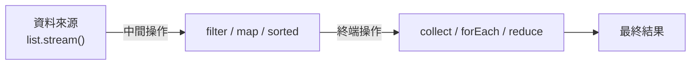

<div class="flex flex-col justify-center items-center h-full" style="background: #ffffff;">
  <p style="color: #5eada0; font-size: 1rem; font-weight: 600; letter-spacing: 0.2em; text-transform: uppercase; margin-bottom: 1.2rem;">Java Programming Masterclass</p>
  <h1 style="color: #1a5c5c; font-size: 3.2rem; font-weight: 900; line-height: 1.15; margin-bottom: 1.5rem;">Stream 與 Lambda</h1>
  <div style="height: 4px; width: 320px; background: linear-gradient(90deg, #5eada0, #a7d9d0); border-radius: 2px; margin-bottom: 1.5rem;"></div>
  <p style="color: #4a7c7c; font-size: 1.15rem; font-style: italic;">
    「用更少的程式碼，做更多的事」
  </p>
  <Link to="home" style="color: #9dc4c4; font-size: 0.85rem; margin-top: 2rem; text-decoration: none; letter-spacing: 0.05em;">← 返回目錄</Link>
</div>

<!--
大家好，這是課程的最後一章，主題是 Stream 與 Lambda。

上一章我們學會用集合存放資料。但要從一份成績清單裡，找出及格的、排序、再取前幾名，用傳統的迴圈得寫好幾層，還要準備一堆暫存的變數。

Lambda 和 Stream 讓我們用「描述要什麼」的方式處理資料，程式碼更短，也更容易閱讀。學完這一章，我們就能寫出現代 Java 風格的資料處理程式。
-->

---
layout: default
---

# Outline

- **Lambda 運算式**：語法、函數式介面（`Predicate`、`Function`、`Consumer`、`Supplier`）
- **方法參考**：`::` 運算子的四種形式
- **Stream API**
  - 中間操作：`filter`、`map`、`flatMap`、`sorted`、`takeWhile`、`dropWhile`...
  - 終端操作：`forEach`、`collect`、`count`、`toList()`...
  - Collectors 工具與 `teeing` 收集器
- **實作練習**

<!--
這一章分成三個部分。

第一部分是 Lambda 運算式，包括它的語法，以及它背後的功能介面。第二部分是方法參考，用雙冒號直接引用現成的方法。第三部分是 Stream API，包括中間操作、終端操作，以及 Collectors 工具。最後有兩題練習。
-->

---
layout: section
class: flex flex-col justify-center items-center text-center
---

# Lambda 運算式

<!--
我們先從 Lambda 運算式開始。
-->

---
layout: default
---

# 什麼是 Lambda？

Lambda 是 Java 8 引入的**匿名函式**語法，讓你不需要宣告完整的類別或方法，直接將「行為」當作參數傳遞。

- **精簡程式碼** — 取代冗長的匿名類別寫法
- **搭配集合框架** — 與 `List.forEach()`、`Stream` 等方法無縫整合
- **核心概念** — let Java support functional programming style

<div class="mt-4 p-3 bg-blue-50 border-l-4 border-blue-400 text-gray-700 text-sm text-left">
💡 <b>基本語法：</b> <code>(參數列) -> 運算式 或 { 程式碼區塊 }</code>
</div>

<!--
Lambda 是 Java 8 加入的匿名函式語法。它讓我們不用宣告完整的類別或方法，就能直接把一段「行為」當作參數傳遞。

它的好處是，可以取代冗長的匿名類別寫法，並且和集合的 forEach、Stream 完美搭配，讓 Java 也能使用函數式程式設計的風格。

基本的語法是：括號裡寫參數，接著一個箭頭，箭頭後面是要執行的運算式，或是一段用大括號包起來的程式碼。
-->

---

# Lambda 語法形式

| 語法形式 | 範例 | 說明 |
| --- | --- | --- |
| 無參數 | `() -> "Hello"` | 小括號不可省略 |
| 單一參數 | `x -> x * 2` | 括號可省略 |
| 多個參數 | `(a, b) -> a + b` | 多參數需加括號 |
| 多行程式碼 | `(x) -> { ...; return x; }` | 需大括號與 `return` |

<div class="mt-4 p-3 bg-blue-50 border-l-4 border-blue-400 text-gray-700 text-sm text-left">
💡 只要你用了大括號 <code>{ }</code>，就必須明確寫 <code>return</code>，否則編譯不過。
</div>

<!--
Lambda 有幾種寫法。

沒有參數時，要寫一對空的括號。只有一個參數時，括號可以省略，例如 x 箭頭 x 乘以 2。有多個參數時，要用括號包起來，例如 a、b 箭頭 a 加 b。

如果程式碼有好幾行，就要用大括號包起來，而且要明確寫出 return。這是很常見的錯誤：只要用了大括號，就一定要寫 return，否則編譯不會通過。
-->

---

# Lambda 語法形式 — 與傳統寫法比較

```java
// ❌ 傳統匿名類別（需實作介面、覆寫方法）
Runnable r1 = new Runnable() {
    @Override
    public void run() {
        System.out.println("Hello!");
    }
};

// ✅ Lambda 寫法（只寫「做什麼」，其餘省略）
Runnable r2 = () -> System.out.println("Hello!");
```

<div class="mt-4 p-3 bg-green-50 border-l-4 border-green-400 text-gray-700 text-sm text-left">
✅ Lambda 省略了介面名稱、方法名稱與 <code>@Override</code>，編譯器能從上下文自動推斷。兩段程式碼的執行結果完全相同。
</div>

<!--
我們比較一下傳統寫法和 Lambda。

上面是用匿名類別建立一個 Runnable，要寫 new Runnable、覆寫 run 方法，還有 @Override，真正要做的事只有中間那一行印出 Hello。

下面是 Lambda 的寫法，一行就完成了。介面名稱、方法名稱和 @Override 都省略了，因為編譯器可以從前後文推斷出來。我們只需要寫出「要做什麼」。兩段程式的執行結果完全一樣。
-->

---

# Lambda 語法 — 比較傳統寫法

```java
List<String> heroes = new ArrayList<>(
    List.of("炭治郎", "禰豆子", "善逸", "伊之助"));

// ❌ 傳統匿名類別寫法（冗長）
Collections.sort(heroes, new Comparator<String>() {
    public int compare(String a, String b) {
        return a.compareTo(b);
    }
});

// ✅ Lambda 寫法（簡潔）
Collections.sort(heroes, (a, b) -> a.compareTo(b));
```

<!--
再看一個排序的例子。

要依照字典順序排序英雄名單，傳統寫法要建立一個匿名的 Comparator，覆寫 compare 方法，總共寫了好幾行。

用 Lambda，只要寫 a、b 箭頭 a.compareTo b，一行就完成了，而且一眼就能看出排序的規則。
-->

---

# Lambda 需要型別：函數式介面

`s -> s.toLowerCase()` 本身沒有型別。Java 是強型別語言，**lambda 必須指派給某個介面**，Java 才知道它「是什麼」。

```java
// ❌ 無法編譯：Java 不知道這是什麼型別
var f = s -> s.toLowerCase();

// ✅ 告訴 Java：這是「吃 String、吐 String」的函數
Function<String, String> f = s -> s.toLowerCase();
```

只要介面**只有一個抽象方法**，lambda 就能直接實作它，這種介面就叫**函數式介面**。

想像你去便利商店打工，老闆說：「你今天只有**一個任務**——幫客人結帳。」因為任務只有一個，所以當客人走過來，你就知道要做什麼，不會搞錯。這就是函數式介面——只有一個「任務定義」，lambda 塞進去就知道自己要做什麼。

<div class="mt-4 p-3 bg-blue-50 border-l-4 border-blue-400 text-gray-700 text-sm text-left">
💡 你不需要每次都自己定義介面 — Java 已經幫你把最常見的幾種形狀都定義好了，下一頁就是這些現成介面。
</div>

<!--
Lambda 本身其實沒有型別。Java 是強型別的語言，所以 Lambda 一定要指定給某個介面，Java 才知道它是什麼。

看範例，直接用 var 宣告一個 Lambda，是無法編譯的，因為 Java 不知道它的型別。要明確告訴 Java，這是一個「接收字串、回傳字串」的 Function，才能編譯。

能接收 Lambda 的介面，必須只有一個抽象方法，這就是功能介面。就像便利商店的店員，今天只有一個任務：幫客人結帳。因為任務只有一個，客人一走過來，就知道要做什麼。功能介面也是這樣，只定義了一件事，Lambda 一放進去，就知道自己要扮演什麼角色。

而且我們不需要每次都自己定義介面，Java 已經準備好了最常用的幾種。
-->

---

# Java 內建函數式介面：四大天王

Java 幫你預先定義了最常用的四種「lambda 形狀」，直接用就好：

| 介面 | Lambda 形狀 | 用途 |
| --- | --- | --- |
| `Predicate<T>` | `T -> boolean` | 判斷條件（裁判：只回 Yes/No）|
| `Function<T, R>` | `T -> R` | 輸入轉輸出（加工機：蘋果進、果汁出）|
| `Consumer<T>` | `T -> void` | 只執行不回傳（大胃王：吃了沒有下文）|
| `Supplier<T>` | `() -> T` | 不輸入只產出（自動販賣機：按一下自己吐東西）|

這四個也正是 **Stream API 每個方法背後要求的 lambda 形狀**：`filter` 要 `Predicate`、`map` 要 `Function`、`forEach` 要 `Consumer`。

<!--
Java 內建了四個最常用的功能介面，每一個都代表一種 Lambda 的形狀。

Predicate 接收一個值，回傳 true 或 false，就像裁判，只回答是或不是。Function 接收一個值，轉換成另一個值，就像榨汁機，放進蘋果，出來果汁。Consumer 接收一個值，只執行動作，不回傳任何東西，就像大胃王，吃下去就沒有下文了。Supplier 不接收任何值，只負責產生一個值，就像自動販賣機，按一下就掉出東西。

這四個介面，正是 Stream 方法背後要求的形狀：filter 需要 Predicate，map 需要 Function，forEach 需要 Consumer。
-->

---

# 常用內建函數式介面 — 呼叫方法

| 介面 | 呼叫方法 | 說明 |
| --- | --- | --- |
| `Predicate<T>` | `.test(值)` | 回傳 `boolean` |
| `Function<T,R>` | `.apply(值)` | 回傳轉換後的值 |
| `Consumer<T>` | `.accept(值)` | 無回傳值 |
| `Supplier<T>` | `.get()` | 不傳入值，產出結果 |

<!--
這四個介面，各自用不同的方法名稱來呼叫。

Predicate 用 test，回傳布林值。Function 用 apply，回傳轉換後的值。Consumer 用 accept，沒有回傳值。Supplier 用 get，不需要傳入任何值，就能取得結果。
-->

---

# 常用內建函數式介面 — 範例

```java
Predicate<Integer> isAdult = age -> age >= 18;
System.out.println(isAdult.test(20));     // true

Function<String, Integer> len = s -> s.length();
System.out.println(len.apply("炭治郎")); // 3

Consumer<String> print = s -> System.out.println("★ " + s);
print.accept("鬼殺隊");                  // ★ 鬼殺隊

Supplier<String> title = () -> "無限列車";
System.out.println(title.get());         // 無限列車
```

<!--
我們看實際的用法。

isAdult 是一個 Predicate，判斷年齡是否大於等於 18，test 20 是 true。len 是一個 Function，把字串轉成長度，apply 炭治郎得到 3。print 是一個 Consumer，accept 鬼殺隊，就會印出星號加上鬼殺隊。title 是一個 Supplier，get 就得到無限列車。
-->

---

# Lambda 中的 var 參數 (JDK 11)

自 Java 11 起，Lambda 參數可以使用 `var` 關鍵字，這讓語法更一致：

| 範例 | 說明 |
| --- | --- |
| `(var x, var y) -> x + y` | 所有參數都必須使用 `var` |
| `(@SuppressWarnings("unused") var x) -> ...` | **主要用途：** 方便在參數上加上註解（Annotation） |

```java
// 傳統寫法
Function<String, String> f1 = (String s) -> s.toLowerCase();

// JDK 11 使用 var
Function<String, String> f2 = (var s) -> s.toLowerCase();

// 搭配註解（必須使用類型或 var，不能直接省略）
Function<String, String> f3 = (@SuppressWarnings("unused") var s) -> s.toLowerCase();
```

<div class="mt-4 p-3 bg-blue-50 border-l-4 border-blue-400 text-gray-700 text-sm text-left">
💡 <b>規則：</b> 不能混用，例如 <code>(var x, y) -> ...</code> 是不允許的。
</div>

<!--
Java 11 之後，Lambda 的參數也可以用 var 宣告。

一般情況下，參數的型別可以直接省略，所以 var 看起來有點多餘。它主要的用途，是可以在參數上加上註解，像範例最後一行那樣，因為註解前面必須有型別或 var，不能直接省略。

要注意一個規則：var 不能和其他寫法混用，如果用了 var，所有的參數都要用 var。
-->

---
layout: section
class: flex flex-col justify-center items-center text-center
---

# 方法參考
# Method Reference

<!--
接下來是第二部分：方法參考。當 Lambda 只是呼叫一個現成的方法時，還能寫得更簡潔。
-->

---
layout: default
---

# 方法參考語法

`::` 運算子讓你直接引用現有的方法，讓程式碼更簡潔：

| 語法 | 說明 | 等同 Lambda |
| --- | --- | --- |
| `ClassName::staticMethod` | 靜態方法 | `x -> ClassName.method(x)` |
| `obj::instanceMethod` | 特定物件的方法 | `x -> obj.method(x)` |
| `ClassName::instanceMethod` | 任意物件的方法 | `x -> x.method()` |
| `ClassName::new` | 建構子 | `x -> new ClassName(x)` |

```java
List<String> heroes = List.of("炭治郎", "善逸", "伊之助");
heroes.forEach(System.out::println);      // obj::instanceMethod
heroes.stream().map(String::length);      // ClassName::instanceMethod
```

<!--
方法參考用兩個冒號，直接引用一個已經存在的方法。它有四種形式。

第一種是類別名稱加靜態方法，等同於把參數傳給這個靜態方法。第二種是某個物件加上它的方法，例如 System.out::println，等同於把參數交給這個物件的方法。第三種是類別名稱加實例方法，等同於對參數本身呼叫這個方法，例如 String::length。第四種是類別名稱加 new，代表呼叫建構子。

看下面的範例，forEach 搭配 System.out::println，就能印出每個英雄的名字。
-->

---

# 方法參考 — 四種形式範例

```java
// 1. ClassName::staticMethod
List.of("1","2").stream().map(Integer::parseInt);
// 2. obj::instanceMethod
List.of("炭治郎","善逸").forEach(System.out::println);
// 3. ClassName::instanceMethod
List.of("炭","治郎").stream().map(String::length);
// 4. ClassName::new
Stream.of(1,2,3).collect(Collectors.toCollection(ArrayList::new));
```

<!--
這一頁把四種形式各舉一個例子。

第一，Integer::parseInt，把每個字串轉成整數。第二，System.out::println，印出每個元素。第三，String::length，取得每個字串的長度。第四，ArrayList::new，在收集結果時建立一個新的 ArrayList。

判斷能不能用方法參考很簡單：如果 Lambda 只是把參數原封不動地交給另一個方法，就可以改寫成方法參考。
-->

---
layout: section
class: flex flex-col justify-center items-center text-center
---

# Stream API

<!--
最後一個部分，也是這一章的重點：Stream API。
-->

---
layout: default
---

# 什麼是 Stream？

`Stream` 是 Java 8 引入的**資料流處理管道**，讓集合操作可以宣告式地串接。

<div class="flex justify-center mt-4">



</div>

<div class="mt-4 p-3 bg-blue-50 border-l-4 border-blue-400 text-gray-700 text-sm text-left">
💡 <b>延遲執行：</b>中間操作不會立即執行，直到遇到終端操作才統一觸發。Stream 也<b>不修改</b>原始集合。
</div>

<!--
Stream 是 Java 8 加入的資料處理管道，讓我們可以用串接的方式，描述要怎麼處理集合裡的資料。

看這張圖，資料從來源開始，例如 list.stream，接著經過一連串的中間操作，例如篩選、轉換、排序，最後由終端操作產生結果，例如收集成清單，或印出每個元素。

就像工廠的生產線，原料從一端進來，經過一站一站的加工，最後產出成品。

有兩個重要的特性：第一，中間操作是延遲執行的，要等到遇到終端操作，整條管線才會真正開始運作。第二，Stream 不會修改原本的集合。
-->

---

# Stream 的建立方式

| 方式 | 語法 | 說明 |
| --- | --- | --- |
| 從 Collection 建立 | `list.stream()` | 最常見的方式 |
| 從陣列建立 | `Arrays.stream(arr)` | 適用於基本型態陣列 |
| 直接建立 | `Stream.of(a, b, c)` | 直接指定元素 |

```java
List<String> list = List.of("A", "B", "C");
Stream<String> s1 = list.stream();

int[] arr = {1, 2, 3};
IntStream s2 = Arrays.stream(arr);
```

<!--
建立 Stream 有三種常見的方式。

最常用的是從集合呼叫 stream。從陣列建立，則用 Arrays.stream。也可以用 Stream.of，直接列出元素。

看範例，從整數陣列建立時，得到的是 IntStream，這是專門處理 int 的 Stream，等一下會介紹。
-->

---

# 中間操作 (Intermediate Operations)

中間操作回傳新的 `Stream`，可以**串接多個**：

| 方法 | 說明 |
| --- | --- |
| `filter(Predicate)` | 篩選符合條件的元素 |
| `map(Function)` | 將每個元素轉換為另一種型態 |
| `sorted()` | 依自然順序排序 |
| `sorted(Comparator)` | 依自訂比較器排序 |
| `distinct()` | 移除重複元素（依 `equals`）|
| `limit(long n)` | 取前 n 個元素 |
| `skip(long n)` | 跳過前 n 個元素 |
| `flatMap(Function)` | 將每個元素展開為 Stream 再合併（攤平巢狀結構）|

<!--
中間操作會回傳一個新的 Stream，所以可以一個接一個串下去。

filter 篩選出符合條件的元素，map 把每個元素轉換成另一種型態，sorted 排序，可以依照自然順序，也可以自訂比較規則。distinct 去除重複的元素，limit 取前幾個，skip 跳過前幾個。flatMap 則會把巢狀的結構攤平。
-->

---

# 中間操作 — 範例

```java
List<Integer> nums = List.of(5, 3, 1, 4, 2, 3, 5);

nums.stream()
    .filter(n -> n > 2)   // [5, 3, 4, 3, 5]
    .distinct()            // [5, 3, 4]
    .sorted()              // [3, 4, 5]
    .limit(2)              // [3, 4]
    .forEach(System.out::println);
// 輸出：3
//       4
```

<!--
我們看這些中間操作怎麼串接起來。

數字清單是 5、3、1、4、2、3、5。filter 大於 2，留下 5、3、4、3、5。distinct 去除重複，剩下 5、3、4。sorted 排序成 3、4、5。limit 2 取前兩個，剩下 3 和 4。最後 forEach 印出來。

每一行做一件事，從上往下讀，就像在讀一份處理步驟的說明。
-->

---

# flatMap — 攤平巢狀結構

將「集合中的集合」攤平為單一串流：

```java
List<List<String>> nested = List.of(
    List.of("水柱", "炭治郎"),
    List.of("雷柱", "善逸")
);
List<String> flat = nested.stream()
    .flatMap(List::stream)
    .toList();
System.out.println(flat); // [水柱, 炭治郎, 雷柱, 善逸]
```

<!--
flatMap 用來處理「集合裡面還有集合」的情況。

看範例，nested 是一個清單，裡面有兩個小清單：水柱和炭治郎、雷柱和善逸。用 flatMap 搭配 List::stream，把每個小清單都展開成 Stream，再合併成一個，就得到一個攤平的清單：水柱、炭治郎、雷柱、善逸。

最後的 toList，是把結果收集成清單，等一下會介紹。
-->

---

# Primitive Stream (基本型態串流)

`map()` 回傳 `Stream<T>`；若需統計數值，改用 `mapToInt`、`mapToDouble`：

| 方法 | 回傳型態 | 常用終端操作 |
| --- | --- | --- |
| `mapToInt(ToIntFunction)` | `IntStream` | `sum()`、`average()`、`min()`、`max()` |
| `mapToDouble(ToDoubleFunction)` | `DoubleStream` | 同上（回傳 double）|

```java
List<String> names = List.of("炭治郎", "禰豆子", "善逸");
double avg = names.stream()
    .mapToInt(String::length).average().getAsDouble();
System.out.println(avg); // 2.333...
```

<!--
map 回傳的是一般的 Stream。如果要做數值的統計，例如加總、平均，要改用 mapToInt 或 mapToDouble，轉成專門處理數字的 Stream。

IntStream 和 DoubleStream 提供了 sum、average、min、max 這些統計方法。

看範例，把每個名字轉成長度，再計算平均。三個名字的長度是 3、3、2，平均大約是 2.33。average 回傳的是 Optional 型態，所以要用 getAsDouble 取出數值。
-->

---

# 有序串流的斷句處理 (JDK 9)

JDK 9 新增了兩個處理有序（Sorted）串流的強大工具：

| 方法 | 說明 |
| --- | --- |
| `takeWhile(Predicate)` | 從頭開始取，直到條件**不成立**就停止 |
| `dropWhile(Predicate)` | 從頭開始丟，直到條件**不成立**才開始取 |

```java
List<Integer> nums = List.of(1, 2, 3, 4, 5, 4, 3, 2, 1);

// takeWhile: 取出 < 4 的元素（遇到 4 即停止）
nums.stream().takeWhile(n -> n < 4); // [1, 2, 3]

// dropWhile: 丟掉 < 4 的元素（遇到 4 才開始取）
nums.stream().dropWhile(n -> n < 4); // [4, 5, 4, 3, 2, 1]
```

<div class="mt-4 p-3 bg-blue-50 border-l-4 border-blue-400 text-gray-700 text-sm text-left">
💡 <b>與 filter 的不同：</b> filter 會檢查「所有」元素；takeWhile 只要條件一失敗就立刻收工。
</div>

<!--
Java 9 加入了兩個處理有順序資料的方法：takeWhile 和 dropWhile。

takeWhile 從頭開始取，直到條件不成立就停止。dropWhile 從頭開始丟棄，直到條件不成立，才開始取。

看範例，數字是 1 到 5，再從 4 遞減到 1。takeWhile 小於 4，取出 1、2、3，遇到 4 就停了。dropWhile 小於 4，丟掉 1、2、3，從 4 開始全部保留。

它和 filter 的差別是：filter 會檢查所有的元素；takeWhile 只要遇到一次條件不成立，就立刻結束，後面的 3、2、1 即使符合條件，也不會被取出。
-->

---

# 終端操作 (Terminal Operations)

終端操作**結束 Stream 管道**，產生最終結果：

| 方法 | 說明 |
| --- | --- |
| `forEach(Consumer)` | 對每個元素執行操作（無回傳值）|
| `collect(Collector)` | 收集結果到集合中 |
| `reduce(identity, BinaryOperator)` | 將元素合併為單一值 |
| `count()` | 回傳元素數量 |
| `min(Comparator)` | 找最小值（回傳 `Optional`）|
| `max(Comparator)` | 找最大值（回傳 `Optional`）|
| `findFirst()` | 取得第一個元素（回傳 `Optional`）|

<!--
終端操作會結束整條 Stream 管線，並產生最後的結果。

forEach 對每個元素執行動作。collect 把結果收集成集合。reduce 把所有元素合併成一個值。count 回傳元素的數量。min 和 max 找出最小值和最大值，findFirst 取得第一個元素，這三個回傳的都是 Optional。

要注意，一個 Stream 只能使用一次，執行過終端操作之後，就不能再使用了。
-->

---

# 終端操作 — 範例

```java
List<Integer> scores = List.of(85, 72, 91, 60, 88, 95);

// count：計算 >= 80 的人數
long cnt = scores.stream().filter(s -> s >= 80).count(); // 4

// reduce：加總所有分數
int sum = scores.stream().reduce(0, Integer::sum);       // 491

// collect：篩選後收集
List<Integer> top = scores.stream()
    .filter(s -> s >= 80)
    .sorted()
    .collect(Collectors.toList());
System.out.println(top); // [85, 88, 91, 95]
```

<!--
看範例，成績清單有六個分數。

count 搭配 filter，計算 80 分以上的人數，結果是 4。reduce 從 0 開始，用 Integer::sum 把所有分數加起來，總分是 491。

最後一個例子，篩選 80 分以上的成績，排序之後，用 collect 搭配 Collectors.toList，收集成一個新的清單：85、88、91、95。
-->

---

# Optional — 安全的可能空值

`min()`、`max()`、`findFirst()` 回傳 `Optional<T>`，代表「可能有值、也可能沒有」：

| 方法 | 說明 |
| --- | --- |
| `isPresent()` | 有值時回傳 `true` |
| `get()` | 取得值（無值時拋出異常）|
| `orElse(T default)` | 無值時回傳預設值 |
| `orElseGet(Supplier)` | 無值時呼叫 Supplier |

```java
Optional<Integer> max = List.of(3, 1, 5).stream()
    .max(Comparator.naturalOrder());
System.out.println(max.isPresent()); // true
System.out.println(max.orElse(-1));  // 5
```

<!--
min、max 和 findFirst 回傳的，是一個 Optional 物件。它代表「可能有值，也可能沒有」，例如對一個空的清單找最大值，就沒有結果。

isPresent 判斷有沒有值。get 取出值，但如果沒有值，就會拋出例外。orElse 在沒有值時，回傳一個預設值；orElseGet 則在沒有值時，才執行一段程式來產生預設值。

看範例，找出 3、1、5 的最大值，isPresent 是 true，orElse 負 1 得到 5。使用 Optional，可以避免很多 NullPointerException。
-->

---

# Stream 轉 List 的捷徑 (JDK 16)

以往將 Stream 轉回 List 需要寫一段冗長的語法，JDK 16 提供了優雅的捷徑：

| 版本 | 語法 | 備註 |
| --- | --- | --- |
| Java 8+ | `.collect(Collectors.toList())` | 回傳的可變性視實作而定 |
| **Java 16+** | **`.toList()`** | 回傳一個**不可變** (Unmodifiable) 的 List |

```java
List<String> list = Stream.of("A", "B", "C").toList();
// 等同於舊版的 .collect(Collectors.toList()) 但更簡潔！
```

<!--
把 Stream 轉回清單，以前要寫 collect 加上 Collectors.toList，比較冗長。

Java 16 之後，可以直接呼叫 toList，簡潔很多。要注意，toList 回傳的是一個不可變的清單，不能再新增或修改元素。如果之後還需要修改，就繼續使用 Collectors.toList。
-->

---

# 技巧：快速反轉條件 (JDK 11)

使用 `Predicate.not()` 讓過濾邏輯讀起來更像英文，提升程式碼可讀性：

```java
List<String> lines = List.of("A", " ", "B", "");

// 傳統寫法：過濾掉空白（邏輯較不明確）
lines.stream().filter(s -> !s.isBlank());

// JDK 11 寫法：過濾「不是空白」的字串
lines.stream().filter(Predicate.not(String::isBlank));
```

<div class="mt-4 p-3 bg-blue-50 border-l-4 border-blue-400 text-gray-700 text-sm text-left">
💡 <b>搭配方法參考：</b> 這種寫法特別適合與 <code>ClassName::methodName</code> 結合使用。
</div>

<!--
Java 11 加入了 Predicate.not，可以把一個條件反過來。

看範例，要過濾掉空白的字串，傳統寫法是 s 箭頭，驚嘆號 s.isBlank。改用 Predicate.not 搭配 String::isBlank，讀起來就像英文的「不是空白」，意思更直接。

這種寫法特別適合搭配方法參考。
-->

---

# Collectors 常用工具

| 方法 | 說明 |
| --- | --- |
| `Collectors.toList()` | 收集為 `List` |
| `Collectors.joining(delimiter)` | 字串串接，可指定分隔符 |
| `Collectors.groupingBy(Function)` | 依條件分組，回傳 `Map` |

```java
List<String> names = List.of("炭治郎", "善逸", "伊之助");
String joined = names.stream()
    .collect(Collectors.joining("、"));
System.out.println(joined); // 炭治郎、善逸、伊之助
Map<Integer, List<String>> byLen = names.stream()
    .collect(Collectors.groupingBy(String::length));
```

<!--
Collectors 是用來搭配 collect 的工具類別，提供了很多收集結果的方式。

toList 收集成清單。joining 把字串串接起來，可以指定分隔符號。groupingBy 則依照某個條件分組，結果是一個 Map。

看範例，用頓號把三個名字串接成一行。接著用 groupingBy 搭配 String::length，依照名字的長度分組，長度 3 的一組，長度 2 的一組。
-->

---

# 雙向收集器：teeing (JDK 12)

`Collectors.teeing` 允許你將同一個串流分流給兩個收集器，最後再將結果合併：

```java
// 範例：同時計算「及格人數」與「平均分數」
var result = Stream.of(85, 45, 90, 62)
    .collect(Collectors.teeing(
        Collectors.filtering(s -> s >= 60, Collectors.counting()), // 收集器 1
        Collectors.averagingInt(s -> s),                         // 收集器 2
        (count, avg) -> "及格人數：" + count + "，平均：" + avg   // 合併邏輯
    ));
System.out.println(result); // 及格人數：3，平均：70.5
```

<div class="mt-4 p-3 bg-blue-50 border-l-4 border-blue-400 text-gray-700 text-sm text-left">
💡 <b>設計目的：</b> 避免為了得到多個統計結果而對同一個集合進行多次 Stream 操作。
</div>

<!--
Java 12 加入了 teeing 收集器，可以把同一個 Stream，同時交給兩個收集器處理，最後再把兩個結果合併。

看範例，成績是 85、45、90、62。第一個收集器計算及格的人數，第二個收集器計算平均分數，最後的合併邏輯，把兩個結果組成一句話：及格人數 3，平均 70.5。

這樣只要走過一次資料，就能同時得到兩個統計結果。
-->

---

# Stream 完整應用範例

```java
import java.util.*;
import java.util.stream.*;

List<Integer> scores = List.of(85, 72, 91, 60, 88, 95, 45);
// 取得所有及格（≥60）且高分（≥80）的成績，排序後輸出
List<Integer> result = scores.stream()
    .filter(s -> s >= 60)
    .filter(s -> s >= 80)
    .sorted()
    .collect(Collectors.toList());
System.out.println(result); // [85, 88, 91, 95]
int sum = scores.stream().reduce(0, Integer::sum);
System.out.println("總分：" + sum); // 536
```

<!--
這是一個完整的應用範例。

成績清單有七個分數。先篩選 60 分以上的及格成績，再篩選 80 分以上的高分，排序之後收集成清單，得到 85、88、91、95。最後用 reduce 計算所有分數的總分，是 536。

如果用傳統的迴圈，需要準備暫存的清單，再加上好幾個 if 判斷；用 Stream，每一步都清清楚楚。
-->

---
layout: default
---

# 練習一：篩選與串接英雄名單
### 任務說明

宣告一個 `List<String>` 包含以下名字：
「炭治郎、禰豆子、善逸、伊之助、蜜璃、甘露寺、時透無一郎」

用 Stream 完成以下操作：
1. 篩選出名字長度 **≥ 3** 個字的人
2. 依字典順序排序
3. 用 `Collectors.joining("、")` 串接後印出一行字串

<!--
接下來我們動手練習。

第一題，給你一份七位英雄的名單。請用 Stream，篩選出名字長度至少 3 個字的人，依照字典順序排序，最後用頓號串接成一行字串印出來。

我們先暫停一下，自己動手試試看。
-->

---

# 練習一：解題提示
### 提示說明

1. `filter(name -> name.length() >= 3)` 篩選
2. `sorted()` 依字典排序
3. `.collect(Collectors.joining("、"))` 串接為一行

```java
List<String> heroes = List.of(
    "炭治郎","禰豆子","善逸","伊之助","蜜璃","甘露寺","時透無一郎");
String result = heroes.stream()
    .filter(n -> n.length() >= 3)
    .sorted()
    .collect(Collectors.joining("、"));
System.out.println(result);
```

<!--
我們來看提示。

用 filter 篩選名字長度大於等於 3，sorted 排序，最後 collect 搭配 Collectors.joining 頓號，串接成一行。

善逸和蜜璃只有兩個字，所以會被過濾掉，剩下五個名字。
-->

---
layout: default
---

# 練習二：成績串流統計
### 任務說明

宣告 `List<Integer>` 成績：`{45, 78, 90, 62, 55, 85, 91, 73}`

用 Stream 完成以下操作：
1. 計算及格（≥ 60）的人數
2. 找出所有成績中的最高分
3. 計算及格學生的平均分（提示：使用 `mapToInt().average()`）

<!--
第二題，給你一份八個人的成績。

請用 Stream 計算三件事：及格的人數、所有成績中的最高分，以及及格學生的平均分數。提示是，平均分數可以用 mapToInt 搭配 average。

一樣先暫停一下，自己動手寫寫看。
-->

---

# 練習二：解題提示
### 提示說明

1. `filter(...).count()` 計算數量
2. `max(Comparator.naturalOrder()).get()` 取最大值（回傳 `Optional<Integer>`）
3. 先 filter 再 `mapToInt(Integer::intValue).average()`

```java
List<Integer> s = List.of(45, 78, 90, 62, 55, 85, 91, 73);
long cnt = s.stream().filter(x -> x >= 60).count();
int max = s.stream().max(Comparator.naturalOrder()).get();
double avg = s.stream().filter(x -> x >= 60)
    .mapToInt(Integer::intValue).average().getAsDouble();
System.out.printf("及格：%d 人，最高：%d，平均：%.1f%n", cnt, max, avg);
```

<!--
我們來看提示。

及格人數，用 filter 大於等於 60 再 count，結果是 6 人。最高分，用 max 搭配 Comparator.naturalOrder，因為回傳的是 Optional，所以用 get 取出，結果是 91。

及格學生的平均，先 filter，再用 mapToInt 轉成 IntStream，呼叫 average，最後用 getAsDouble 取出數值，大約是 79.8。
-->

---
layout: section
class: flex flex-col justify-center items-center text-center
---

# Q & A

<!--
這一章我們學會了 Lambda 和 Stream。

Lambda 讓我們直接把行為當作參數傳遞，它背後是只有一個抽象方法的功能介面，最常用的是 Predicate、Function、Consumer 和 Supplier。方法參考用雙冒號，讓程式更簡潔。

Stream 是一條資料處理管線：從集合建立，經過 filter、map、sorted 這些中間操作，最後由 collect、count、reduce 這些終端操作產生結果。它不會修改原本的資料，而且要遇到終端操作才會執行。

【講師】開放 Q&A。
-->

---
layout: end
---

# 課程結束
### 掌握 Lambda 與 Stream，寫出更現代的 Java！
如有課後疑問，歡迎來信討論。

<!--
到這裡，我們整個 Java 課程就告一段落了。

從最基本的變數和迴圈，到物件導向、例外處理、集合，最後到 Lambda 和 Stream，大家已經具備了寫出完整 Java 程式的能力。接下來最重要的，就是多寫、多練習，把這些工具用在真正的專案裡。

謝謝大家，祝大家學習順利。
-->
